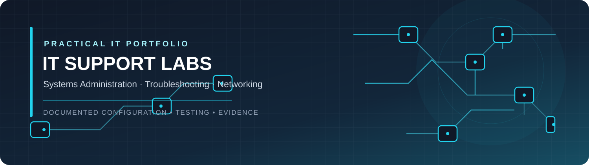
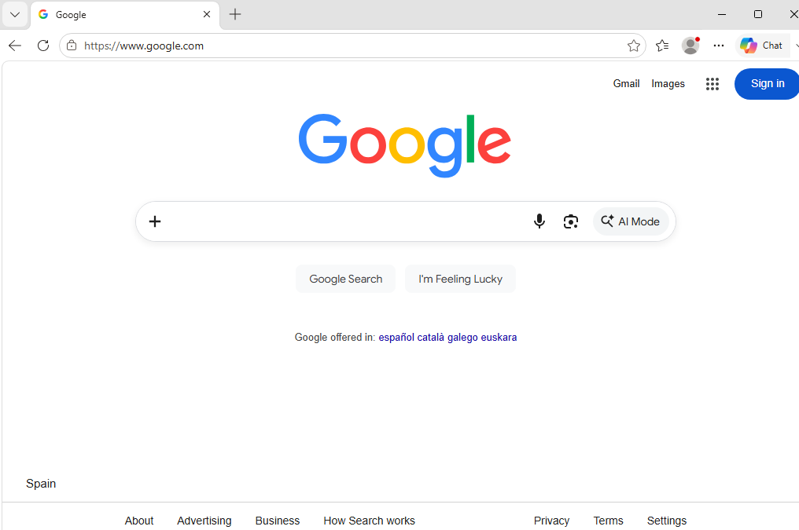
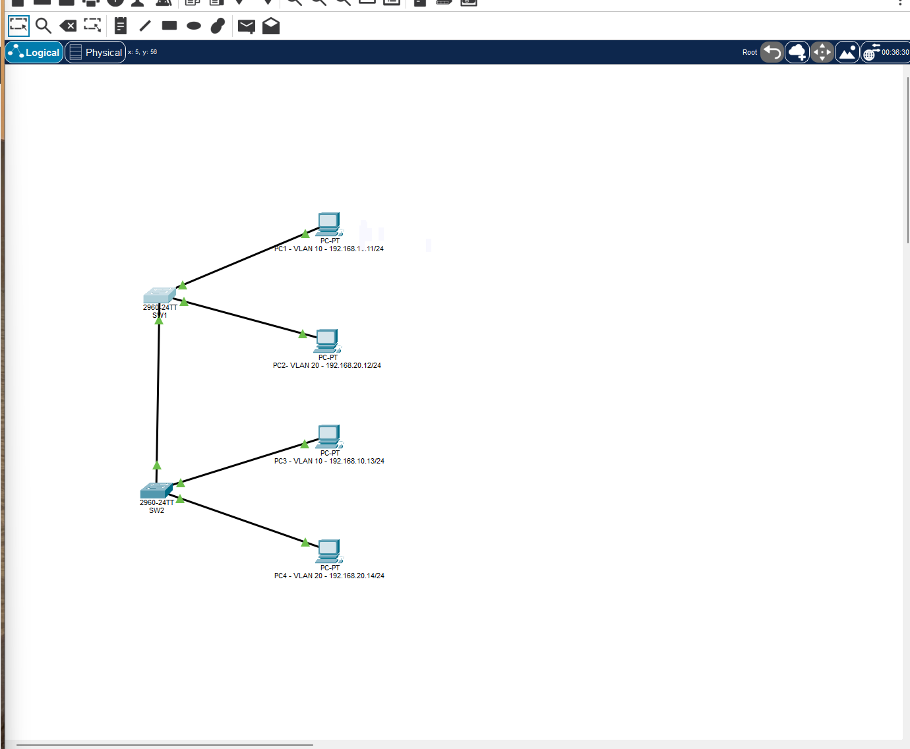

# IT Support & Systems Administration Labs

Hands-on IT portfolio focused on **support troubleshooting, Windows systems administration, Linux and networking**. Projects document the problem, the work performed, the evidence available and the checks used to validate the result.

This repository contains personal labs and simulated support scenarios—not professional employment experience.

**[Featured projects](#featured-projects)** · **[Support](#support-and-troubleshooting)** · **[Systems](#systems-administration)** · **[Networking](#networking-and-ccna)** · **[Tools](#tools-and-demos)**

---

## Featured Projects

### 🖥️ Active Directory Multi-DC Environment
**Windows Server 2022 · Hyper-V · AD DS · DNS · PowerShell**

Build and document a virtualised domain environment with two domain controllers on an isolated NAT network.

- **Evidence:** VM and network setup, domain-controller promotion, and replication checks.
- **Current status:** In progress. Phases 0–10 are marked completed, although the lab notes that evidence for one phase is still pending; identity-management and security work remains planned.
- **Explore:** [English README](labs/active-directory-multi-dc/README.md) · [Spanish README](labs/active-directory-multi-dc/README.es.md)

### 🛠️ HD-1 — Website Access Failure
**IT Support L1 · Windows 11 · DNS · Jira Service Management**

A simulated incident where a workstation cannot open websites because its configured DNS resolver does not answer. The case documents how IP connectivity and name resolution were isolated, the DNS setting was corrected, and browser/DNS behaviour was checked again.

- **Evidence:** Diagnostic output, fault-state screenshots, remediation commands and recovery evidence.
- **Important context:** The requester, organisation and ticket are fictional; this is a deliberately introduced lab fault.
- **Explore:** [Incident walkthrough](labs/01-dns-misconfiguration/README.md) · [Evidence folder](labs/01-dns-misconfiguration/evidence/)

### 🌐 VLANs → Router-on-a-Stick
**Cisco Packet Tracer · VLAN 10/20 · 802.1Q · Inter-VLAN routing**

Two connected labs show the progression from Layer 2 VLAN separation to Layer 3 communication through router subinterfaces. Both include connectivity checks and deliberate troubleshooting scenarios.

- **Lab 04 — VLANs & 802.1Q trunk:** [English walkthrough](labs/ccna-packet-tracer/04-vlan-trunk/README_EN.md) · [Packet Tracer file](labs/ccna-packet-tracer/04-vlan-trunk/04_VLAN_Trunk.pkt)
- **Lab 05 — Router-on-a-Stick:** [English walkthrough](labs/ccna-packet-tracer/05-router-on-a-stick/README_EN.md) · [Packet Tracer file](labs/ccna-packet-tracer/05-router-on-a-stick/05_Router_on_a_Stick.pkt)
- **Explore all labs:** [CCNA Packet Tracer index](labs/ccna-packet-tracer/README.md)

---

## Support and Troubleshooting

### HD-1 — First case in a growing support series

**HD-1 is the first documented support case, not the whole help-desk portfolio.** The aim is to build a collection of distinct L1 scenarios, each with its own symptom, investigation, evidence, resolution and verification. Future cases will remain planned until they have actually been executed and documented.

| Scenario | Skills practised | Status |
|---|---|---|
| [HD-1 — Website access failure caused by DNS](labs/01-dns-misconfiguration/README.md) | DNS vs IP connectivity, ipconfig, resolver checks, cache flush and verification | Documented case |
| [HD-002 — No Internet connection](https://github.com/anudoranador87/help-desk-simulation/blob/main/tickets/HD-002-no-internet-connection.md) | IP configuration, gateway, DHCP lease and connectivity isolation | Planned |
| [HD-003 — Printer appears offline](https://github.com/anudoranador87/help-desk-simulation/blob/main/tickets/HD-003-printer-offline.md) | Queue, device state, spooler and connectivity checks | Planned |
| [HD-004 — Low disk space](https://github.com/anudoranador87/help-desk-simulation/blob/main/tickets/HD-004-disk-full-low-disk-space.md) | Storage investigation, safe cleanup and post-cleanup verification | Planned |
| [HD-005 — Shared-folder access denied](https://github.com/anudoranador87/help-desk-simulation/blob/main/tickets/HD-005-access-denied-shared-folder.md) | Share vs NTFS permissions and least privilege | Planned |
| [HD-006 — Password reset request](https://github.com/anudoranador87/help-desk-simulation/blob/main/tickets/HD-006-password-reset-request.md) | Identity verification, secure process and ticket documentation | Planned |

**Support-series home:** [Help Desk Simulation repository](https://github.com/anudoranador87/help-desk-simulation) · [Support roadmap](LABS-ROADMAP.md)

The DNS case separates general IP connectivity from name resolution, records the configured resolver, documents the remediation and lists the verification performed. Unrelated observations and evidence limitations are kept separate from the confirmed cause.

> These are personal labs and simulated incidents. A scenario stays **Planned** until it has been performed, verified and supported by evidence; planned cases are not presented as completed experience.

## Systems Administration

### Windows Server UEFI/GPT and Active Directory
**Windows Server 2022 · AD DS · DNS · Group Policy · Ubuntu / SSSD**

A hands-on case study covering UEFI/GPT installation troubleshooting, Windows Server setup, domain services, organisational units, a security group, a password-policy GPO, DNS records and Linux domain integration.

- **Status:** Documented as completed in the lab README.
- **Explore:** [Windows Server lab and evidence](labs/windows-server-uefi-gpt-ad-ds/README.md)

### Active Directory Multi-DC

The multi-domain-controller lab complements the Windows Server case with Hyper-V networking, domain-controller deployment and replication verification.

- **Explore:** [Architecture and phase evidence](labs/active-directory-multi-dc/README.md)

---

## Networking and CCNA

The Packet Tracer portfolio progresses from initial topology and cabling to routing and switching concepts. The current index identifies Labs 01, 02, 04 and 05 as completed, with Lab 03 still in progress.

### Lab 04 — VLANs and 802.1Q

**What it demonstrates:** VLAN creation, access-port assignment, trunk verification, same-VLAN connectivity, expected isolation between VLANs, 802.1Q frame inspection and recovery from controlled faults.

[Read the English walkthrough](labs/ccna-packet-tracer/04-vlan-trunk/README_EN.md)

### Lab 05 — Router-on-a-Stick

**What it demonstrates:** Router subinterfaces, <code>encapsulation dot1q</code>, default gateways, inter-VLAN connectivity, <code>ping</code>/<code>tracert</code> verification and troubleshooting of configuration faults.

[Read the English walkthrough](labs/ccna-packet-tracer/05-router-on-a-stick/README_EN.md) · [Open the Packet Tracer file](labs/ccna-packet-tracer/05-router-on-a-stick/05_Router_on_a_Stick.pkt)

> CCNA is a study and practice objective, not a certification claim.

---

## Linux Troubleshooting

### Wi-Fi Driver and Kernel Module Investigation

A Linux troubleshooting guide covering hardware identification (<code>lspci</code>, <code>lsusb</code>), kernel logs (<code>dmesg</code>), module inspection (<code>lsmod</code>), driver installation concepts and connectivity verification.

**Status:** In progress; the repository marks the practical evidence as partial. The documented workflow should not be interpreted as proof that every chipset-specific remediation has been completed.

[Open the Linux Wi-Fi lab](labs/linux-wifi-driver-fix/README.md)

---

## Tools and Demos

Small browser-based utilities for common technical tasks. These links point to the published GitHub Pages demos.

| Tool | Purpose | Demo |
|---|---|---|
| **IP Subnet Calculator** | IPv4/CIDR breakdown, network and broadcast addresses, host range and binary visualisation. | [Open tool](https://anudoranador87.github.io/it-support-labs/tools/subnet-calculator/) |
| **RAID Storage Calculator** | Compare usable capacity, redundancy and trade-offs across RAID levels. | [Open tool](https://anudoranador87.github.io/it-support-labs/tools/raid-calculator/) |
| **Linux Permissions Visualizer** | Convert symbolic and octal permissions and generate a <code>chmod</code> command. | [Open tool](https://anudoranador87.github.io/it-support-labs/tools/linux-permissions-visualizer/) |

[Browse tool source folders](tools/)

### Related projects

- [Help Desk Simulation](https://github.com/anudoranador87/help-desk-simulation) — incident-style support practice and technical evidence.
- [Endpoint Health Toolkit](https://github.com/anudoranador87/endpoint-health-toolkit) — read-only endpoint diagnostics for Windows and Linux.
- [Hotel Sentinel](https://github.com/anudoranador87/hotel-sentinel) — infrastructure-monitoring concept for hospitality environments.

---

## Troubleshooting Method

The case studies use a structured workflow, adapting the steps to the actual problem and available evidence.

~~~mermaid
flowchart TD
    A["Identify the symptom"] --> B["Collect evidence"]
    B --> C["Form a hypothesis"]
    C --> D["Test and isolate the cause"]
    D --> E["Apply a controlled fix"]
    E --> F["Verify the result"]
    F --> G["Document findings and limitations"]
    classDef step fill:#101827,stroke:#22D3EE,color:#FFFFFF
    class A,B,C,D,E,F,G step
~~~

---

## Skills and Credentials

**Technical areas represented in the documented labs**

- **IT Support:** incident-style documentation, command-line diagnostics, DNS troubleshooting and verification.
- **Systems:** Windows Server, Hyper-V, AD DS, DNS, Group Policy and domain integration.
- **Networking:** IPv4 addressing, VLANs, 802.1Q trunks, router subinterfaces and connectivity testing.
- **Linux:** hardware discovery, kernel logs, modules and driver troubleshooting concepts.
- **Tools:** PowerShell, Windows networking commands, Linux CLI and Cisco IOS CLI.

**Credential**

- [Microsoft Applied Skills: Administer Active Directory Domain Services — view credential](https://learn.microsoft.com/api/credentials/share/es-es/JosemariaAparicioPortillo-6505/ABD3679EBC76C5DB?sharingId=BEB98820D4F8219)

**Other repository navigation:** [All labs](labs/) · [Lab roadmap](LABS-ROADMAP.md) · [Changelog](CHANGELOG.md) · [MIT License](LICENSE)

---

*Portfolio projects are personal learning work. Completion status and claims should be read alongside the evidence and limitations documented in each lab.*
