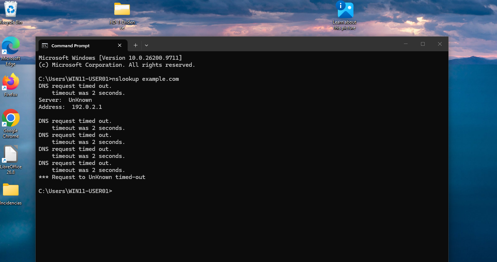

# HD-1 — Unable to access websites (DNS misconfiguration)

[](README.md)
[](README.md)
[](README.md)
[](README.md)

[🏠 Home](../../README.md) · [📂 All Labs](../README.md) · [📋 Roadmap](../../LABS-ROADMAP.md)

---

Level 1 troubleshooting of a Windows 11 workstation that could not open websites. The cause was a DNS server that did not answer queries; it was found by separating IP connectivity from name resolution, fixed, and verified.

| | |
|---|---|
| **Ticket** | HD-1 (Incident), Jira Service Management, project HD |
| **Requester** | Maria Garcia, Finance *(fictional)* |
| **Device** | WIN11-USER01, Windows 11 on Hyper-V |
| **Priority** | Medium |
| **Root cause** | DNS server set to `192.0.2.1`, which does not respond |
| **Resolution** | DNS restored to `8.8.8.8`, DNS cache flushed |
| **Status** | Completed |
| **Date** | 2026-10-19 |

## Scenario

This is a **simulated environment** built to practise service desk work. The user, the company (Fabrikam Inc) and the incident are fictional, and the fault was introduced on purpose by changing the DNS setting of the virtual machine. The ticket was handled as a real incident: report, investigation, root cause, resolution, verification.

**Reported symptom:** the user cannot open any website; the browser shows an error page.

## Environment

- Windows 11 virtual machine (Hyper-V), acting as the user's workstation
- Static IPv4 `10.10.10.20/24`, DNS `8.8.8.8` (no alternate)
- Ticketing: Jira Service Management
- Tools: `ipconfig`, `ping`, `nslookup`, `netsh`, Edge

## Investigation

The goal was to tell apart three possible failures: no IP connectivity, no name resolution, or a problem at HTTPS level.

### 1. Working state (before the fault)

- `ping 1.1.1.1` returned 4/4 replies — [`01-baseline-ping.png`](evidence/01-baseline-ping.png)
- `nslookup example.com` resolved through `dns.google` (`8.8.8.8`) — [`01-baseline-nslookup.png`](evidence/01-baseline-nslookup.png)
- `ipconfig /all` showed the static IP and `DNS Servers: 8.8.8.8` — [`01-baseline-dns.png`](evidence/01-baseline-dns.png)
- IPv4 properties: preferred DNS `8.8.8.8`, alternate empty — [`02-dns-original.png`](evidence/02-dns-original.png)

### 2. With the fault

The preferred DNS server was changed to `192.0.2.1` (Control Panel → Network Connections → Ethernet → IPv4 properties). That address belongs to a range reserved for documentation (RFC 5737), so nothing answers on it.

- `nslookup example.com` timed out repeatedly. The output shows `Server: UnKnown` and `Address: 192.0.2.1`, i.e. Windows was querying the wrong server and getting no answer.
- Edge could not load a page (`ERR_TIMED_OUT`).



More: [`02-fault-browser.png`](evidence/02-fault-browser.png)

### 3. Reasoning

Resolving a name needs a DNS server that answers. With the server at `192.0.2.1` unreachable, names cannot be resolved, so websites do not open even though the network itself is up. Comparing the `nslookup` result with the working state points to the DNS setting, not to the network or the browser.

## Root cause

The workstation's DNS server was `192.0.2.1`, an address that does not answer DNS queries.

## Resolution

From an elevated Command Prompt:

```cmd
netsh interface ipv4 set dnsservers name="Ethernet" static 8.8.8.8 primary
ipconfig /flushdns
```

The IP address and gateways were not modified.

## Verification

- `nslookup example.com` resolves again through `dns.google` (`8.8.8.8`).
- Edge loads `https://www.google.com` normally.


## Other observations (not part of this incident)

- `curl.exe -I https://example.com` returns `curl: (35) Recv failure: Connection was reset`, both before the fault and after the fix. It is unrelated to DNS and was not investigated.
- The adapter lists two default gateways (`192.168.100.1` and `10.10.10.1`). They were not changed; worth reviewing in a separate ticket.

## Limitations

- `ipconfig /all` was not captured while the fault was active. The DNS server in use during the fault is shown by the `Address: 192.0.2.1` line in the `nslookup` output.
- `ERR_TIMED_OUT` in the browser does not by itself distinguish a DNS failure from a connectivity failure; the link to DNS comes from the `nslookup` result.
- The `nslookup` check after the fix is terminal output and was not saved as a screenshot.

## Evidence

All files are in [`evidence/`](evidence/):

| File | Shows |
|---|---|
| `01-baseline-ipconfig.txt` / `01-baseline-dns.png` | Network configuration before the fault |
| `01-baseline-ping.txt` / `.png` | Connectivity to `1.1.1.1` |
| `01-baseline-nslookup.txt` / `.png` | Name resolution before the fault |
| `02-dns-original.png` | Original DNS setting |
| `02-fault-nslookup.png` | `nslookup` timing out against `192.0.2.1` |
| `02-fault-browser.png` | Edge failing to load a page |
| `03-recovery-browser.png` | Edge loading a page after the fix |

## Skills practised

Separating connectivity from name resolution, reading `ipconfig` / `nslookup` / `ping` output, changing and restoring DNS settings safely, documenting an incident with evidence, and keeping unrelated findings out of the root cause.
