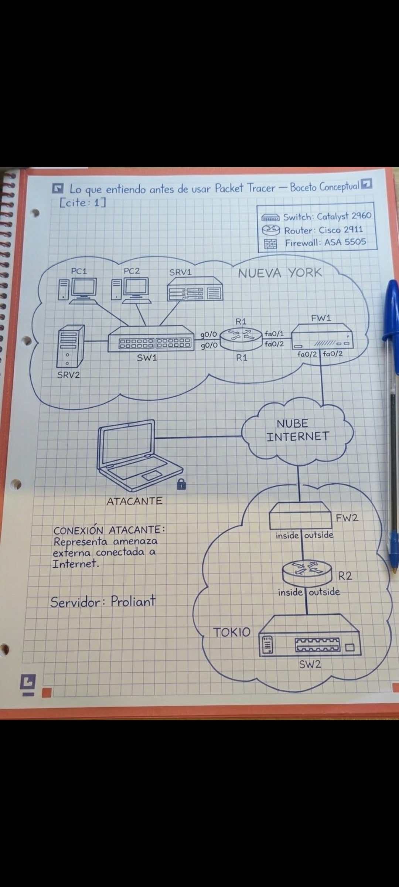
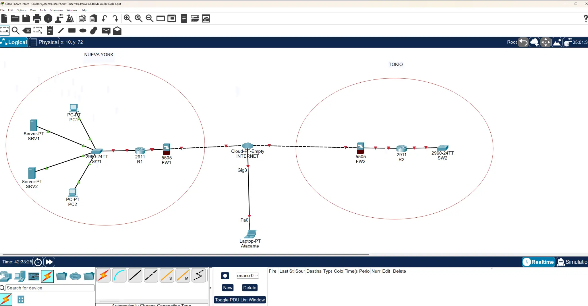

# Lab 1: Initial Topology (CCNA · Jeremy's IT Lab, Day 1)

> 🇪🇸 [Versión en español](./README.md)

First lab of my CCNA preparation with Cisco Packet Tracer. The goal is to reproduce a complete network diagram **without configuring any device**, practising how to use the program: choosing the correct model for each device, naming them, cabling them and organising the diagram.

## Objective

Reproduce in Packet Tracer the network diagram of two sites (New York and Tokyo) connected through the Internet, with a laptop representing an external threat connected to the Internet.

## Pre-sketch

Before opening Packet Tracer I drew a conceptual sketch by hand to understand the topology.

## Topology

- **New York:** PC1, PC2, SRV1 and SRV2 → SW1 → R1 → FW1 → Internet Cloud
- **Tokyo:** Internet Cloud → FW2 → R2 → SW2
- **Attacker:** laptop connected directly to the Internet Cloud

## Equipment

| Qty | Device | Model |
|---|---|---|
| 2 | Routers (R1, R2) | Cisco 2911 |
| 2 | Switches (SW1, SW2) | Catalyst 2960 |
| 2 | Firewalls (FW1, FW2) | ASA 5505 |
| 2 | PCs (PC1, PC2) | PC-PT |
| 2 | Servers (SRV1, SRV2) | Server-PT |
| 1 | Laptop (Attacker) | Laptop-PT |
| 1 | Internet Cloud | Cloud-PT-Empty |

## Steps

1. Enable device labels and increase font size (Options > Preferences).
2. Choose the category and model for each device.
3. Rename the devices: PC1, PC2, SW1, R1, FW1, R2, FW2, SW2, SRV1, SRV2 and Attacker.
4. Connect the devices using the automatic connection option (*Automatically Choose Connection Type*).
5. Mark the two zones with ellipses and text notes (NEW YORK and TOKYO).
6. Verify that all links in the diagram are connected.

## Difficulties and solutions

**1. The cloud only had one port.**  
The Cloud-PT comes with a single Ethernet port by default and FW1 was already using it, so there was no way to connect FW2 or the Attacker. I solved it by using a **Cloud-PT-Empty**: I powered it off, added three Ethernet modules (one for FW1, one for FW2 and one for the Attacker) and powered it back on.

**2. Wrong router model.**  
I started with a 1941 router, but the exercise required a **2911**. I replaced it with the correct model.

**3. Red links.**  
Several links show red triangles. This is expected behaviour: router and firewall ports are shut down by default and this lab does not include any configuration.

**4. Marking the zones.**  
I had trouble finding how to label New York and Tokyo. I solved it by drawing ellipses with the shapes tool and adding text with *Place Note*.

**5. Difference between my notes and the sketch.**  
My notes described the Tokyo section as "Internet → R2 → FW2 → SW2", but the sketch placed FW2 before R2. I followed the sketch: Cloud → FW2 → R2 → SW2.

## What I learned

- Each device model has its own ports and modules, and they must be chosen carefully from the start.
- Router and firewall ports are shut down by default; red links are not always an error.
- The Packet Tracer cloud needs additional modules when multiple devices must be connected.

## Files

- `Lab1_Topologia_Inicial.pkt`: Packet Tracer file
- `screenshots/topologia-final.png.webp`: screenshot of the finished topology
- `screenshots/conceptual-topology-sketch.png`: hand-drawn pre-sketch
