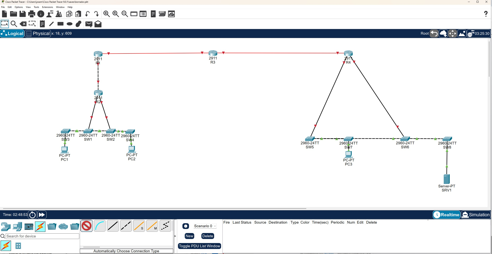

# Lab 2: Cableado de la topología (CCNA · Packet Tracer)

> 🇬🇧 [English version](./README_EN.md)

Laboratorio de cableado con Cisco Packet Tracer. El objetivo es conectar todos los dispositivos de una topología ya dada, eligiendo en cada enlace el tipo de cable adecuado según los equipos que une y la distancia. No se configura ningún dispositivo: ni IPs, ni rutas, ni interfaces.

## Objetivo

Reproducir el cableado de una red con dos redes locales (izquierda y derecha) unidas por una ruta de cuatro routers (`R2 - R1 - R3 - R4`), usando cobre directo, cobre cruzado y fibra según corresponda.

## Topología

**Izquierda:** PC1 → SW3, PC2 → SW4, y los switches SW3 - SW1 - SW2 - SW4 encadenados. SW1 y SW2 se conectan a R2, y R2 a R1.
**Núcleo:** R1 - R3 - R4 (enlaces de fibra).
**Derecha:** R4 se conecta a SW5 y SW6. Los switches SW7 - SW5 - SW6 - SW8 van encadenados. PC3 cuelga de SW7 y SRV1 de SW8.

## Material

| Cantidad | Dispositivo | Modelo |
|---|---|---|
| 4 | Routers (R1, R2, R3, R4) | Cisco 2911 |
| 8 | Switches (SW1 a SW8) | Catalyst 2960-24TT |
| 3 | PCs (PC1, PC2, PC3) | PC-PT |
| 1 | Servidor (SRV1) | Server-PT |

## Conexiones (17)

| Tipo de cable | Enlaces | Por qué |
|---|---|---|
| Cobre directo (8) | PC1-SW3, PC2-SW4, PC3-SW7, SRV1-SW8, SW1-R2, SW2-R2, SW5-R4, SW6-R4 | Dispositivos de distinto tipo: equipo final o router con switch |
| Cobre cruzado (7) | SW3-SW1, SW1-SW2, SW4-SW2, SW7-SW5, SW5-SW6, SW8-SW6, R2-R1 | Dispositivos del mismo tipo: switch con switch y router con router |
| Fibra (2) | R1-R3 (3 km, monomodo), R3-R4 (250 m, multimodo) | El cobre solo llega a 100 m |

Por qué cada tipo:

- **Directo:** los PCs, el servidor y los routers transmiten por los pines 1 y 2, y los switches por los 3 y 6. Al unir equipos distintos los pares ya se corresponden, así que el cable va pin a pin.
- **Cruzado:** si los dos extremos son del mismo tipo, transmiten por los mismos pines. El cable cruza los pares para que lo que sale de uno entre por el receptor del otro. El ejercicio asume que Auto MDI-X está desactivado, por eso la diferencia importa.
- **Fibra:** a 3 km el cobre no sirve y hace falta monomodo. A 250 m basta el multimodo. Packet Tracer solo tiene un tipo de cable de fibra, así que la diferencia monomodo/multimodo viene del enunciado.

## Pasos

1. Colocar los dispositivos y elegir el modelo de cada uno.
2. Renombrar los equipos: R1 a R4, SW1 a SW8, PC1 a PC3 y SRV1.
3. Elegir el tipo de cable de cada enlace a mano, sin usar la conexión automática.
4. Conectar PCs y servidor al puerto `FastEthernet0` del equipo y a un puerto FastEthernet libre del switch.
5. Añadir módulos de fibra a R1, R3 y R4 para los dos enlaces entre routers.
6. Comprobar que están las 17 conexiones, que el tipo de cable es el indicado y que los nombres son correctos.

## Dificultades y solución

**1. SW1-R2 y SW2-R2 estaban en cruzado.**
Router con switch es cobre directo. Borré los dos enlaces y los rehice con el cable correcto.

**2. Un enlace de más (R4-SW7).**
No estaba en el enunciado. Lo borré.

**3. Faltaban SW5-R4 y SW6-R4.**
Los añadí con cobre directo.

**4. El cable SW5-SW6 pasaba por detrás de SW7.**
Parecía un enlace SW7-SW6. Moví los switches para separar los cables y comprobar que SW7 solo se conecta con SW5.

**5. La fibra multimodo no se dejaba conectar.**
Los 2911 solo traen puertos de cobre de serie y R3 necesita dos puertos de fibra (uno hacia R1 y otro hacia R4). Lo resolví apagando los routers, añadiendo módulos con puertos de fibra en la pestaña Physical y volviéndolos a encender.

**6. Enlaces en rojo.**
Varios enlaces aparecen con triángulos rojos. El enunciado dice que no hay que arreglarlos. Lo más probable es que los puertos de los routers estén apagados por defecto y este laboratorio no incluye configuración, por eso se ponen en rojo los enlaces que tocan un router. Los de switches, PCs y servidor están en verde. Lo comprobaré cuando configure las interfaces (`show ip interface brief` y `no shutdown`).

## Qué aprendí

- Directo para dispositivos distintos y cruzado para dispositivos iguales.
- El cobre llega a 100 m. Más allá se usa fibra, monomodo para kilómetros y multimodo para cientos de metros.
- Los routers 2911 necesitan módulos para tener puertos de fibra.
- Un cable largo que pasa por detrás de otro equipo puede confundir. Conviene separar los dispositivos para revisar el diagrama.
- Los triángulos rojos indican enlace caído, y en este laboratorio son esperables.

## Archivos

- `Lab_Cableado.pkt`: archivo de Packet Tracer
- `img/topologia-final.png`: captura de la topología terminada
