# Lab 3: Modelo OSI, STP, OSPF y DHCP (CCNA · Packet Tracer)

> 🇬🇧 [English version](./README_EN.md)

Primer laboratorio del CCNA donde **configuro dispositivos de verdad**. En los dos anteriores solo coloqué equipos y cables; aquí escribo comandos en el CLI de los routers, configuro direcciones IP en las interfaces, monto un servidor DHCP con relay y preparo la base para OSPF. El objetivo es practicar los comandos aprendidos en el curso de Jeremy conectando una topología pequeña paso a paso.

## Objetivo

Construir una red con dos LANs separadas (una de servidor y otra de cliente), unidas por dos routers, y practicar:

- Configuración de interfaces IPv4 en routers Cisco.
- Direccionamiento estático en un servidor.
- Servicio DHCP y relay entre subredes distintas.
- Verificación de conectividad con `ping`.
- DHCP funcional mediante relay entre dos subredes.
- Observación de STP y BPDUs en modo simulación.
- Preparación para OSPF (pendiente).

## Por qué separé el servidor del PC

En una empresa real los servidores suelen estar en una red distinta a los puestos de trabajo. Si hubiera puesto todo en la misma LAN (la misma subred), el PC podría obtener su IP por DHCP directamente sin ninguna configuración especial en el router.

Al separar el servidor (`192.168.1.0/24`) del PC (`192.168.2.0/24`) me obligo a:

1. **Configurar interfaces de router en dos subredes distintas**, lo que me enseña que cada interfaz del router es una puerta de entrada a una red diferente.
2. **Usar DHCP relay** (`ip helper-address`), porque las peticiones DHCP son broadcast y no cruzan routers a no ser que el router las reenvíe.
3. **Entender el enrutamiento**, porque el tráfico entre las dos LANs tiene que pasar por R1.

Si todo estuviera en la misma red, no habría aprendido nada de esto.

## Topología

| Dispositivo | Rol |
|---|---|
| R1 | Router principal: conecta la LAN del servidor, la LAN del cliente y R2 |
| R2 | Segundo router para practicar conectividad inter-router y OSPF |
| SW1 | Switch de capa 2 para la LAN del servidor |
| SW2 | Switch de capa 2 para la LAN del cliente |
| SRV1 | Servidor con IP estática y servicio DHCP |
| PC1 | Cliente que obtendrá su IP por DHCP |

### Conexiones físicas

- SRV1 → SW1
- SW1 → R1 GigabitEthernet0/0
- PC1 → SW2
- SW2 → R1 GigabitEthernet0/1
- R1 GigabitEthernet0/2 → R2 GigabitEthernet0/0

Usé Ethernet entre los routers en vez del enlace serial que aparece en algunas guías. El 2911 tiene puertos GigabitEthernet de serie y es más sencillo que añadir módulos seriales.

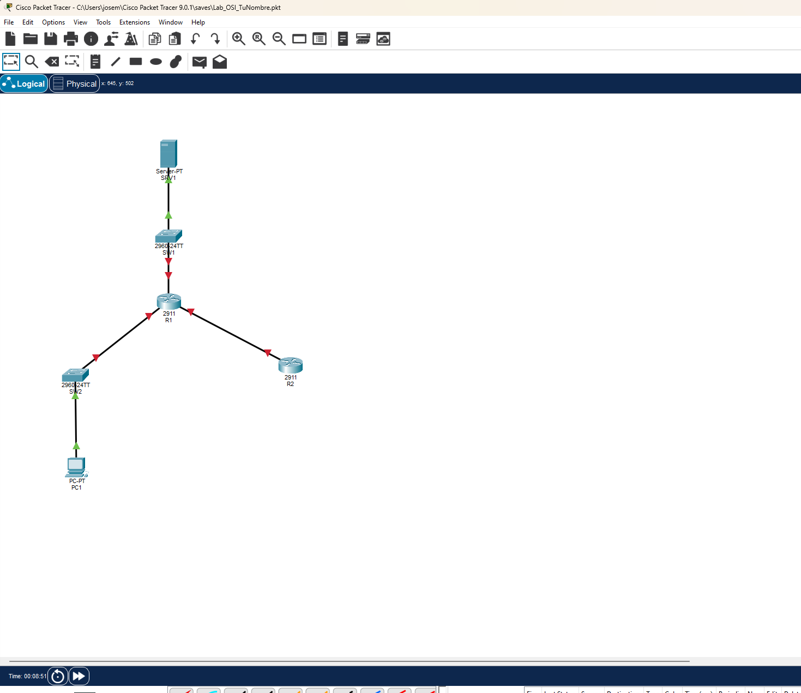

## Plan de direccionamiento IPv4

| Dispositivo / Interfaz | Dirección IPv4 | Para qué |
|---|---|---|
| R1 G0/0 | 192.168.1.1/24 | Gateway de la LAN del servidor |
| SRV1 | 192.168.1.2/24 | Servidor con IP estática |
| R1 G0/1 | 192.168.2.1/24 | Gateway de la LAN del cliente |
| PC1 | DHCP — pendiente de verificar | IP del cliente, asignada por DHCP |
| R1 G0/2 | 10.0.0.1/30 | Enlace entre routers |
| R2 G0/0 | 10.0.0.2/30 | Enlace entre routers |

### Por qué /30 entre routers

Un enlace punto a punto solo necesita dos direcciones IP (una para cada extremo). La máscara `/30` da exactamente 2 hosts utilizables (`10.0.0.1` y `10.0.0.2`). Usar una `/24` entera desperdiciaría 252 direcciones.

### Configuración del servidor

SRV1 tiene asignado:

- IPv4: `192.168.1.2`
- Máscara: `255.255.255.0`
- Gateway: `192.168.1.1` (la interfaz G0/0 de R1)
- DNS: `8.8.8.8` (es un valor conocido para pruebas; la conectividad externa no está probada en la simulación)

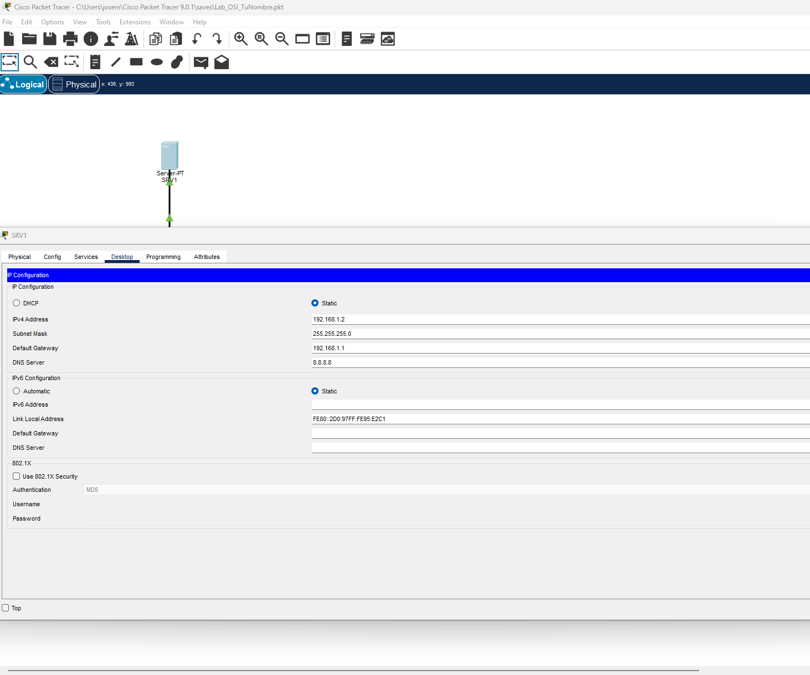

## Configuración del DHCP

El servicio DHCP se activó en SRV1 con un pool llamado `LAN_PC1`.

| Parámetro | Valor |
|---|---|
| Nombre del pool | LAN_PC1 |
| Gateway por defecto | 192.168.2.1 |
| Servidor DNS | 8.8.8.8 |
| Dirección de inicio | 192.168.2.10 |
| Máscara de subred | 255.255.255.0 |
| Usuarios máximos | 50 |

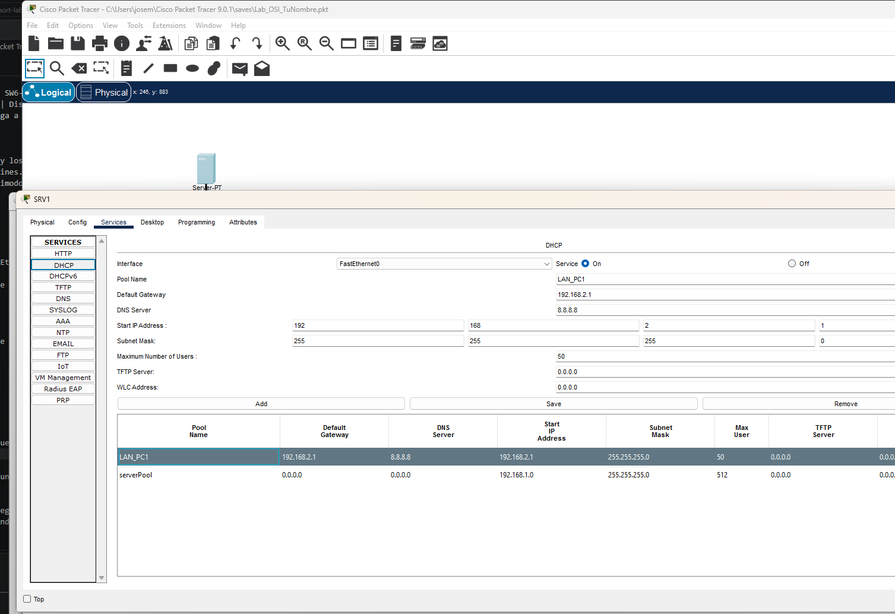

### DHCP relay (ip helper-address)

El servidor DHCP está en `192.168.1.0/24`, pero el PC que necesita la IP está en `192.168.2.0/24`. Las peticiones DHCP son broadcast y no cruzan routers. Sin hacer nada más, el PC envía un DHCP Discover en su red, y como el servidor está en otra, nunca lo recibe.

Para solucionarlo, configuré `ip helper-address` en la interfaz de R1 que da al PC:

```text
interface GigabitEthernet0/1
 ip helper-address 192.168.1.2
```

Lo que hace este comando: cuando R1 recibe un broadcast DHCP en G0/1, lo convierte en unicast y lo reenvía a `192.168.1.2` (SRV1). El servidor responde a R1, y R1 se lo pasa al PC. Sin este comando, el PC nunca obtendría IP.

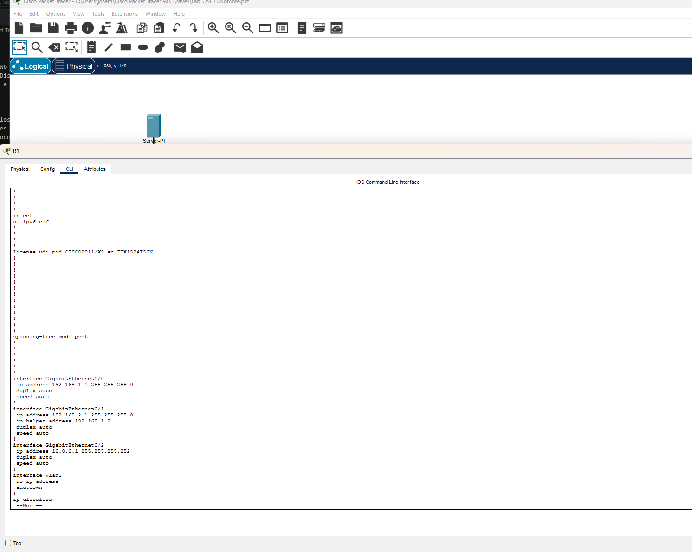

**Verificación realizada:** PC1 recibió mediante DHCP `192.168.2.2/24`, gateway `192.168.2.1` y DNS `8.8.8.8`. La prueba confirma que el servicio DHCP y el relay de R1 funcionan entre ambas subredes.

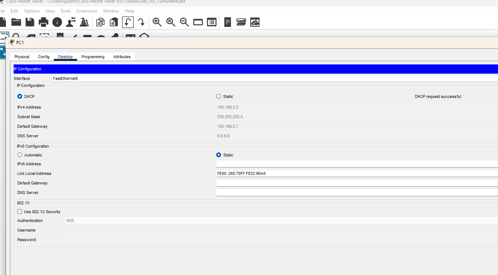

> Nota de configuración: la evidencia actual del servidor muestra el inicio del pool como `192.168.2.1`; el rango previsto para el laboratorio es `192.168.2.10`–`192.168.2.59`. Antes de guardar la versión definitiva del proyecto, se debe ajustar ese valor para no incluir la dirección del gateway dentro del rango del pool.

## Configuración de los routers — por qué cada comando

### R1

```text
interface GigabitEthernet0/0
 ip address 192.168.1.1 255.255.255.0
 no shutdown
!
interface GigabitEthernet0/1
 ip address 192.168.2.1 255.255.255.0
 ip helper-address 192.168.1.2
 no shutdown
!
interface GigabitEthernet0/2
 ip address 10.0.0.1 255.255.255.252
 no shutdown
```

**Qué creo que hace cada comando:**

- `interface GigabitEthernet0/0` → Entro en la configuración de ese puerto concreto. Cada interfaz se configura por separado, una a una.
- `ip address 192.168.1.1 255.255.255.0` → Asigno la IP y la máscara al puerto. Esta es la dirección que usarán los dispositivos de esa LAN como gateway.
- `no shutdown` → Enciendo el puerto. **Los puertos de los routers vienen apagados por defecto.** Si no escribo esto, el enlace sigue en rojo y no pasa tráfico.
- `ip helper-address 192.168.1.2` → Reenvía los broadcasts DHCP de esta interfaz hacia el servidor. Solo lo pongo en G0/1 porque es la interfaz del lado del PC.

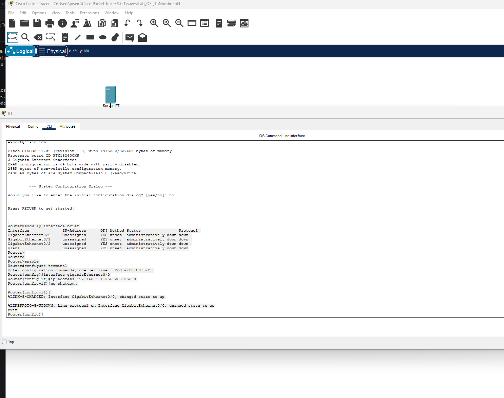

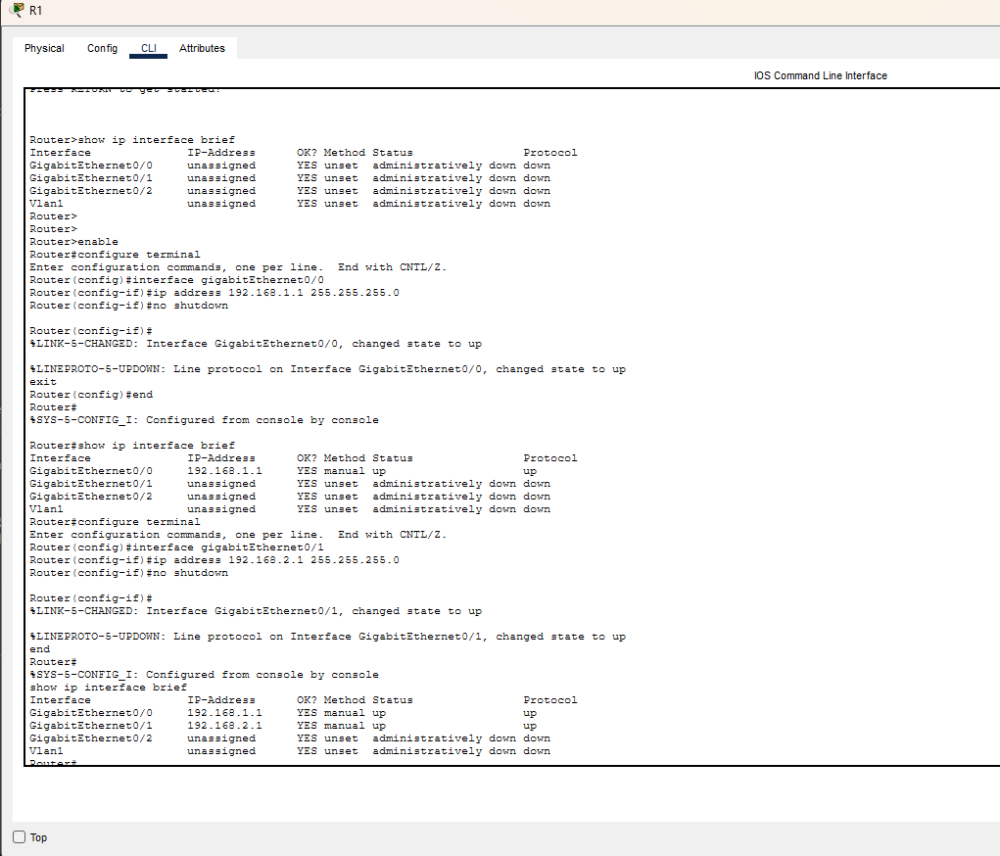

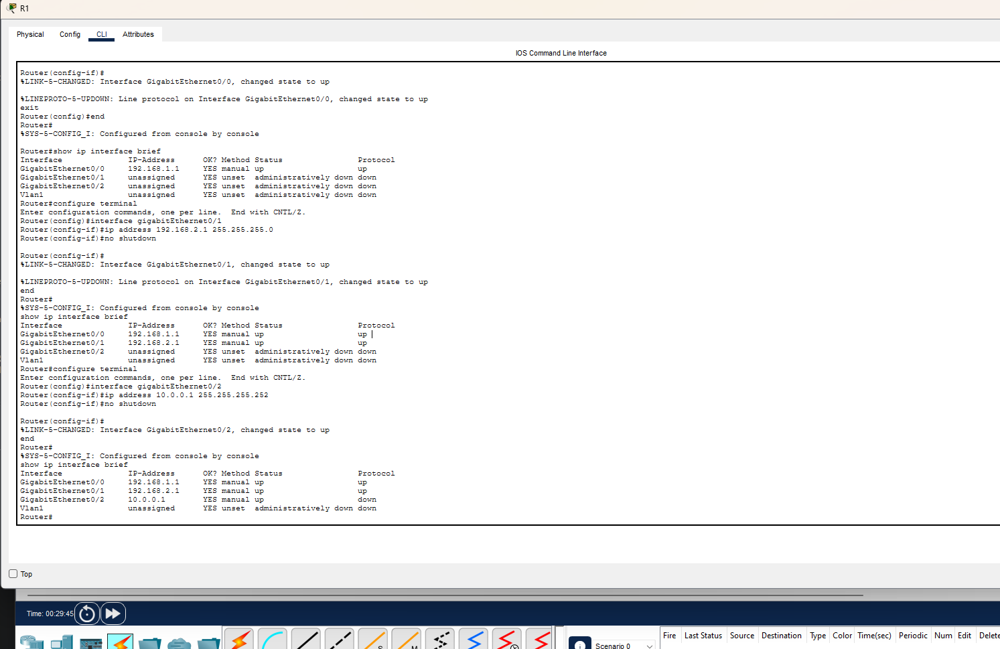

### R2

```text
interface GigabitEthernet0/0
 ip address 10.0.0.2 255.255.255.252
 no shutdown
```

R2 solo tiene una interfaz configurada por ahora. Cuando configure OSPF, R2 compartirá sus rutas con R1.

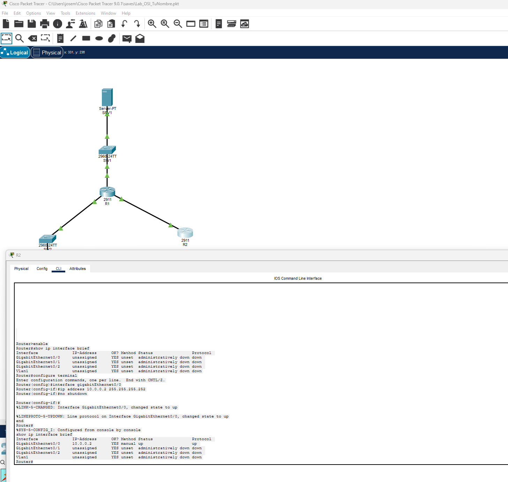

### OSPF — qué es, qué problema resuelve, y por qué lo necesito

Ahora mismo R1 conoce sus tres redes directamente conectadas, pero R2 solo conoce la red `10.0.0.0/30`. Si más adelante añado una LAN detrás de R2, R1 no sabría cómo llegar a ella, y habría que añadir rutas estáticas a mano.

**OSPF** (Open Shortest Path First) es un protocolo de enrutamiento dinámico. Lo que hace es que los routers se descubren entre sí como vecinos y se intercambian automáticamente las redes que conocen. Si un enlace cae, OSPF recalcula la ruta sin que yo toque nada.

**Por qué OSPF y no otro protocolo:**

- Es un estándar abierto (funciona en cualquier marca, no solo Cisco).
- Es el protocolo de enrutamiento interior que más se usa en entornos empresariales.
- Está en el temario del CCNA.

**Estado:** Pendiente de configurar. Los próximos pasos serán:

1. Activar OSPF en R1 y R2.
2. Anunciar las redes de cada router.
3. Verificar vecindad con `show ip ospf neighbor`.
4. Comprobar que las rutas aprendidas aparecen en `show ip route`.

## Pruebas de conectividad

### Prueba 1 — SRV1 a R1

```text
ping 192.168.1.1
```

- Paquetes enviados: 4
- Paquetes recibidos: 4
- Pérdida: 0%

**Resultado:** El servidor llega a su gateway. La IP de R1 G0/0 está bien configurada y la interfaz está levantada.

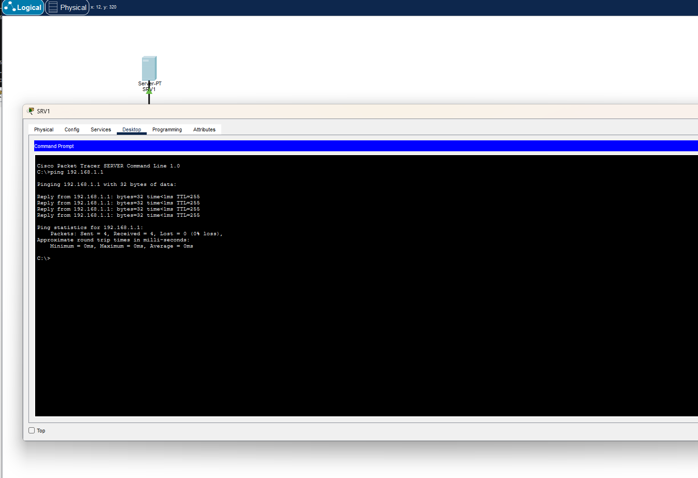

### Prueba 2 — R2 a R1

```text
ping 10.0.0.1
```

- Paquetes enviados: 5
- Paquetes recibidos: 4
- Pérdida: 20%

El primer ping falló y los cuatro siguientes funcionaron. Esto pasa por la resolución ARP: la primera vez que un dispositivo habla con otro, necesita descubrir su dirección MAC y eso tarda lo suficiente para que el primer paquete se pierda. En la vida real y en Packet Tracer esto es normal al primer intento. Un segundo `ping` debería dar 0% de pérdida.

**Resultado:** Hay conectividad; falta repetir para confirmar al 100%.

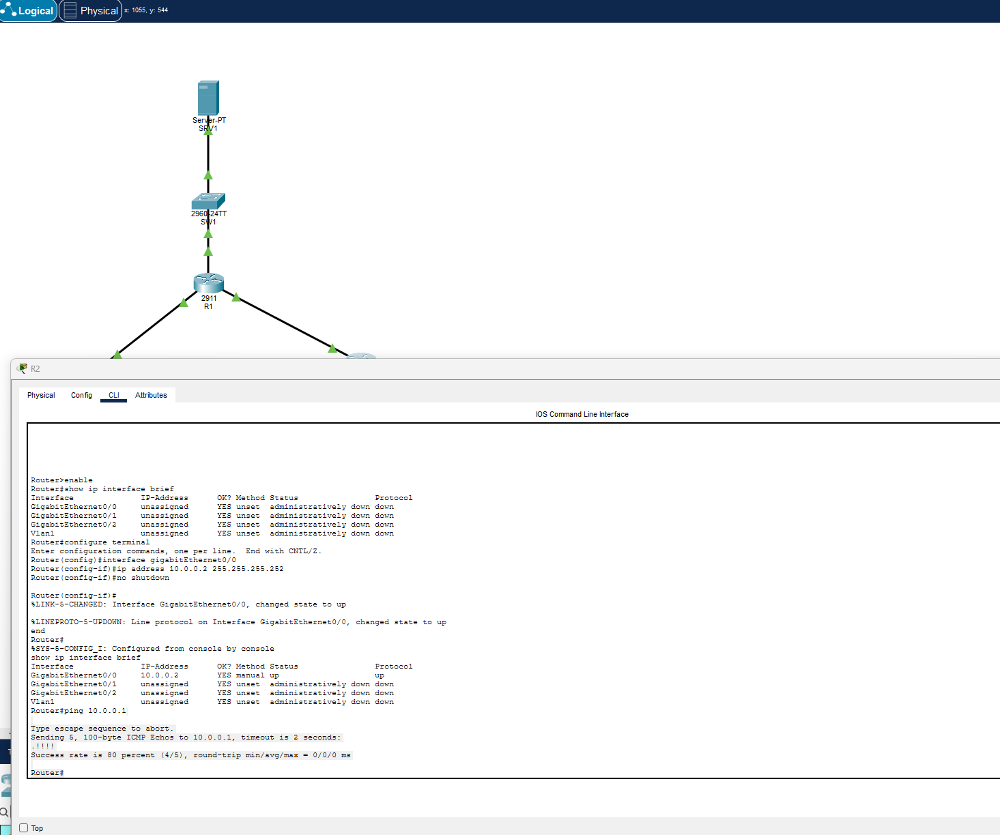

### Prueba 3 — Ping estable de R2 a R1

Repetí `ping 10.0.0.1` después de resolver la entrada ARP inicial y recibí 5 respuestas de 5 (0% de pérdida). El enlace `10.0.0.0/30` entre R1 y R2 es estable.

También probé desde R2 `ping 192.168.2.1`; falló porque R2 todavía no tiene una ruta hacia la LAN del cliente. Es el comportamiento esperado antes de configurar OSPF o una ruta estática.

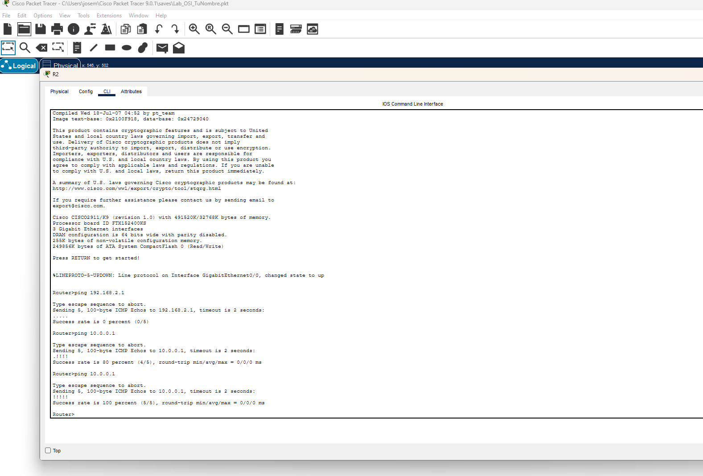

### Prueba 4 — PC1 al gateway y al servidor

Desde PC1, los pings a `192.168.2.1` y a `192.168.1.2` devolvieron 4 respuestas de 4 (0% de pérdida). Esto confirma que PC1 llega a su gateway y que R1 enruta correctamente entre la LAN del cliente y la LAN del servidor.

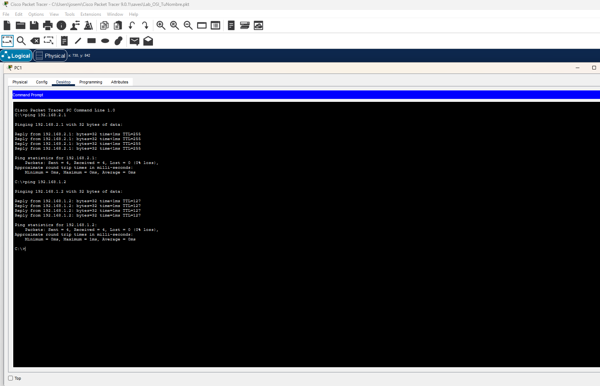

### Observación de STP en Simulation Mode

En Simulation Mode filtré el protocolo **STP** y avancé los eventos con `Capture/Forward`. El panel *Event List* mostró BPDUs de tipo `STP` enviadas por SW1 y SW2 hacia sus dispositivos conectados.

No apareció ningún puerto bloqueado, lo cual es correcto para esta topología: no contiene enlaces redundantes de Capa 2 que STP necesite bloquear. La prueba demuestra la emisión periódica de BPDUs, no una convergencia ante un bucle.

[Vídeo de la simulación STP y las BPDUs](evidence/14-stp-bpdu-simulation.mp4)

### Incidencia de Simulation Mode con DHCP

Intenté capturar la secuencia DHCP por separado: limpié los eventos, filtré DHCP y ARP, cambié PC1 entre configuración estática y DHCP y también intenté renovar la concesión. Packet Tracer no añadió eventos DHCP al panel de simulación, aunque la concesión se completó correctamente y las pruebas de conectividad funcionaron.

Por tanto, esta limitación queda registrada como una incidencia de visualización de Packet Tracer, **no** como un fallo del DHCP relay. Queda pendiente investigarla para obtener una captura de `Discover`, `Offer`, `Request` y `ACK`.

## Dificultades y solución

**1. Olvidé `no shutdown` en una interfaz.**
Configuré la IP en G0/0 pero no escribí `no shutdown`. El enlace seguía en rojo y el ping no funcionaba. Me costó un rato darme cuenta porque la IP estaba bien puesta. La lección: **siempre terminar con `no shutdown`** después de configurar una interfaz.

**2. Comandos en el nivel equivocado del CLI.**
Intenté escribir `ip address ...` desde el modo privilegiado (`Router#`) en vez de desde el modo de configuración de interfaz (`Router(config-if)#`). El router me devolvió un error que no entendí al principio. La jerarquía del CLI es:
- `Router>` → modo usuario (solo consultas básicas).
- `Router#` → modo privilegiado (`enable`): se puede ver la configuración y hacer pings, pero no cambiar nada.
- `Router(config)#` → modo de configuración global (`configure terminal`).
- `Router(config-if)#` → modo de configuración de interfaz (`interface G0/0`): aquí es donde se ponen las IPs y el `no shutdown`.

**3. Cada interfaz se configura por separado.**
Al principio pensaba que podía configurar varias interfaces de golpe. No. Hay que entrar en cada una con `interface GigabitEthernet0/X`, ponerle su IP y su `no shutdown`, y luego pasar a la siguiente. Antes de tocar nada es importante tener claro **qué interfaces están cableadas y a qué red va cada una**, porque si te equivocas de interfaz, le pones la IP a un puerto que no está conectado y nada funciona.

**4. El primer ping que falla por ARP.**
Ya lo expliqué arriba. No es un error, pero la primera vez que lo vi pensé que algo estaba mal configurado.

**5. Comandos `show` no admitidos por la imagen IOS de Packet Tracer.**
Intenté consultar una sola interfaz con `show running-config interface GigabitEthernet0/1`, tanto desde el modo privilegiado como usando `do` desde configuración. Esta imagen IOS 15.1 de Packet Tracer marcó `Invalid input`. La solución fue usar `show running-config` completo y localizar manualmente el bloque de la interfaz. El problema no era la interfaz ni el relay, sino una limitación de sintaxis de la imagen simulada.

**6. DHCP correcto, pero sin eventos DHCP visibles en Simulation Mode.**
La ausencia de eventos llevó inicialmente a pensar que el relay no funcionaba. Sin embargo, PC1 recibió una concesión válida (`192.168.2.2`, gateway y DNS) y alcanzó SRV1 mediante ping. Aprendí a contrastar una vista de simulación con evidencias funcionales antes de concluir que una configuración está rota.

## Qué aprendí

- Las interfaces de un router se configuran de una en una. Hay que saber qué cable va a qué puerto antes de empezar.
- `no shutdown` es obligatorio en los routers. Sin él, la interfaz está administrativamente apagada y no pasa tráfico.
- Los niveles del CLI importan: cada comando solo funciona en su modo. Si el router dice "Invalid input", probablemente estoy en el nivel equivocado.
- DHCP relay (`ip helper-address`) es necesario cuando el servidor DHCP está en otra subred. La concesión correcta de PC1 lo demostró en la práctica.
- La subred `/30` es lo adecuado para enlaces punto a punto entre routers.
- Un ping correcto entre routers no implica que R2 conozca las LAN de R1: sin OSPF o rutas estáticas, R2 solo conoce sus redes directamente conectadas.
- STP genera BPDUs incluso sin bucles; para ver un puerto bloqueado hace falta una topología con redundancia de Capa 2.
- Los resultados funcionales deben contrastarse con la simulación, ya que Packet Tracer puede no mostrar todos los eventos esperados.
- OSPF permite que los routers compartan rutas automáticamente en vez de configurarlas a mano; todavía no lo he implementado.

## Trabajo pendiente

- [x] Repetir el ping de R2 a R1 para confirmar conectividad estable.
- [ ] Configurar OSPF en R1 y R2.
- [ ] Verificar vecindad OSPF y rutas aprendidas.
- [x] Activar DHCP en PC1 y verificar que recibe IP, gateway y DNS.
- [x] Probar conectividad de PC1 a su gateway y a SRV1.
- [ ] Investigar por qué Simulation Mode no muestra los mensajes DHCP pese a una concesión correcta.
- [x] Observar STP e identificar BPDUs.
- [ ] Ajustar el inicio del pool DHCP a `192.168.2.10` y renovar la concesión antes de guardar la versión definitiva.
- [ ] Guardar el proyecto final y completar las capturas.

## Evidencias

Todas las capturas están en [`evidence/`](evidence/). El archivo de Packet Tracer es [`Lab_OSI_JoseAparicio.pkt`](Lab_OSI_JoseAparicio.pkt).

| Archivo | Qué muestra |
|---|---|
| `01-topology-physical.png` | Vista general de la topología |
| `02-r1-g0-0-up.png` | Interfaz G0/0 de R1 levantada |
| `03-r1-lan-interfaces.png` | Configuración de las interfaces LAN de R1 |
| `04-r1-router-link-initial.png` | Enlace inter-router de R1 |
| `05-r2-g0-0-up.png` | Interfaz G0/0 de R2 levantada |
| `06-r2-ping-r1.png` | Ping de R2 a R1 (10.0.0.1) |
| `07-srv1-ip-configuration.png` | IP estática de SRV1 |
| `08-srv1-ping-r1.png` | Ping de SRV1 a su gateway |
| `09-srv1-dhcp-pool-config.png` | Pool DHCP en SRV1 |
| `10-r1-dhcp-relay.png` | DHCP relay (`ip helper-address`) en R1 |
| `11-r2-ping-r1-stable.png` | Segundo ping R2 → R1, 5/5 respuestas |
| `12-pc1-dhcp-success.png` | Concesión DHCP correcta para PC1 |
| `13-pc1-connectivity.png` | PC1 alcanza su gateway y SRV1 |
| `14-stp-bpdu-simulation.mp4` | Simulation Mode mostrando BPDUs STP |
