# Lab 5: Inter-VLAN Routing con Router-on-a-Stick (CCNA · Packet Tracer)

> 🇬🇧 [English version](./README_EN.md)

Quinto bloque de mi portfolio de redes (CCNA). En el laboratorio anterior dejamos configuradas dos VLANs separadas en dos switches y comprobamos que no podían comunicarse entre sí. En este lab resuelvo esa limitación introduciendo un router (**R1**, Cisco 2911) para conectar ambas redes mediante **enrutamiento entre VLANs (Router-on-a-Stick)**, usando un único cable físico dividido en subinterfaces lógicas con etiquetado **802.1Q**.

| | |
|---|---|
| **Herramienta** | Cisco Packet Tracer |
| **Equipos** | 1 × Cisco 2911 (R1), 2 × Catalyst 2960-24TT (SW1, SW2) y 4 PCs |
| **Tiempo de ejecución** | ~1 h |
| **Fecha** | 26/10/2026 |
| **Archivo Packet Tracer** | [`05_Router_on_a_Stick.pkt`](05_Router_on_a_Stick.pkt) |

---

## Resumen técnico rápido

| Comprobación | Resultado esperado | Qué demuestra |
|---|---|---|
| PC1 → PC3 (192.168.10.13) | Correcto; TTL 128 en esta simulación | El tráfico de la misma VLAN se conmuta en capa 2 |
| PC1 → gateway (192.168.10.1) | Correcto | La puerta de enlace de VLAN 10 responde |
| PC1 → PC2 (192.168.20.12) | Correcto tras resolver ARP; TTL 127 | El router enruta entre VLANs |
| show ip route en R1 | Rutas conectadas para 192.168.10.0/24 y 192.168.20.0/24 | Las dos subinterfaces participan en el routing |
| show interfaces gi0/0.20 | Encapsulación 802.1Q VLAN 20 | Verifica el ID de VLAN configurado |

**Comandos rápidos de diagnóstico**

```text
show interfaces trunk
show ip interface brief
show ip route
show interfaces gi0/0.10
show interfaces gi0/0.20
```

Si las interfaces están up/up pero falla la comunicación entre VLANs, reviso el trunk, el ID de VLAN en cada subinterfaz, las IPs de los equipos y sus gateways. **Up/up no demuestra por sí solo que la encapsulación sea correcta.**

## 🎯 Objetivo

- Conectar un router a la topología previa mediante un único enlace físico hacia SW1.
- Configurar el enlace entre switch y router como enlace troncal (**Trunk 802.1Q**).
- Habilitar subinterfaces lógicas en el router (`Gi0/0.10` y `Gi0/0.20`) y asociarlas a sus respectivas VLANs.
- Asignar puertas de enlace (Default Gateway) a los puestos de trabajo.
- Verificar el enrutamiento inter-VLAN mediante pruebas de `ping`, observación de la pérdida de **TTL (128 vs 127)** y trazas con `tracert`.
- Inspeccionar en Simulation Mode cómo cambia la etiqueta 802.1Q en el mismo cable (entra con tag 10 y sale con tag 20).
- Provocar dos fallos de configuración controlados (puerto access y error de encapsulación) y documentar el proceso de diagnóstico y resolución.

---

## 🗺️ Topología y Concepto "Router en un palo"

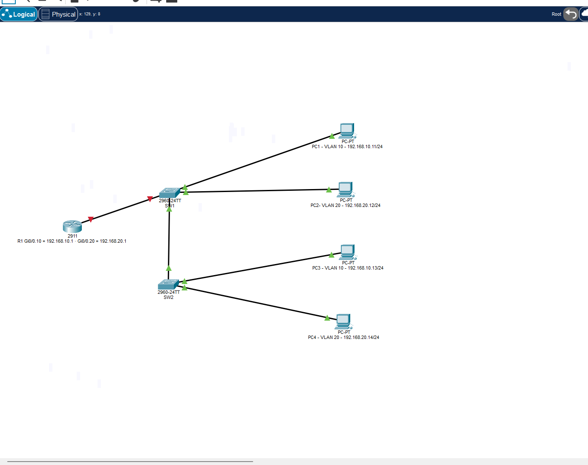

```text
               [ R1 ] (Cisco 2911)
                 |
            G0/0 | (Enlace físico único: "el palo")
                 | Subinterfaces: .10 (VLAN 10) y .20 (VLAN 20)
                 |
          Gi0/2  | (Trunk 802.1Q)
        [ SW1 ]-----------------[ SW2 ] (Cisco 2960)
        /     \      Gi0/1      /     \
       /       \    (Trunk)    /       \
     Fa0/1   Fa0/2           Fa0/1   Fa0/2
    [PC1]   [PC2]           [PC3]   [PC4]
   (VLAN10) (VLAN20)       (VLAN10) (VLAN20)
```

### ¿Por qué "Router-on-a-Stick" y un solo router?
Antes de hacer la práctica me preguntaba si harían falta dos routers o tirar varios cables. La respuesta es no: toda la red cuelga de un solo enlace físico conectado al switch, como si fuera una piruleta o un router "en un palo". 

Tirar un cable físico por cada VLAN hacia un puerto distinto del router sería más costoso, gastaría interfaces caras de router, introduciría más cables físicos y aumentaría las posibilidades de error. Con Router-on-a-Stick, un único puerto físico GigabitEthernet atiende múltiples redes virtuales de forma limpia.

| Dispositivo | Interfaz | Conexión / Rol | VLAN / IP / Gateway |
|---|---|---|---|
| **SW1** | Fa0/1 | PC1 | VLAN 10 · Access |
| **SW1** | Fa0/2 | PC2 | VLAN 20 · Access |
| **SW1** | Gi0/1 | SW2 Gi0/1 | Trunk (enlace entre switches) |
| **SW1** | Gi0/2 | R1 Gi0/0 | Trunk (enlace hacia el router) |
| **SW2** | Fa0/1 | PC3 | VLAN 10 · Access |
| **SW2** | Fa0/2 | PC4 | VLAN 20 · Access |
| **R1** | Gi0/0 | Interfaz física | Sin IP (solo transporte Capa 2/3) |
| **R1** | Gi0/0.10 | Subinterfaz lógica | 192.168.10.1/24 (Gateway VENTAS) |
| **R1** | Gi0/0.20 | Subinterfaz lógica | 192.168.20.1/24 (Gateway IT) |
| **PC1** | NIC | SW1 Fa0/1 | 192.168.10.11/24 · GW: 192.168.10.1 |
| **PC2** | NIC | SW1 Fa0/2 | 192.168.20.12/24 · GW: 192.168.20.1 |
| **PC3** | NIC | SW2 Fa0/1 | 192.168.10.13/24 · GW: 192.168.10.1 |
| **PC4** | NIC | SW2 Fa0/2 | 192.168.20.14/24 · GW: 192.168.20.1 |

---

## 🛠️ Desarrollo paso a paso

### Fase 0 · Estado inicial (el "antes")

Partiendo del laboratorio anterior (`02_VLAN_Trunk.pkt`), guardé una copia limpia como `05_Router_on_a_Stick.pkt`. Añadí el router 2911 (R1) y lo conecté con cable directo desde `Gi0/0` a `Gi0/2` de SW1. El enlace aparece inicialmente en rojo porque los puertos de los routers Cisco están administrativamente apagados por defecto.

Antes de configurar nada, realicé un ping de prueba desde PC1 (VLAN 10) hacia PC2 (VLAN 20):

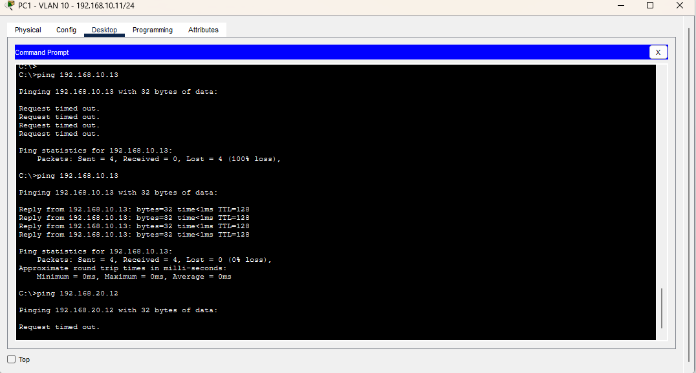

Como era de esperar, el ping da `Request timed out` al 100%: sin capa 3 ni gateway, las VLANs están estrictamente aisladas.

En SW1 comprobé el estado inicial de los troncales:
```text
show interfaces trunk
```

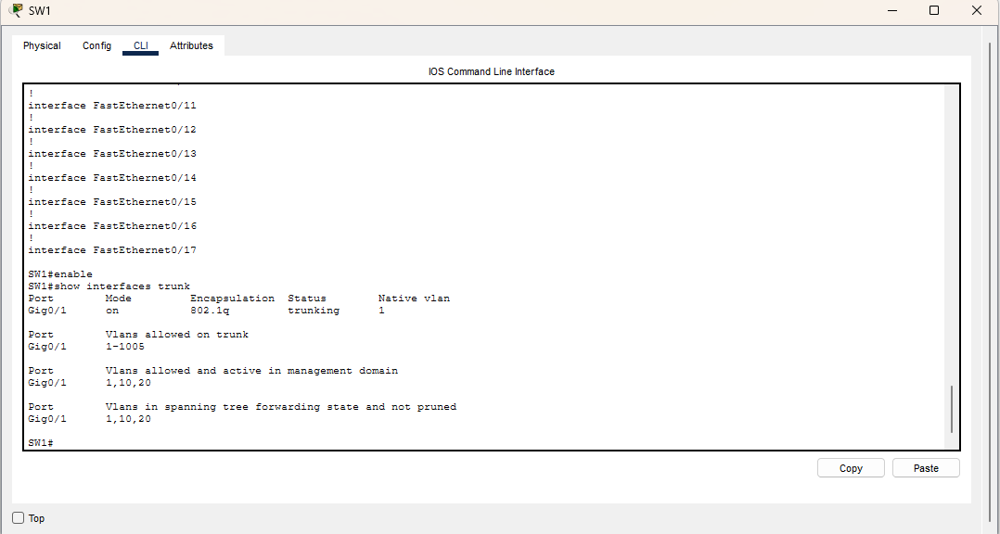

Solo `Gi0/1` (hacia SW2) estaba como trunk. El puerto `Gi0/2` todavía no estaba configurado.

---

### Fase 1 · El puerto del switch hacia el router (SW1)

Para que el switch envíe tramas etiquetadas con 802.1Q hacia el router, configuré `Gi0/2` en modo trunk forzado (los routers no negocian DTP):

```text
SW1# conf t
SW1(config)# interface gi0/2
SW1(config-if)# switchport mode trunk
SW1(config-if)# end
```

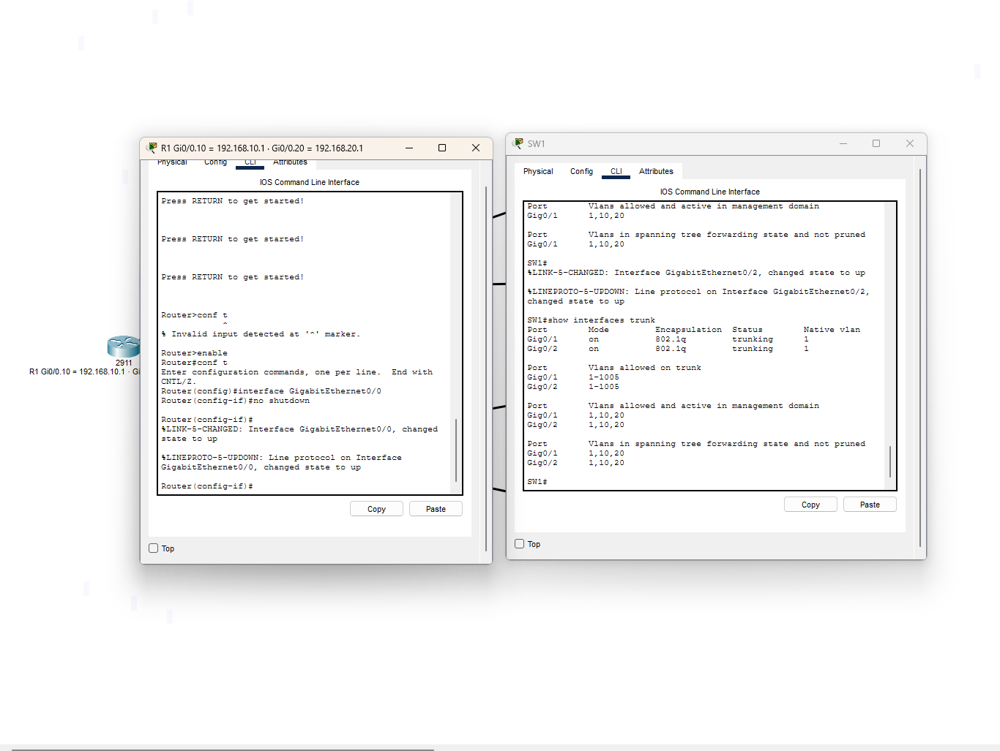
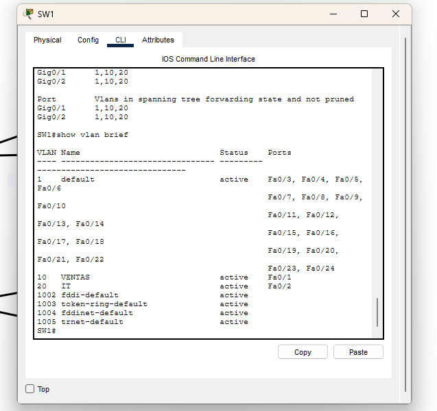

En `show vlan brief`, el puerto `Gi0/2` desaparece de la lista de VLANs de acceso, confirmando que ahora opera como troncal.

---

### Fase 2 · Subinterfaces en el Router (R1)

En el router R1 realicé la configuración de las subinterfaces. La interfaz física principal se enciende pero **no lleva dirección IP**:

```text
R1# conf t
R1(config)# hostname R1
R1(config)# interface gi0/0
R1(config-if)# no shutdown
R1(config-if)# exit

! Subinterfaz para VLAN 10 (Ventas)
R1(config)# interface gi0/0.10
R1(config-subif)# encapsulation dot1q 10
R1(config-subif)# ip address 192.168.10.1 255.255.255.0
R1(config-subif)# description GW-VENTAS
R1(config-subif)# exit

! Subinterfaz para VLAN 20 (IT)
R1(config)# interface gi0/0.20
R1(config-subif)# encapsulation dot1q 20
R1(config-subif)# ip address 192.168.20.1 255.255.255.0
R1(config-subif)# description GW-IT
R1(config-subif)# end
```

> **Regla de oro de Cisco IOS:** La sentencia `encapsulation dot1q <vlan-id>` debe aplicarse **antes** de asignar la dirección IP. Si intentas poner la IP primero, IOS la rechaza indicando que la interfaz no tiene configurada encapsulación de enlace de datos.

Comprobaciones del estado y la tabla de enrutamiento:

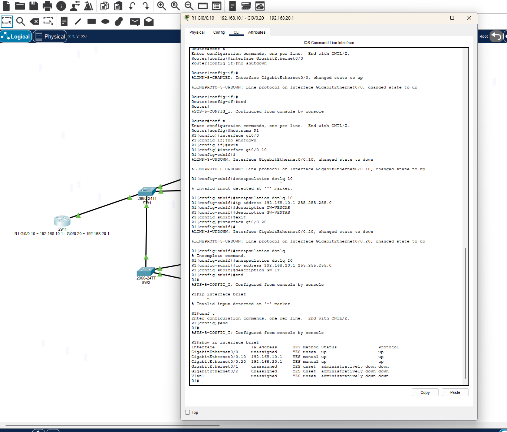
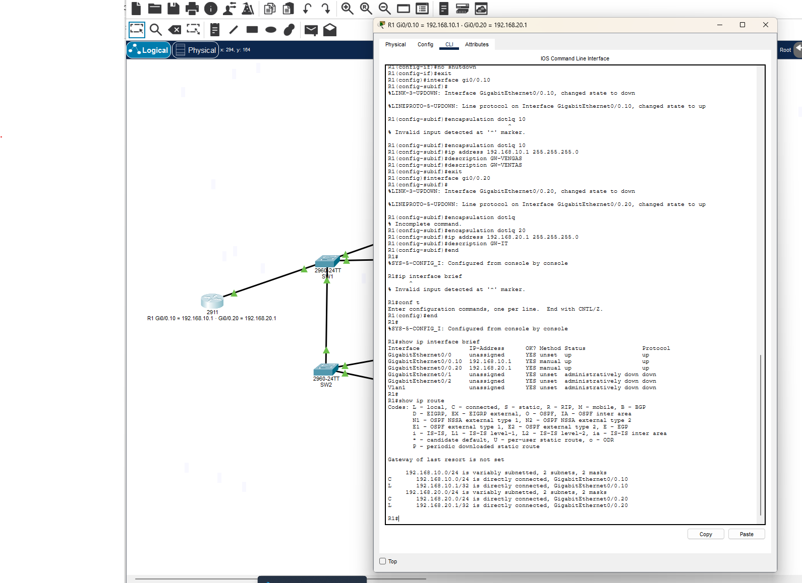
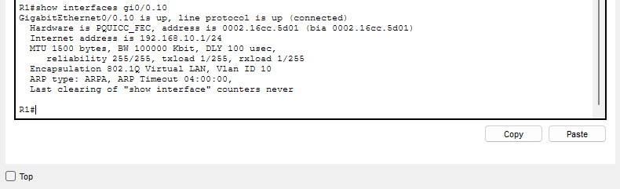

En `show ip route` aparecen automáticamente dos redes directamente conectadas (`C`):
* `192.168.10.0/24` directamente conectada a `GigabitEthernet0/0.10`.
* `192.168.20.0/24` directamente conectada a `GigabitEthernet0/0.20`.  
No se requieren rutas estáticas: el router conoce ambas redes porque residen en sus propias subinterfaces.

---

### Fase 3 · Puertas de enlace en los PCs

Configuré el Default Gateway en los cuatro equipos finales (PC1/PC3 con `192.168.10.1`, PC2/PC4 con `192.168.20.1`).

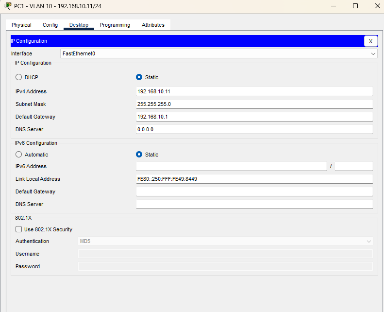

Verifiqué que PC1 alcanzaba ambos gateways:
```text
ping 192.168.10.1
ping 192.168.20.1
```

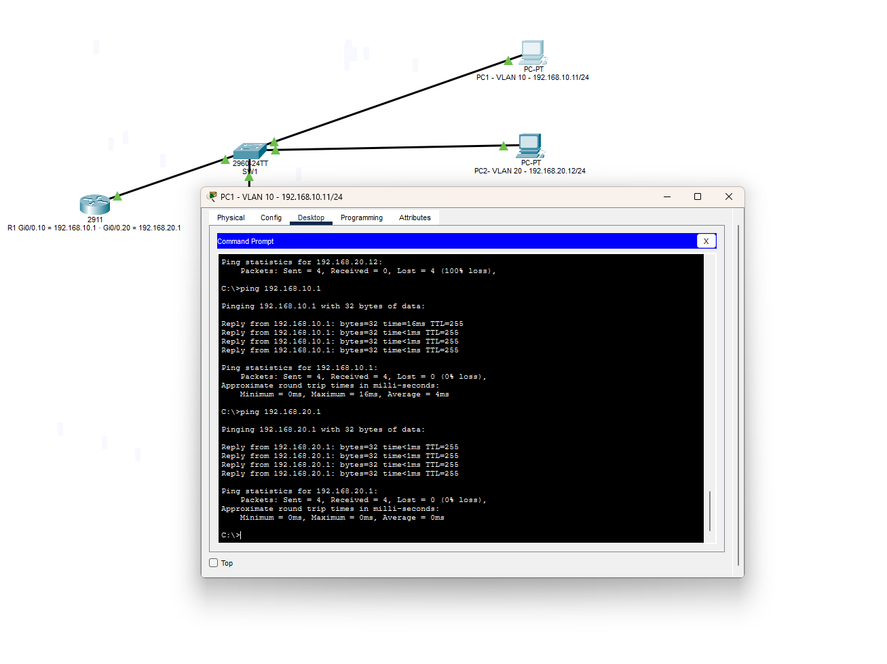

Ambos respondieron correctamente. PC1 alcanza incluso la IP de la otra subinterfaz (`192.168.20.1`) porque R1 procesa internamente el paquete.

---

### Fase 4 · Pruebas de conectividad Inter-VLAN

Aquí es donde se demostró la diferencia entre comunicación dentro de la misma red y enrutamiento entre redes distintas:

#### 1. Comunicación Intra-VLAN (PC1 ➔ PC3)
```text
ping 192.168.10.13
```
* **Resultado:** 4/4 respuestas con **TTL = 128**.  
* **Explicación:** Ambos equipos están en la VLAN 10. El tráfico viaja directo por capa 2 a través de los switches sin pasar por el router, por lo que el TTL original de Windows (128) no se decrementa.

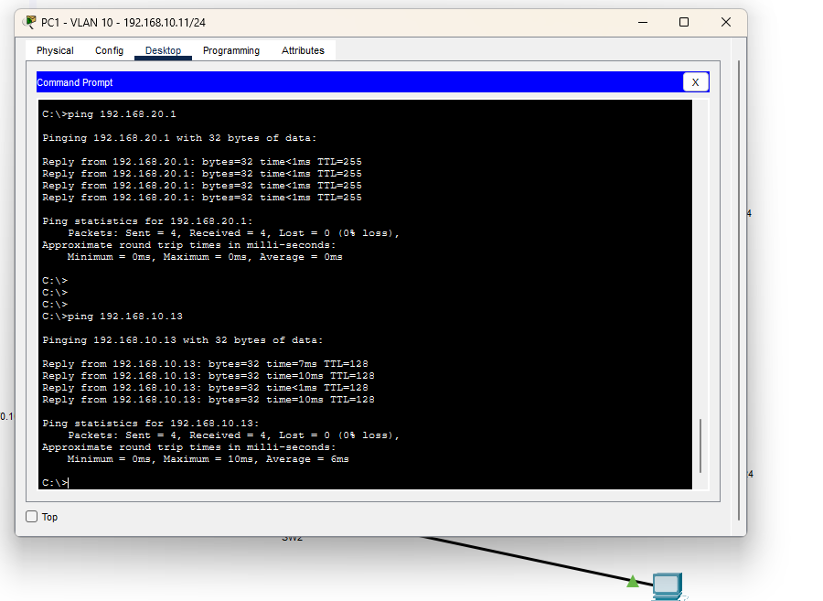

#### 2. Comunicación Inter-VLAN (PC1 ➔ PC2) — ¡La prueba clave!
```text
ping 192.168.20.12
```
* **Resultado:** Primer paquete fallido (*Request timed out*), seguido de 3 respuestas exitosas con **TTL = 127**.
* **Explicación técnica:** 
  1. El primer paquete se perdió por la **resolución ARP**: PC1 necesita conocer la MAC de su gateway (`192.168.10.1`), y a su vez R1 necesita resolver por ARP la MAC de PC2 en la VLAN 20. Una vez poblada la tabla ARP, los siguientes paquetes fluyeron de inmediato.
  2. El valor **TTL = 127** demuestra que el paquete atravesó un salto de Capa 3: cada router por el que pasa un paquete decrementa el campo *Time To Live* en 1 para evitar bucles.

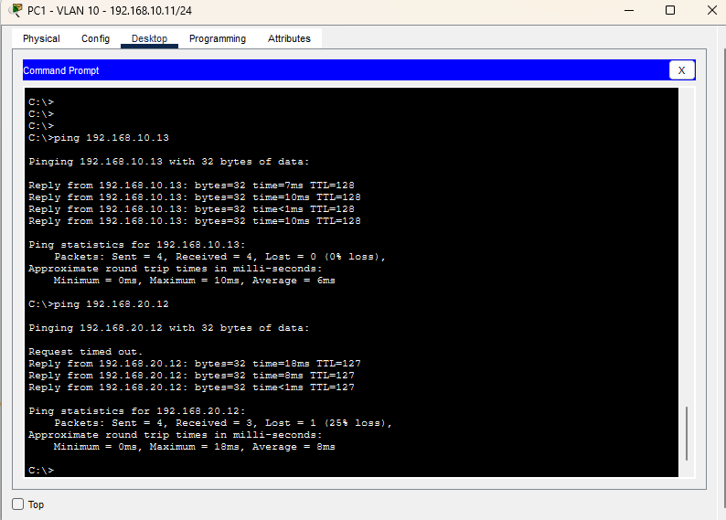

#### 3. Comunicación extremo a extremo (PC4 ➔ PC1)
Probado desde el PC4 en SW2 hacia PC1 en SW1: el paquete atraviesa SW2 ➔ Trunk ➔ SW1 ➔ Stick hacia R1 ➔ vuelve a SW1 ➔ PC1.

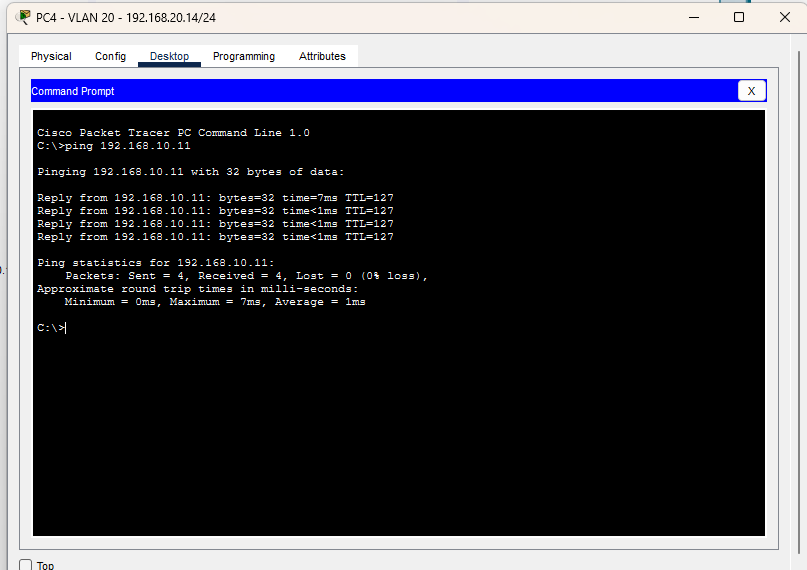

#### 4. Trazado de ruta con `tracert`
```text
tracert 192.168.20.14
```
La traza mostró con exactitud los dos saltos obligados:
1. `192.168.10.1` (R1 - Subinterfaz Gateway).
2. `192.168.20.14` (PC4 - Destino final en VLAN 20).

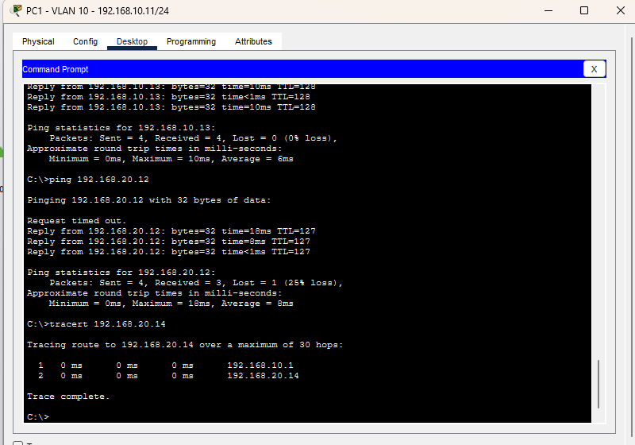

---

### Fase 5 · El viaje del Tag 802.1Q en Simulation Mode

En Simulation Mode filtré por ICMP y ARP y seguí un paquete ping desde PC1 a PC2 en tres puntos exactos del camino:

1. **Subiendo hacia el router por el enlace troncal (`Gi0/2`):**
   La PDU saliente lleva cabecera `Ethernet 802.1q` con el campo `TCI: 0x000a` (**VLAN 10** en hexadecimal) y `TPID: 0x8100`.
   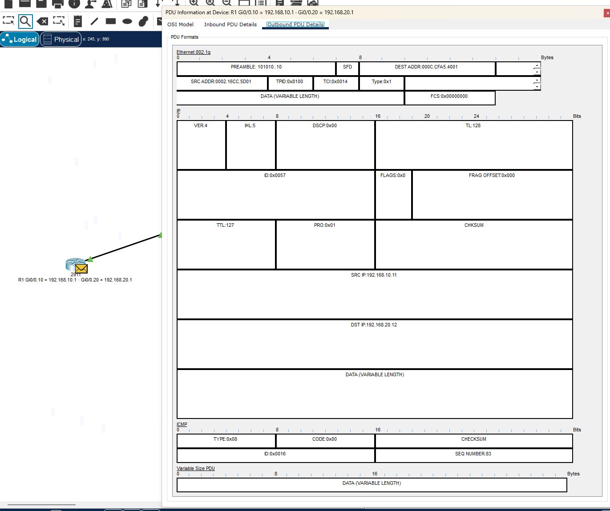

2. **Bajando del router por el mismo cable hacia SW1:**
   El router retiró la cabecera de la VLAN 10, consultó su tabla de rutas, decrementó el TTL a 127 y le colocó la cabecera `Ethernet 802.1q` con `TCI: 0x0014` (**VLAN 20** en hexadecimal).
   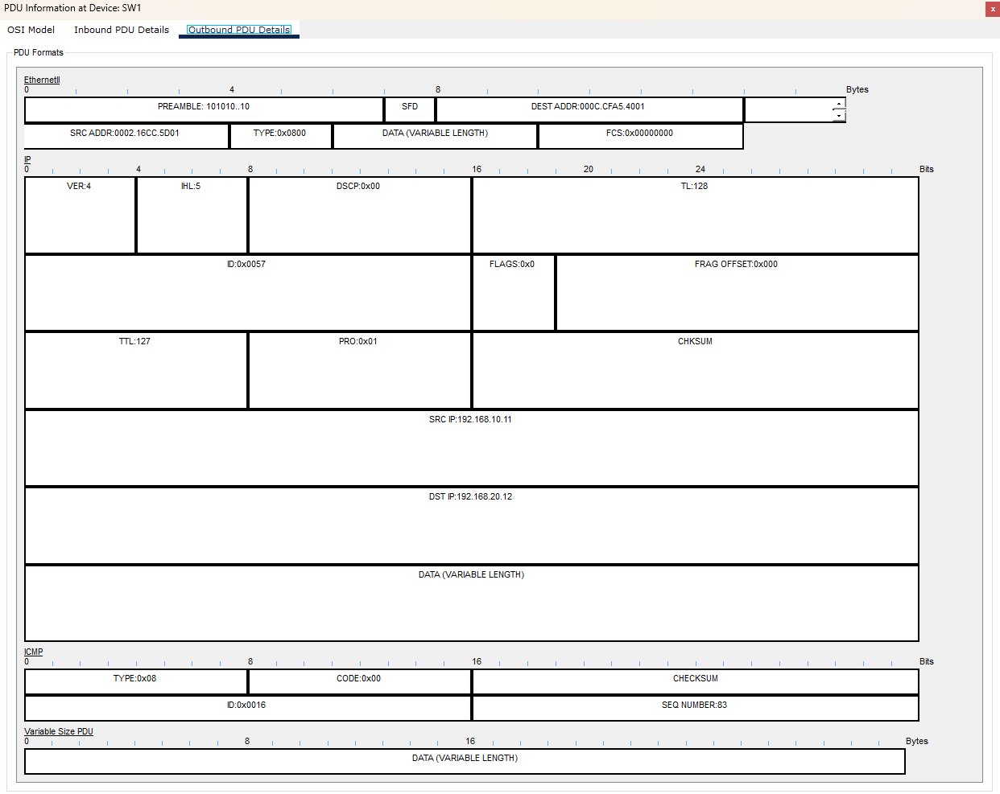

3. **Entregándose a PC2 en el puerto de acceso (`Fa0/2`):**
   Al salir hacia el puesto final, el switch retira la etiqueta 802.1Q y entrega una trama `Ethernet II` estándar y limpia.
   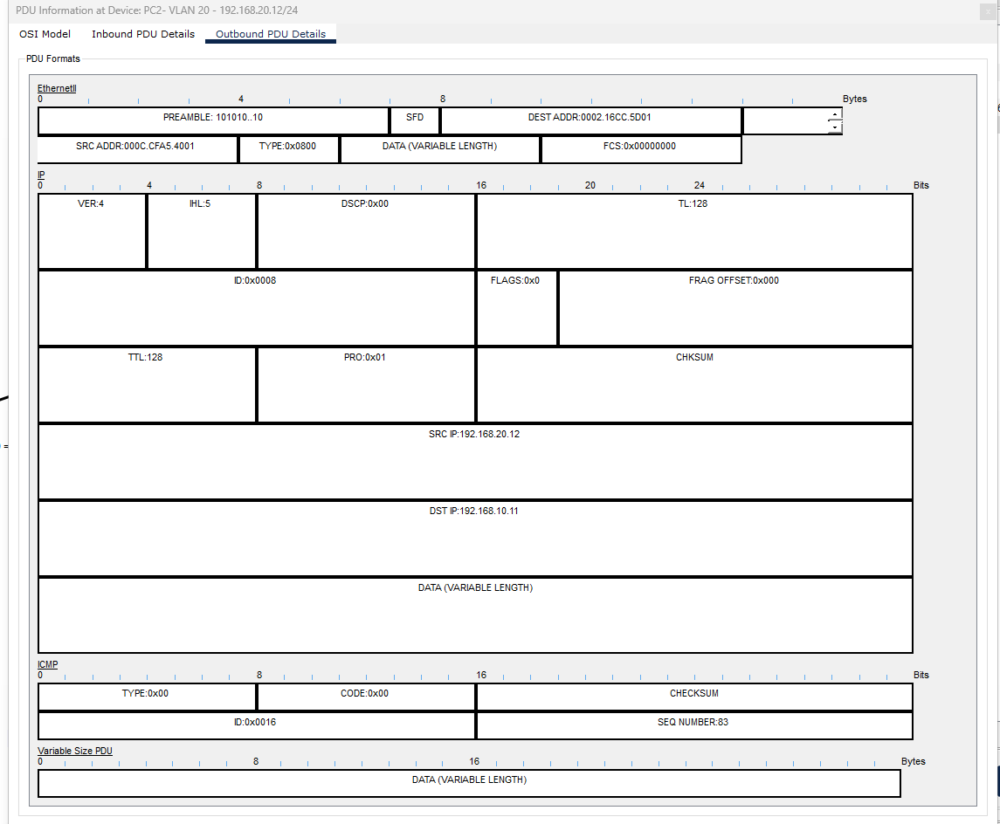

---

### Fase 6 · Troubleshooting (Romper y Reparar)

#### Fallo 1 · Puerto troncal hacia el router forzado a modo Access
* **Acción:** En SW1 cambié `Gi0/2` a `switchport mode access`.
* **Síntoma:** El ping entre VLANs murió inmediatamente. Al ejecutar `show interfaces trunk` en SW1, el puerto `Gi0/2` desapareció de la tabla.
* **Causa raíz:** Un puerto de acceso solo transmite tramas sin etiquetar pertenecientes a una única VLAN (por defecto VLAN 1). El router dejó de recibir tramas con tags 802.1Q para sus subinterfaces.
* **Solución:** Reconfigurar `switchport mode trunk` en `Gi0/2`. El enlace volvió a la tabla de trunks y el ping se restableció.

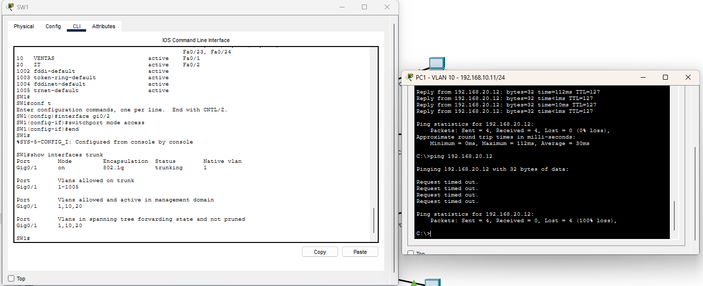
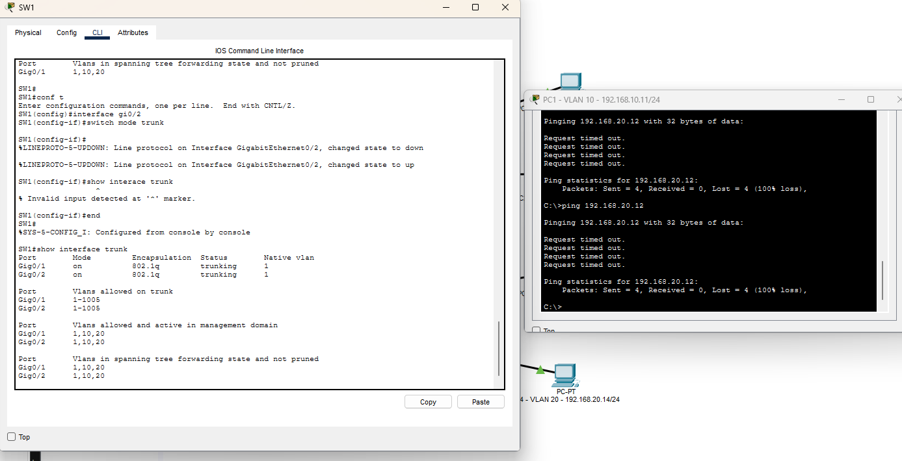

---

#### Fallo 2 · Encapsulación dot1q configurada con VLAN errónea
* **Acción:** En R1 modifiqué la subinterfaz `.20` asignándole `encapsulation dot1q 30`.
* **Síntoma:** Ping de PC1 a PC2 falló con 100% de pérdida.
* **Diagnóstico clave:** Al ejecutar `show ip interface brief`, la subinterfaz `Gi0/0.20` **seguía apareciendo en estado `up / up`** con su IP `192.168.20.1`. Sin embargo, en `show interfaces gi0/0.20` se comprobó que estaba etiquetando para la `Vlan ID 30` en lugar de la `20`.
* **Lección aprendida:** **"Up / Up" no significa que el servicio esté funcionando.** Un estado de interfaz positivo solo indica que la capa física y de enlace están activas, pero un fallo en la configuración de encapsulación lógica descarta el tráfico en silencio.
* **Solución:** Aplicar `encapsulation dot1q 20` en la subinterfaz.

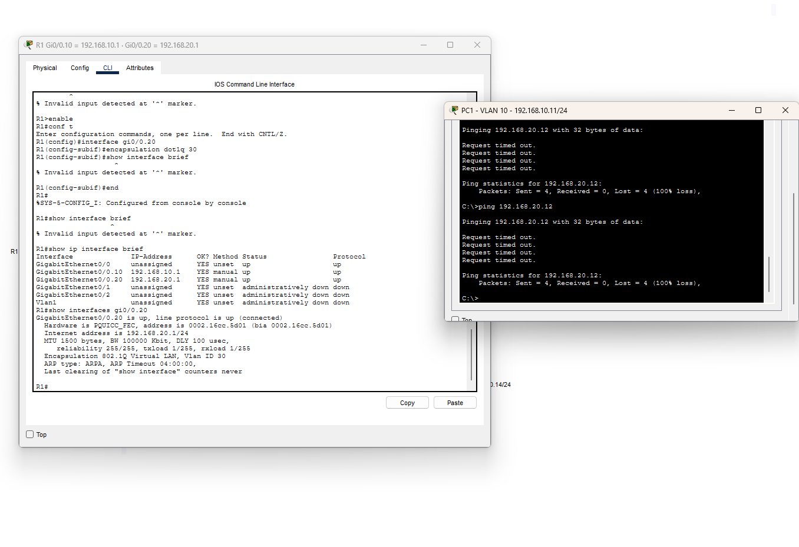
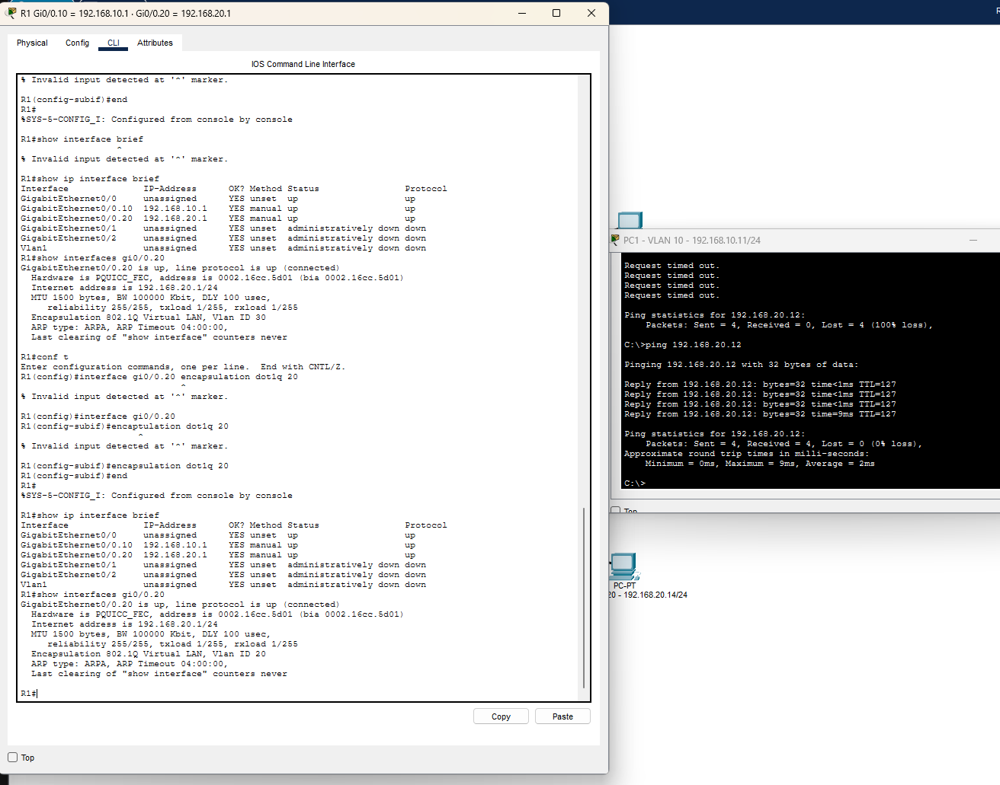

---

### Fase 7 · Cierre y Verificación Final

Guardé la configuración en los 3 equipos (`copy running-config startup-config`) y comprobé el archivo de configuración final de R1:

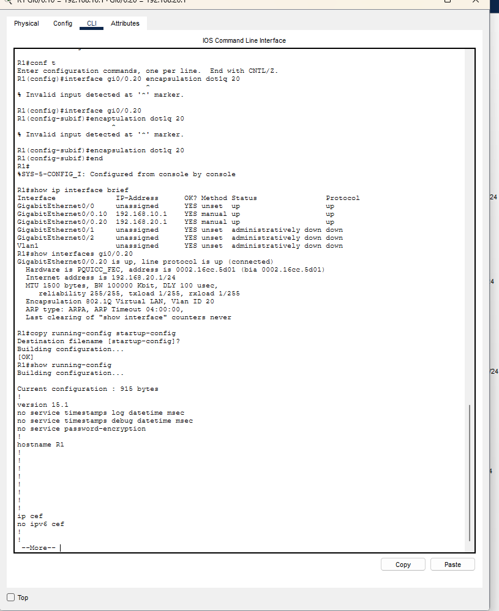
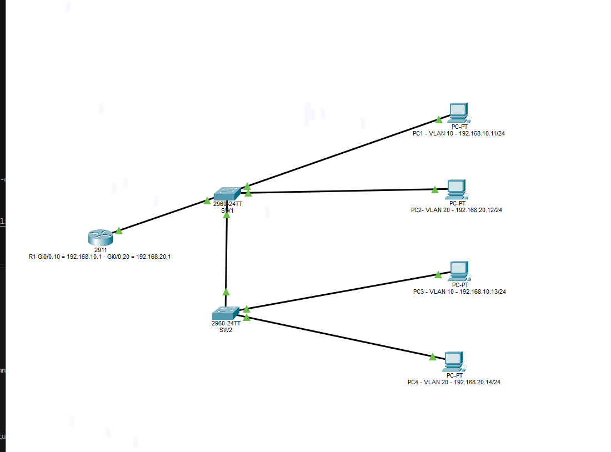

---

## ❌ Mis fallos y dificultades (y qué aprendí)

| Fallo / Incidencia | Qué pasó | Causa y qué aprendí |
|---|---|---|
| **Susto de `down / down` en `Gi0/2`** | Al principio configuré el trunk en SW1 pero `Gi0/2` no aparecía en `show interfaces trunk` y salía `down/down`. Pensé que la interfaz estaba rota o el cable dañado. | **Los switches ocultan los trunks que están físicamente caídos.** Como R1 tenía `Gi0/0` en `shutdown` por defecto, SW1 no detectaba señal de Capa 1. Aprendí que los estados `up/up`, `up/down` y `down/down` dan las pistas clave para diagnosticar el problema antes de volverse loco. |
| **Error de comando `dotlq` (letra L en vez de 1)** | En R1 escribí `encapsulation dotlq 10` y la consola me marcó error de entrada (`% Invalid input`). Estaba convencido de haberlo escrito bien. | Puse una `l` minúscula en vez de un `1`. Aprendí que la tipografía de la consola engaña y que el comando hace referencia al estándar numérico IEEE 802.**1**Q. |
| **Duda sobre el número de routers** | Tenía dudas sobre si hacía falta un segundo router para comunicar ambas redes. | Con Router-on-a-Stick un único router físico centraliza todas las conexiones a través de un único enlace dividido lógicamente. Tirar cables físicos para cada red sería más costoso, propenso a errores y gastaría puertos. |
| **Susto con el primer ping (25% loss)** | Al hacer el primer ping inter-VLAN el primer paquete dio *Request timed out* y pensé que algo fallaba. | Luego respondió 3/3. Es el retardo normal de la resolución ARP tanto en el host origen con su gateway como en el router con el host destino. |
| **Inspección en modo simulación** | Me costó entender las etiquetas y el panel de simulación en Packet Tracer; se me hizo algo cuesta arriba la visualización de PDUs. | Aunque todavía me falta soltura manejando las listas de eventos, pude ver por primera vez en directo cómo viaja la trama, cómo entra con una etiqueta y el router la cambia por otra. |

## ✅ Mis aciertos

- Completé el laboratorio en **~1 hora**, registrando las **23 capturas** solicitadas en el orden exacto.
- Relacioné el valor de **TTL (128 vs 127)** como evidencia directa del salto de enrutamiento por el router.
- Interioricé la regla de configuración de subinterfaces: `encapsulation dot1q` siempre antes de `ip address`.
- Diagnostiqué el fallo de encapsulación comprendiendo que el estado `up/up` no garantiza la entrega de paquetes si hay discrepancia de VLAN ID.

## 🧠 Aprendizajes clave

1. **Un solo enlace físico puede transportar múltiples redes lógicas:** Gracias al etiquetado 802.1Q en el puerto troncal, una única interfaz de router atiende a múltiples VLANs mediante subinterfaces virtuales.
2. **Sin router no hay comunicación entre VLANs:** Los switches conmutan dentro de la misma VLAN a nivel de Capa 2, pero para cruzar entre dominios de broadcast distintos hace falta un dispositivo de Capa 3 que enrute.
3. **El router decrementa el TTL:** Una forma rápida de saber si un ping cruzó un router es comprobar si el TTL bajó de 128 a 127.
4. **`up/up` no significa operativo a nivel de servicio:** Un puerto puede estar arriba físicamente y a nivel de protocolo de línea, pero descartar tráfico si la etiqueta dot1q no coincide.
5. **Mecanización de la CLI de Cisco:** Cada vez me siento más cómodo con la jerarquía de modos (`#`, `(config)#`, `(config-if)#` y `(config-subif)#`).

## 📋 Comandos de referencia rápida

| Objetivo | Dispositivo | Comando |
|---|---|---|
| Forzar puerto troncal | Switch | `interface gi0/2` ➔ `switchport mode trunk` |
| Encender interfaz física | Router | `interface gi0/0` ➔ `no shutdown` |
| Crear subinterfaz y encapsular | Router | `interface gi0/0.10` ➔ `encapsulation dot1q 10` |
| Asignar IP de Gateway | Router | `ip address 192.168.10.1 255.255.255.0` |
| Ver subinterfaces y estados | Router | `show ip interface brief` |
| Ver tabla de enrutamiento | Router | `show ip route` |
| Ver detalles de VLAN en subinterfaz | Router | `show interfaces gi0/0.10` |
| Comprobar saltos de red | PC | `tracert 192.168.20.14` |

---

## ➡️ Siguiente paso

Enrutamiento mediante **Switch Multicapa (SVI de Capa 3)** para comparar la velocidad y arquitectura del hardware con respecto a Router-on-a-Stick, o diseño de direccionamiento con **Subnetting y VLSM**.

---

*José María Aparicio Portillo · [GitHub](https://github.com/anudoranador87) · [LinkedIn](https://linkedin.com/in/joseaparicio87)*
