# Lab 6: Subnetting y VLSM (CCNA · Packet Tracer)

> 🇬🇧 [English version](./README_EN.md)

Sexto bloque de mi portfolio de redes (CCNA). En el laboratorio anterior conecté dos VLANs (VENTAS e IT) con Router-on-a-Stick. En este lab extiendo esa misma topología: añado una tercera VLAN (**INVITADOS**), un segundo router (**R2**) para una sucursal remota y un nuevo switch (**SW3**). Pero antes de tocar un solo comando, tengo que **diseñar el plan de direccionamiento desde cero** usando VLSM, porque ya no vale con un `/24` genérico para todo.

| | |
|---|---|
| **Herramienta** | Cisco Packet Tracer |
| **Equipos** | 2 × Cisco 2911 (R1, R2), 3 × Catalyst 2960-24TT (SW1, SW2, SW3) y 6 PCs |
| **Tiempo de ejecución** | ~1 h 30 min – 2 h |
| **Fecha** | 27/10/2026 |
| **Archivo Packet Tracer** | [`06_Subnetting_VLSM.pkt`](06_Subnetting_VLSM.pkt) |

---

## 🎯 Objetivo

- Entender qué es VLSM y por qué se usa en lugar de subnetting de tamaño fijo.
- Diseñar un plan de direccionamiento para cuatro segmentos de distinto tamaño y un enlace WAN, todo dentro de `192.168.50.0/24`.
- Extender la topología del lab anterior añadiendo VLAN 30 (INVITADOS), un tercer switch (SW3) y un segundo router (R2) para la sucursal.
- Configurar R1 con una tercera subinterfaz (`.30`) y el enlace WAN.
- Configurar R2 con dos interfaces físicas: WAN y LAN de sucursal.
- Añadir rutas estáticas en ambos routers para lograr conectividad extremo a extremo.
- Verificar con `show ip route`, `show ip interface brief`, `ping` y `tracert`.
- Entender el fallo asimétrico de routing: cuando el ping va pero no vuelve.

---

## 🧮 Fase 0 · El plan en papel (antes de encender Packet Tracer)

Lo primero fue salir del ordenador. Calculé la tabla VLSM a mano ordenando los segmentos de **mayor a menor número de hosts** — esa es la clave del método:

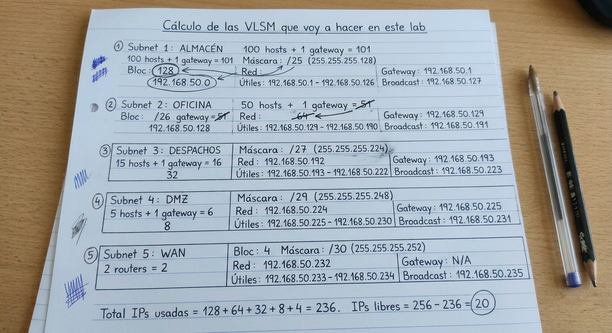

> **Por qué hay que ordenar de mayor a menor:** si asignas primero los bloques pequeños y luego intentas meter los grandes, te quedas sin espacio contiguo o creas solapamientos. Con VLSM empiezas por la red más grande y vas encadenando bloques del tamaño justo.

### Plan de direccionamiento elegido

Espacio de direcciones: `192.168.50.0/24`

| Segmento | Hosts requeridos | Prefijo | Máscara | Red | Primer host | Último host | Broadcast |
|---|---|---|---|---|---|---|---|
| **VLAN 10 · VENTAS** | ~50 | `/26` | `255.255.255.192` | `192.168.50.0` | `192.168.50.1` | `192.168.50.62` | `192.168.50.63` |
| **VLAN 20 · IT** | ~25 | `/27` | `255.255.255.224` | `192.168.50.64` | `192.168.50.65` | `192.168.50.94` | `192.168.50.95` |
| **VLAN 30 · INVITADOS** | ~10 | `/28` | `255.255.255.240` | `192.168.50.96` | `192.168.50.97` | `192.168.50.110` | `192.168.50.111` |
| **SUCURSAL** | ~10 | `/28` | `255.255.255.240` | `192.168.50.112` | `192.168.50.113` | `192.168.50.126` | `192.168.50.127` |
| **WAN R1 ↔ R2** | 2 | `/30` | `255.255.255.252` | `192.168.50.128` | `192.168.50.129` | `192.168.50.130` | `192.168.50.131` |

> **La regla de no solapamiento:** cada red empieza justo después del broadcast de la anterior. `192.168.50.64` empieza en el broadcast de VENTAS (`.63`) + 1. `192.168.50.96` empieza en el broadcast de IT (`.95`) + 1. Y así sucesivamente. Si hay un salto que no cuadra, hay un error de cálculo.

---

## 🗺️ Topología

```text
                        [ R1 ] (Cisco 2911)
                       /      \
                 Gi0/0 |       | Gi0/1
          (subinterfaces        (WAN /30 · cable cruzado)
           .10, .20, .30)        |
                 |               |
        Gi0/2   |           192.168.50.129 ←→ 192.168.50.130
      (Trunk)  SW1                         [ R2 ] (Cisco 2911)
              /   \                       /        \
          Gi0/1   Fa0/1 Fa0/2         Gi0/1       Gi0/0
       (Trunk)    PC1   PC2         (SUCURSAL)    (WAN)
           |     (V10) (V20)            |
          SW2                          SW3
      /    |    \                       |
  Fa0/1 Fa0/2 Fa0/3                  Fa0/2
   PC3   PC4   PC5                    PC6
  (V10) (V20) (V30)               (SUCURSAL)
```

> **Sobre el cable cruzado R1–R2:** router con router, igual que en el Lab 02 con los cables cruzados entre switches. No hay switch en medio, así que los puertos TX de un equipo van directamente a los RX del otro. En Packet Tracer se elige *Copper Cross-Over*.

### Tabla de direccionamiento completa

| Dispositivo | Interfaz | Rol | IP / Máscara | Gateway |
|---|---|---|---|---|
| **R1** | Gi0/0 | Interfaz física (solo transporte) | — | — |
| **R1** | Gi0/0.10 | Gateway VLAN 10 · VENTAS | `192.168.50.1 /26` | — |
| **R1** | Gi0/0.20 | Gateway VLAN 20 · IT | `192.168.50.65 /27` | — |
| **R1** | Gi0/0.30 | Gateway VLAN 30 · INVITADOS | `192.168.50.97 /28` | — |
| **R1** | Gi0/1 | Enlace WAN hacia R2 | `192.168.50.129 /30` | — |
| **R2** | Gi0/0 | Enlace WAN hacia R1 | `192.168.50.130 /30` | — |
| **R2** | Gi0/1 | Gateway SUCURSAL | `192.168.50.113 /28` | — |
| **PC1** | NIC | SW1 Fa0/1 · VLAN 10 | `192.168.50.11 /26` | `192.168.50.1` |
| **PC2** | NIC | SW1 Fa0/2 · VLAN 20 | `192.168.50.70 /27` | `192.168.50.65` |
| **PC3** | NIC | SW2 Fa0/1 · VLAN 10 | `192.168.50.13 /26` | `192.168.50.1` |
| **PC4** | NIC | SW2 Fa0/2 · VLAN 20 | `192.168.50.94 /27` | `192.168.50.65` |
| **PC5** | NIC | SW2 Fa0/3 · VLAN 30 | `192.168.50.100 /28` | `192.168.50.97` |
| **PC6** | NIC | SW3 Fa0/2 · SUCURSAL | `192.168.50.120 /28` | `192.168.50.113` |

---

## 🛠️ Desarrollo paso a paso

### Fase 1 · Estado inicial (el "antes")

Partiendo del archivo del lab anterior, comprobé la tabla de rutas de R1 antes de tocar nada:

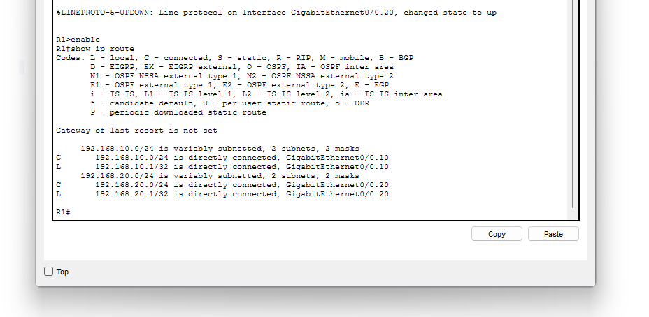

Solo aparecen las dos redes directamente conectadas del lab 05 (VLAN 10 y VLAN 20). Todavía no hay ni VLAN 30 ni sucursal.

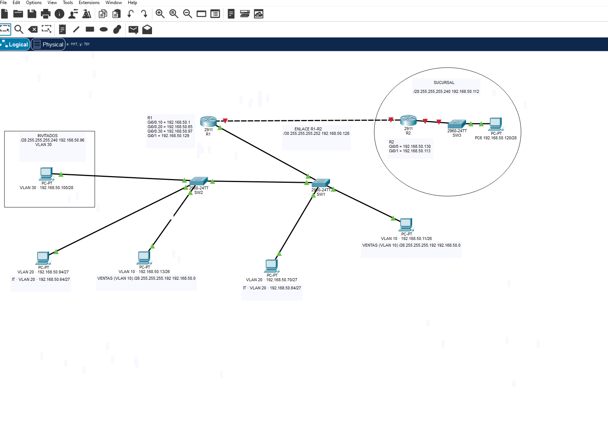

La topología ya muestra R2, SW3, PC5 y PC6 añadidos. Los enlaces de los routers salen en rojo: es lo normal, los puertos de los routers Cisco están **apagados por defecto** y hay que levantarlos con `no shutdown`.

---

### Fase 2 · VLAN 30 (INVITADOS) en los switches

La VLAN 30 necesita existir en SW1 y SW2. En SW2, además, hay que asignar el puerto de PC5:

```text
SW1(config)# vlan 30
SW1(config-vlan)# name INVITADOS
SW1(config-vlan)# end

SW2(config)# vlan 30
SW2(config-vlan)# name INVITADOS
SW2(config-vlan)# exit
SW2(config)# interface fa0/3
SW2(config-if)# switchport mode access
SW2(config-if)# switchport access vlan 30
SW2(config-if)# end
```

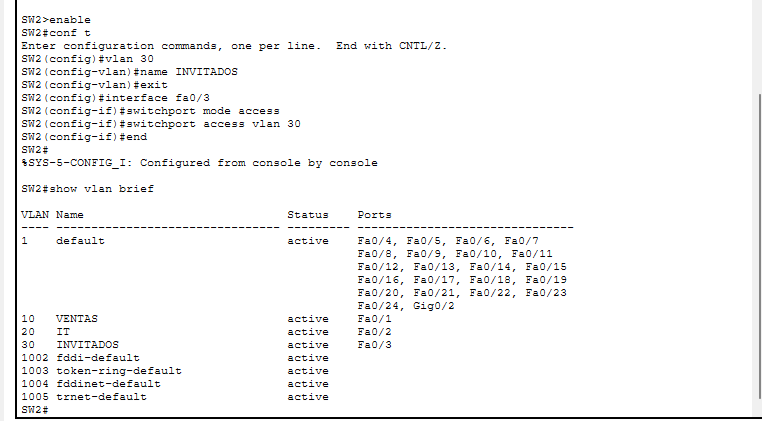

El trunk SW1–SW2 ya existía del lab anterior y **permite por defecto el rango 1-1005**, así que VLAN 30 viaja por él automáticamente en cuanto existe en ambos switches:

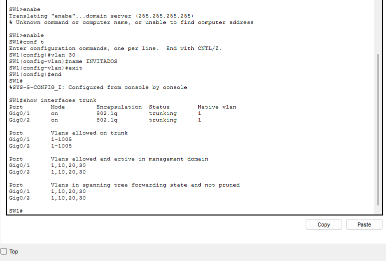

---

### Fase 3 · Nueva subinterfaz en R1 (VLAN 30) y enlace WAN

Actualicé las subinterfaces de R1 con las IPs VLSM, añadí la nueva `.30` para INVITADOS y levanté el enlace WAN hacia R2:

```text
R1# conf t

! Subinterfaz VLAN 10 (Ventas) - /26
R1(config)# interface gi0/0.10
R1(config-subif)# encapsulation dot1q 10
R1(config-subif)# ip address 192.168.50.1 255.255.255.192
R1(config-subif)# exit

! Subinterfaz VLAN 20 (IT) - /27
R1(config)# interface gi0/0.20
R1(config-subif)# encapsulation dot1q 20
R1(config-subif)# ip address 192.168.50.65 255.255.255.224
R1(config-subif)# exit

! Subinterfaz VLAN 30 (Invitados) - /28  ← NUEVA
R1(config)# interface gi0/0.30
R1(config-subif)# encapsulation dot1q 30
R1(config-subif)# ip address 192.168.50.97 255.255.255.240
R1(config-subif)# exit

! Enlace WAN hacia R2 - /30
R1(config)# interface gi0/1
R1(config-if)# ip address 192.168.50.129 255.255.255.252
R1(config-if)# description ENLACE-R2
R1(config-if)# no shutdown
R1(config-if)# end
```

> **Regla de oro:** `encapsulation dot1q` siempre **antes** de `ip address`. Si intentas poner la IP primero, IOS la rechaza.

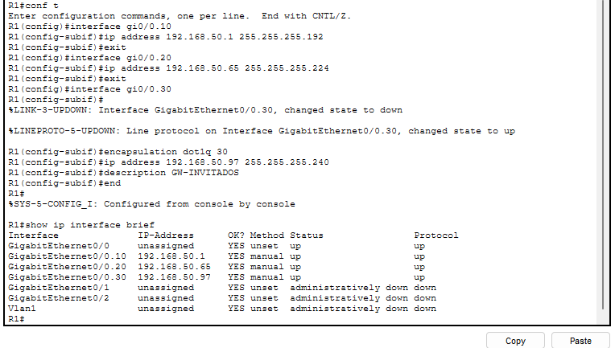
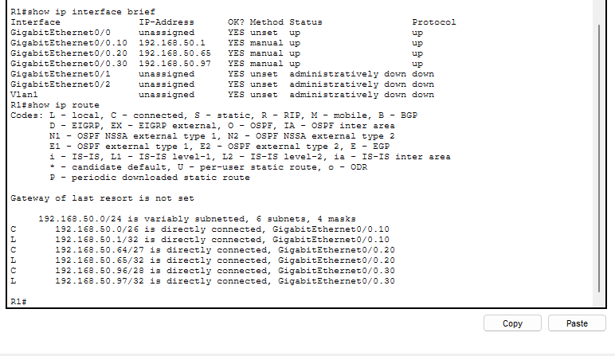

En `show ip route` aparecen cuatro redes directamente conectadas con cuatro máscaras distintas (`/26`, `/27`, `/28`, `/30`). Ahí está la belleza de VLSM.

---

### Fase 4 · Configurar R2

R2 no usa subinterfaces: tiene una interfaz física para el enlace WAN y otra para la LAN de la sucursal:

```text
R2# conf t
R2(config)# hostname R2

! Enlace WAN hacia R1 - /30
R2(config)# interface gi0/0
R2(config-if)# ip address 192.168.50.130 255.255.255.252
R2(config-if)# description ENLACE-R1
R2(config-if)# no shutdown
R2(config-if)# exit

! LAN Sucursal - /28
R2(config)# interface gi0/1
R2(config-if)# ip address 192.168.50.113 255.255.255.240
R2(config-if)# description LAN-SUCURSAL
R2(config-if)# no shutdown
R2(config-if)# end
```

---

### Fase 5 · IPs en los PCs con las nuevas máscaras

Actualicé las IPs en los seis PCs. La diferencia respecto a labs anteriores es que cada VLAN tiene su propia máscara, no siempre `/24`:

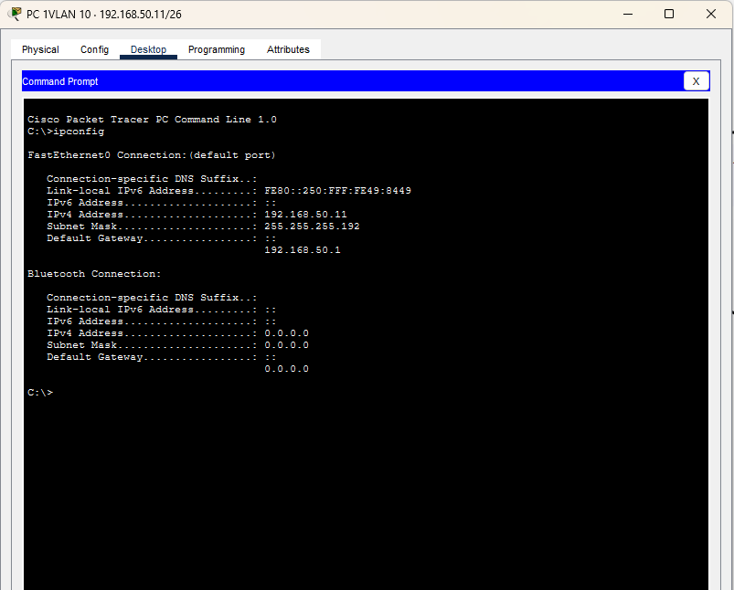

---

### Fase 6 · Verificación parcial

Antes de las rutas estáticas, comprobé lo que ya debía funcionar:

**Ping de PC1 a los gateways de R1:**

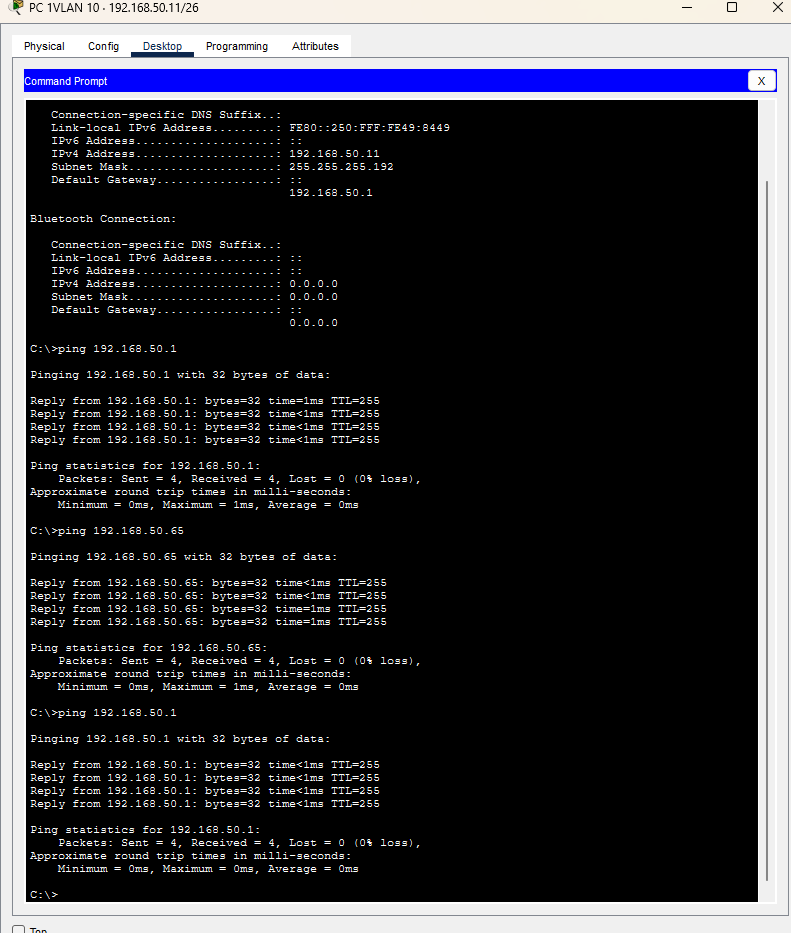

**Ping dentro de la misma VLAN (PC1 → PC3, ambos VLAN 10):**

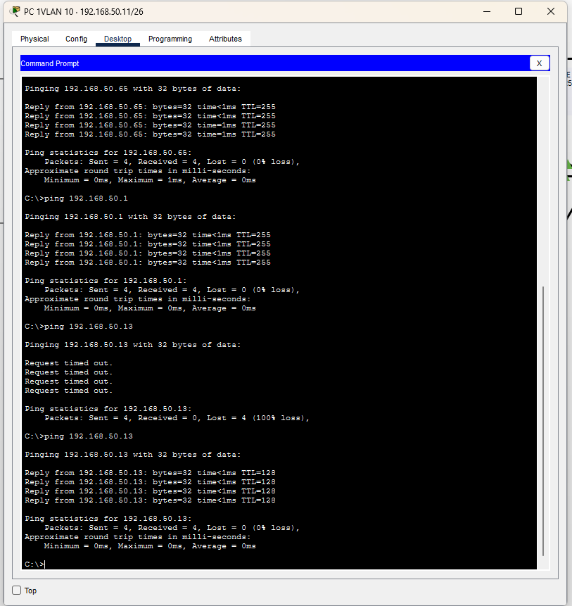

**Ping entre VLANs a través de R1 (PC1 → PC2):**

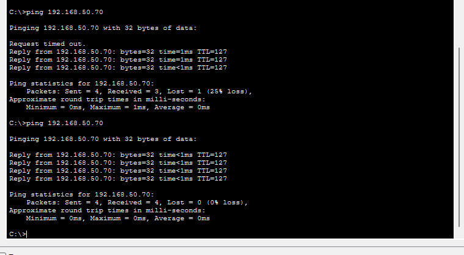

**Ping desde VLAN 20 a VLAN 30 (PC4 → PC5):**

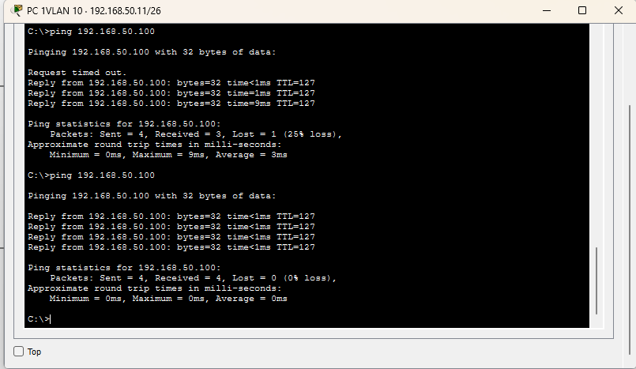

El primer paquete se perdió en todos los casos (25% de pérdida). Ya me lo esperaba: es la resolución ARP, no un fallo de configuración.

---

### Fase 7 · Rutas estáticas entre routers

Esta es la parte nueva. R1 conoce sus cuatro redes directas, pero no sabe llegar a la sucursal. Y R2 no sabe nada de las redes de R1.

#### Verificación del enlace WAN R1 ↔ R2

Primero confirmé que el enlace WAN funciona haciendo ping desde R1 a la IP de R2:

```text
R1# ping 192.168.50.130
```

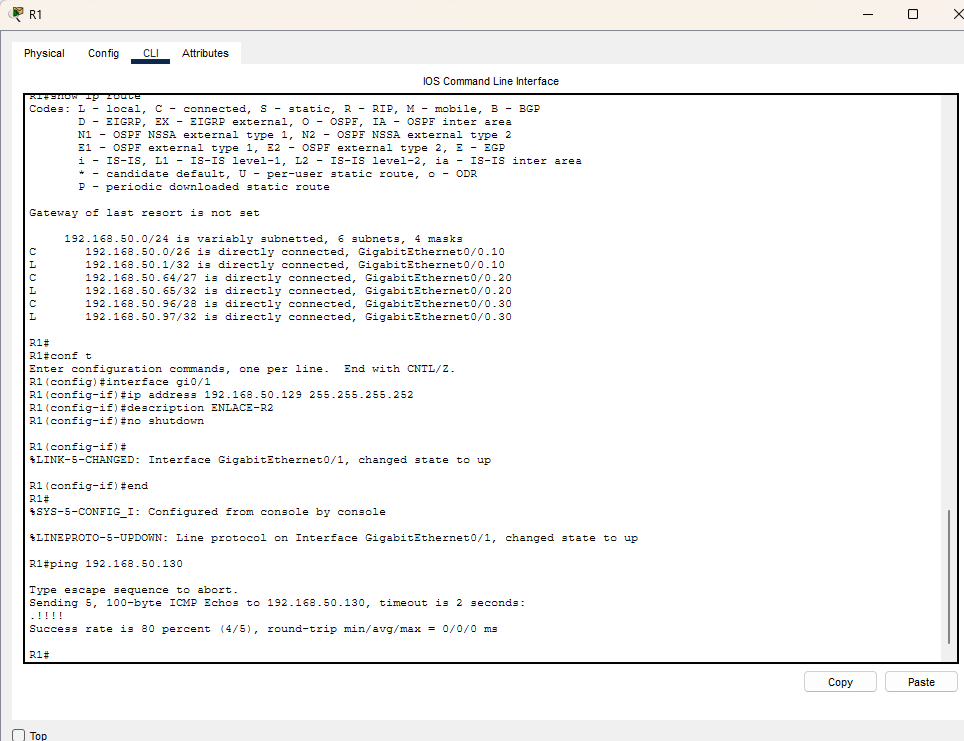

Resultado `.!!!!`: 4/5 (80%). El primer paquete se pierde por ARP, los cuatro siguientes van bien. El enlace `/30` funciona.

#### El fallo asimétrico

Hice ping desde PC1 hasta PC6 (sucursal) antes de añadir rutas. Falló al 100%:

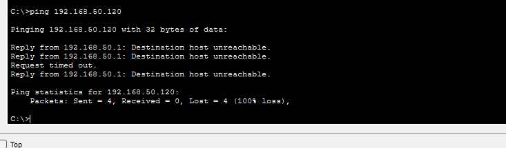

Añadí la ruta estática **solo en R1** (hacia la sucursal) y repetí el ping. Seguía fallando al 100%, pero de una forma diferente:

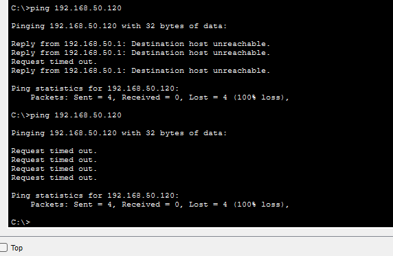

La pista: el `ping` de R1 a R2 (entre routers) funcionaba perfectamente. Pero de PC1 a PC6 seguía cayendo todo. **El paquete salía pero la respuesta no volvía.** R2 no tenía ninguna ruta para regresar a las redes de R1 y tiraba los paquetes de respuesta en silencio.

#### Configuración de rutas estáticas (en los dos sentidos)

```text
! En R1: enseñar el camino hacia la sucursal
R1(config)# ip route 192.168.50.112 255.255.255.240 192.168.50.130

! En R2: enseñar el camino de vuelta hacia las tres redes de R1
R2(config)# ip route 192.168.50.0   255.255.255.192 192.168.50.129  ! VENTAS /26
R2(config)# ip route 192.168.50.64  255.255.255.224 192.168.50.129  ! IT /27
R2(config)# ip route 192.168.50.96  255.255.255.240 192.168.50.129  ! INVITADOS /28
```

> **Por qué hay que hacerlo en los dos sentidos:** una ruta estática le dice a un router cómo llegar a un destino, pero no le dice al destino cómo volver. Si solo configuras la ida, los paquetes llegan pero las respuestas se pierden. Parece obvio, pero es uno de los errores más frecuentes en la práctica.

---

### Fase 8 · Verificación final

Con las rutas en ambos routers, el ping extremo a extremo funcionó:

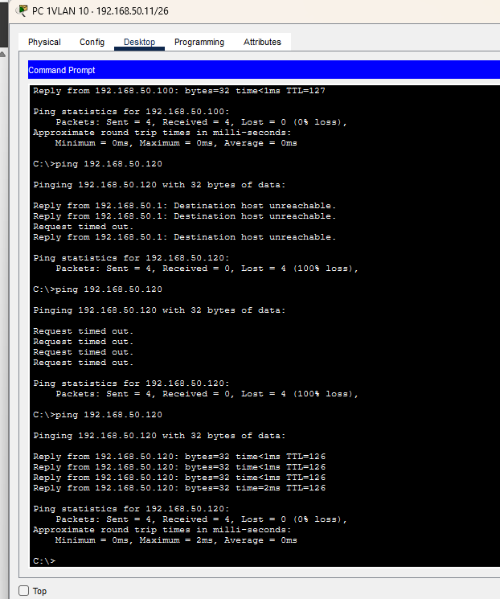

El `tracert` mostró la ruta completa: PC1 → R1 (`192.168.50.1`) → R2 (`192.168.50.130`) → PC6. Dos saltos de Capa 3, TTL bajando de 128 a 126:

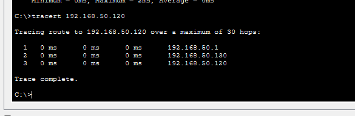

Tablas de rutas finales de ambos routers:

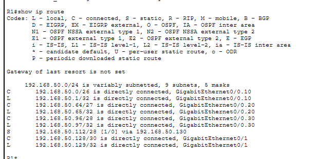
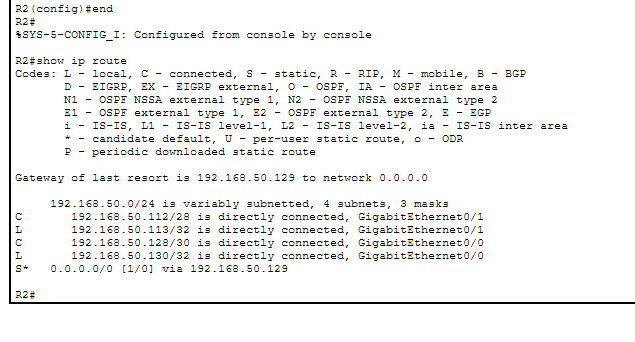

---

### Fase 9 · Cierre

```text
copy running-config startup-config
```

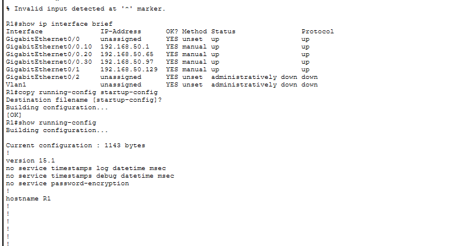
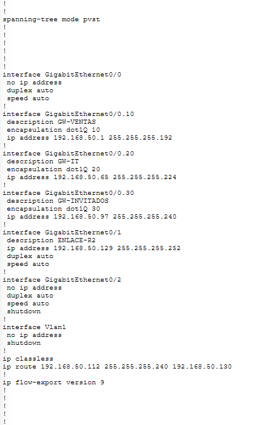
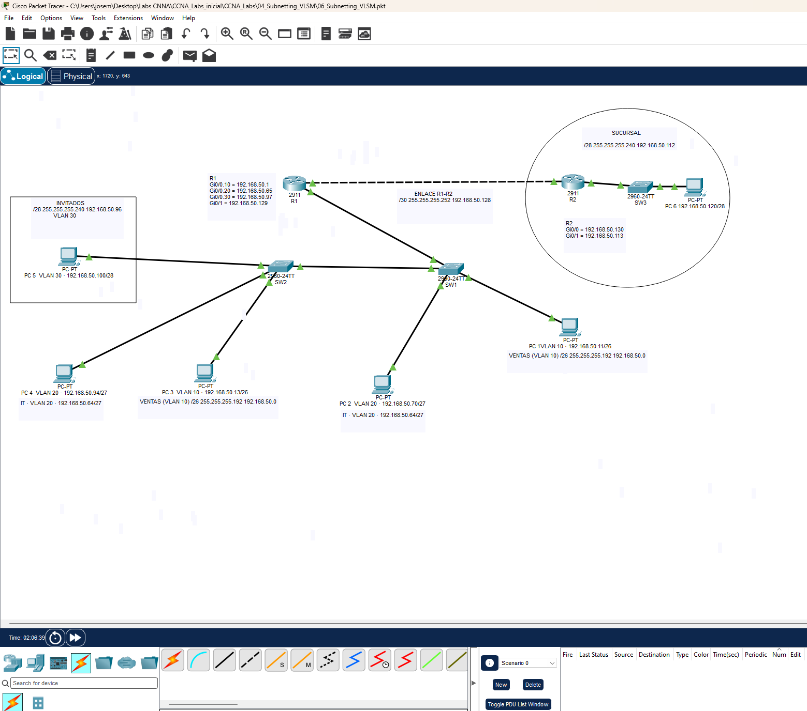

---

### Fase 10 · Troubleshooting (Romper y Reparar)

> ⚠️ Esta sección describe los fallos controlados del lab. Las capturas de los pasos de reparación no están disponibles en este README, pero los síntomas y la solución están documentados a continuación.

#### Fallo 1 · Solapamiento de subredes

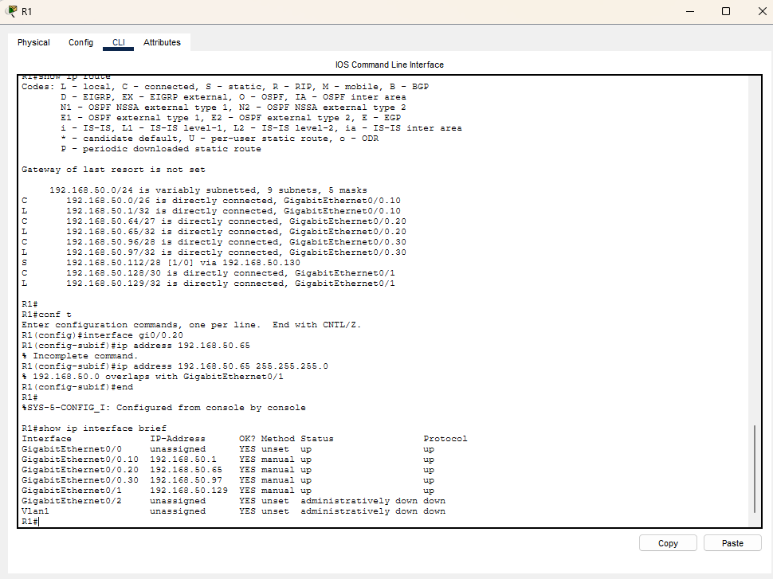

* **Acción:** Asigné intencionadamente una máscara incorrecta haciendo que dos redes se solaparan.
* **Síntoma:** Packet Tracer rechazó la asignación de IP con un aviso de solapamiento y `show ip route` mostró entradas incoherentes.
* **Lección:** El solapamiento es un error de diseño, no de configuración. Hay que resolverlo en papel antes de abrir la CLI.
* **Solución:** Recalcular los bloques verificando que el primer host de cada red es el broadcast de la anterior + 1.

#### Fallo 2 · Máscara `/24` en el enlace WAN (descripto, sin captura)

* **Acción:** Usé `/24` en el enlace WAN R1-R2 en lugar de `/30`.
* **Síntoma:** El enlace parecía funcionar, pero el bloque desperdiciado se solapaba con las LANs y el plan de direccionamiento se descuadraba.
* **Diagnóstico:** `show ip route` mostraba la ruta del WAN consumiendo un bloque mucho más grande de lo necesario.
* **Lección aprendida:** En un enlace punto a punto entre dos routers solo hacen falta 2 IPs útiles. `/30` es el estándar. Usar `/24` aquí es como reservar un aparcamiento de 254 plazas para dos coches.

#### Fallo 3 · Gateway fuera de la subred (descripto, sin captura)

* **Acción:** Asigné a PC5 un gateway que no pertenecía a su subred `/28`.
* **Síntoma:** PC5 podía hacer ping dentro de su VLAN (capa 2 directa), pero no podía salir a ninguna otra red.
* **Diagnóstico:** `ipconfig` mostraba el gateway erróneo. El PC intentaba resolver por ARP una IP que no estaba en su segmento.
* **Lección aprendida:** El default gateway debe pertenecer a la misma subred que el equipo. Si está fuera de rango, el ARP nunca lo resuelve y el equipo pierde la salida al exterior.

---

## ❌ Mis fallos y dificultades (y qué aprendí)

| Fallo / Incidencia | Qué pasó | Causa y qué aprendí |
|---|---|---|
| **`ip route` en modo exec → `% Invalid input`** | Tras hacer el ping de verificación, intenté añadir la ruta estática directamente en `R1#` sin entrar en configuración. IOS me devolvió `% Invalid input detected at '^' marker`. | `ip route` es un comando de **modo configuración global**. Hay que entrar primero con `configure terminal` y ver el prompt `R1(config)#`. El `^` que marca IOS apunta exactamente al primer carácter que no reconoce. |
| **`end` en modo exec → DNS lookup bloqueado** | Acto seguido, con el prompt en `R1#`, escribí `end` (que en ese nivel no significa nada). IOS lo intentó resolver como nombre de host: `Translating "end"...domain server (255.255.255.255)` y el prompt se quedó colgado esperando respuesta del servidor DNS. | En modo privilegiado `R1#`, `end` no es un comando válido. IOS, si no reconoce algo, lo trata como un nombre de equipo e intenta resolverlo. Para salir del cuelgue hay que pulsar **Ctrl+Shift+6**. Para evitar que vuelva a pasar en el futuro: `no ip domain-lookup` en modo configuración. |
| **El cálculo binario se me fue de las manos** | Tenía clara la idea del VLSM, pero al verificar los límites de bloque en binario empecé a liarme con los bits de subred. | Aprendí a usar la potencia de dos inmediatamente superior como método rápido: para ~50 hosts necesito 64 direcciones (2⁶) → `/26`. Para ~25 necesito 32 (2⁵) → `/27`. El binario lo uso para verificar, no para calcular. |
| **Perdido entre interfaces: cuál va a qué red** | Con dos routers, seis PCs y cinco subredes, llegó un momento en que no tenía claro qué interfaz debía llevar qué IP. | La tabla de direccionamiento completamente rellena en papel antes de tocar la CLI es obligatoria. Si entras a configurar sin el plan escrito, los errores se acumulan. |
| **El solapamiento que no vi** | Al principio no me di cuenta de que dos subredes se solapaban hasta que Packet Tracer me lo rechazó. Creía haberlo calculado bien. | Hay que verificar siempre que `primera IP de la red siguiente = broadcast anterior + 1`. Si hay un salto inexplicable, hay un error de cálculo. |
| **El fallo asimétrico (ping va pero no vuelve)** | Configuré la ruta en R1 hacia la sucursal, lancé el ping de PC1 a PC6 y… 100% de pérdida. Me quedé mirando la pantalla pensando que algo estaba mal en R1. | Al ver que el ping de R1 a R2 (entre routers) sí funcionaba, lo entendí: R2 no tenía ruta de retorno. El routing es bidireccional; si solo configuras un sentido, las respuestas se pierden. |
| **Etiquetas con IPs del lab anterior** | Al preparar la captura de topología, las etiquetas de los PCs y de R1 aún mostraban las IPs del Lab 05 (192.168.10.x/24), contradiciendo las notas VLSM de al lado. | Revisar siempre las etiquetas antes de capturar. En Packet Tracer es fácil olvidar actualizar los textos de las notas cuando se cambia la dirección real del equipo. |
| **El primer ping al 25% como siempre** | Al hacer el primer ping inter-VLAN con las rutas ya configuradas, el primer paquete se perdió y pensé que algo seguía fallando. | Ya lo conozco del lab anterior: es la resolución ARP. Una vez pobladas las tablas, los siguientes paquetes vuelan. |

## ✅ Mis aciertos

- Calculé el plan VLSM **en papel antes de abrir Packet Tracer**, lo que hizo la configuración mucho más ordenada.
- Completé el lab en **~1 h 30 min – 2 h** (más que los anteriores por la fase de cálculo previa, que compensa).
- Identifiqué el fallo asimétrico comparando el ping entre routers (que sí funcionaba) con el ping extremo a extremo (que fallaba), y deduje que el problema era la falta de ruta de retorno en R2.
- Aprendí a salir de un prompt colgado por DNS lookup con **Ctrl+Shift+6** sin tener que reiniciar.
- Relacioné el TTL del `tracert` (128 → 126, dos decrementos) con los dos saltos de router que da el paquete.
- La CLI de Cisco me resultó más fluida que en labs anteriores, aunque sigo necesitando pensar antes de entrar en cada modo.

## 🧠 Aprendizajes clave

1. **VLSM significa dar a cada red el espacio justo:** En vez de usar siempre `/24`, calculas la potencia de dos mínima que cubra los hosts necesarios. Eso evita desperdiciar el espacio de direcciones.
2. **Ordena siempre de mayor a menor antes de asignar bloques:** Si empiezas por los bloques pequeños, los grandes no cabrán después. El orden es fundamental.
3. **El diseño en papel va antes que la CLI:** Si entras a configurar sin el plan completo, acabas metiendo IPs incorrectas y el troubleshooting se vuelve un caos. La tabla de direccionamiento rellenada es el punto de partida obligatorio.
4. **Las rutas estáticas van en los dos sentidos:** Una ruta le dice a un router cómo llegar a un destino, pero el destino también necesita saber cómo volver. Sin ruta de retorno, el tráfico es de una sola dirección.
5. **El solapamiento es un error de diseño, no de configuración:** Si dos subredes se solapan, el problema está en el cálculo. Los routers no pueden solucionar lo que está mal en el plan.
6. **`ip route` solo funciona en modo `(config)#`:** Escribirlo en `R1#` da `% Invalid input`. El prompt es la pista más rápida para saber dónde estás.
7. **`no ip domain-lookup` salva tiempo:** Evita que un comando mal escrito en modo exec bloquee el terminal esperando respuesta DNS. Ctrl+Shift+6 es la salida de emergencia cuando ocurre.

## 📋 Comandos de referencia rápida

| Objetivo | Dispositivo | Comando |
|---|---|---|
| Ver tabla de rutas | Router | `show ip route` |
| Ver estado de interfaces | Router | `show ip interface brief` |
| Añadir ruta estática | Router | `ip route <red> <máscara> <next-hop>` |
| Evitar cuelgues por DNS | Router | `no ip domain-lookup` |
| Salir de prompt colgado | — | **Ctrl + Shift + 6** |
| Ver detalle de una interfaz | Router | `show interfaces gi0/1` |
| Verificar conectividad | Cualquiera | `ping <ip>` |
| Trazar ruta | PC | `tracert <ip>` |
| Guardar configuración | Cualquiera | `copy running-config startup-config` |

### Tabla rápida de potencias de 2 para VLSM

| Hosts necesarios | Bloque | Prefijo | Máscara |
|---|---|---|---|
| 1–2 | 4 | `/30` | `255.255.255.252` |
| 3–6 | 8 | `/29` | `255.255.255.248` |
| 7–14 | 16 | `/28` | `255.255.255.240` |
| 15–30 | 32 | `/27` | `255.255.255.224` |
| 31–62 | 64 | `/26` | `255.255.255.192` |
| 63–126 | 128 | `/25` | `255.255.255.128` |
| 127–254 | 256 | `/24` | `255.255.255.0` |

---

## ➡️ Siguiente paso

Con el plan de direccionamiento y las rutas estáticas dominadas, el siguiente paso lógico es **enrutamiento dinámico con OSPF**, para que los routers se descubran sus redes automáticamente sin rutas manuales, o **DHCP**, para que los propios routers asignen IPs a los PCs sin configurarlos uno a uno.

---

*José María Aparicio Portillo · [GitHub](https://github.com/anudoranador87) · [LinkedIn](https://linkedin.com/in/joseaparicio87)*
