# Lab 7: Static Routing (CCNA · Packet Tracer)

> 🇪🇸 [Leer en español](./README.md) · [CCNA Packet Tracer lab index](../README.md)

The seventh block in my networking portfolio (CCNA). In the previous lab I designed the VLSM plan and connected the branch office using a single static route. Here I continue with that same topology and work with static routes in more depth: next-hop and exit-interface routes, a summary route, the default route, and a backup link using a floating static route.

| | |
|---|---|
| **Tool** | Cisco Packet Tracer |
| **Devices** | 2 Cisco 2911 routers (R1, R2), 3 Catalyst 2960-24TT switches (SW1, SW2, SW3), and 6 PCs |
| **Execution time** | ~2 h (excluding the paper-planning phase) |
| **Date** | 30/10/2026 |
| **Packet Tracer file** | [`07_Routing_Estatico.pkt`](07_Routing_Estatico.pkt) |

---

## 🎯 Objective

- Understand each part of a static route: network, mask, and next hop or exit interface.
- Understand what the default route (`0.0.0.0 0.0.0.0`) does and when it is used.
- Compare a next-hop route with an exit-interface route.
- Use a summary route to replace several routes with one.
- Set up a backup link with a floating route (AD 200) and verify failover with `tracert`.
- Understand the difference between load balancing and backup routes in `show ip route`.
- Introduce and repair three common static-routing faults.

---

## 🧮 Phase 0 · The plan on paper

Before touching Packet Tracer, I wrote down the routes I needed and the address range covered by the summary:

- R1 → branch: `192.168.50.112/28` via `192.168.50.130`.
- R2 → rest of the network: default route via `192.168.50.129`.
- Summary: `192.168.50.0/25` covers `.0` through `.127`, which includes SALES, IT, and GUESTS. It also covers `.112/28`, the branch LAN. I had to think this through (see Fault 1 and Key learnings).
- Backup: `192.168.50.132/30` (unused since the previous lab), with `.133` for R1 and `.134` for R2.

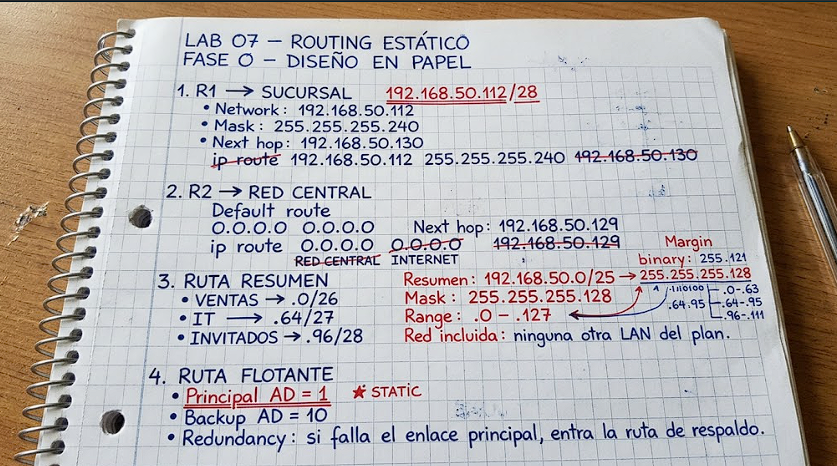

> **A prediction I got wrong:** I thought R2 would use the `/25` route for `192.168.50.120` because it was “more specific.” I had not considered that the connected `.112/28` route is even more specific. I understood this after looking at R2's routing table.

---

## 🗺 Topology

```text
   SALES / IT / GUESTS                              BRANCH
        SW1 · SW2 · PC1–PC5                        SW3 · PC6
              |                                       |
           [ R1 ] ==== primary /30 link ========> [ R2 ]
   Gi0/0 (trunk)  Gi0/1 (.129 / .130)    Gi0/1 (.113)
              \                                     /
               ==== backup /30 link ================
                  Gi0/2 (.133 / .134)   Gi0/2
```

There are two links between R1 and R2: the primary link and the backup link. In Packet Tracer, the backup appears as a second dashed line between the routers.

### Link addressing table

| Device | Interface | Role | IP / mask |
|---|---|---|---|
| R1 | Gi0/1 | Primary link to R2 | `192.168.50.129 /30` |
| R2 | Gi0/0 | Primary link to R1 | `192.168.50.130 /30` |
| R2 | Gi0/1 | Branch LAN | `192.168.50.113 /28` |
| R1 | Gi0/2 | Backup link to R2 | `192.168.50.133 /30` |
| R2 | Gi0/2 | Backup link to R1 | `192.168.50.134 /30` |

---

## 🛠 Step-by-step walkthrough

### Phase 1 · Starting state

I opened the previous lab's file and saved it as `07_Routing_Estatico.pkt` so I would not change the original.

At the start, R2 had only the default route:

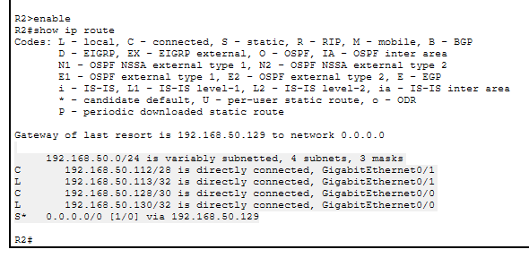

R1 already had the route to the branch that I added in the previous lab:

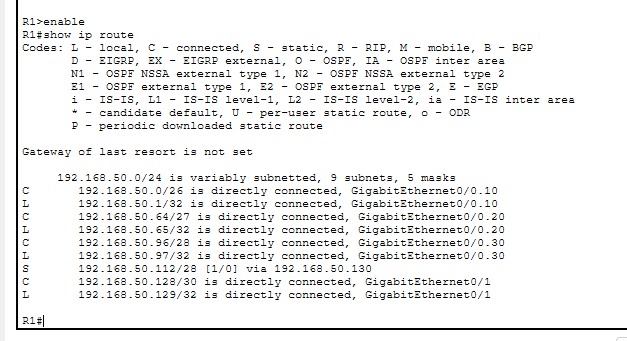

---

### Phase 2 · Next hop versus exit interface

This was the part I found hardest. At first, I did not understand why `0.0.0.0 0.0.0.0` meant “everything I don't know,” or what the neighbor's IP address was for. I understood it when I changed the route to use the exit interface:

```text
R2# conf t
R2(config)# no ip route 0.0.0.0 0.0.0.0 192.168.50.129
R2(config)# ip route 0.0.0.0 0.0.0.0 GigabitEthernet0/0
R2(config)# end
R2# show ip route
```

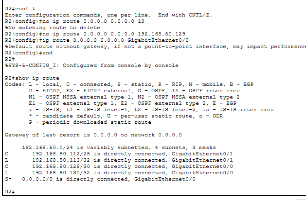

IOS displayed `%Default route without gateway, if not a point-to-point interface, may impact performance`. I understood it this way: on a point-to-point link with only two endpoints, the exit interface is enough. On a LAN with many devices, the router would have to use ARP to resolve each destination, which can put extra load on the segment.

Then I checked that the ping from PC6 to PC3 still worked:

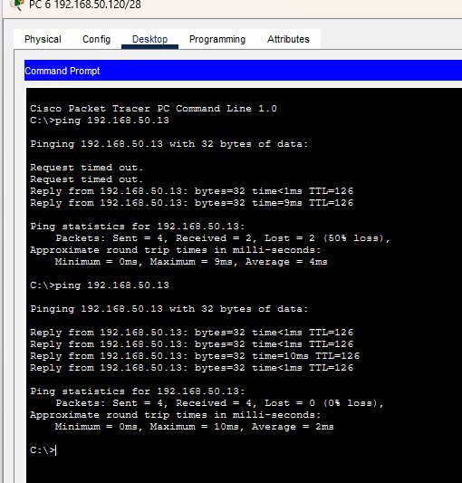

I restored the original configuration using next hop `.129`, because the rest of the lab depends on it.

> **A failed prediction:** I thought using the interface would make no difference. I only noticed the distinction after reading the IOS warning, so I recorded it here.

---

### Phase 3 · Summary route

I added a route on R2 covering `192.168.50.0/25`, alongside the default route:

```text
R2(config)# ip route 192.168.50.0 255.255.255.128 192.168.50.129
R2# show ip route
```

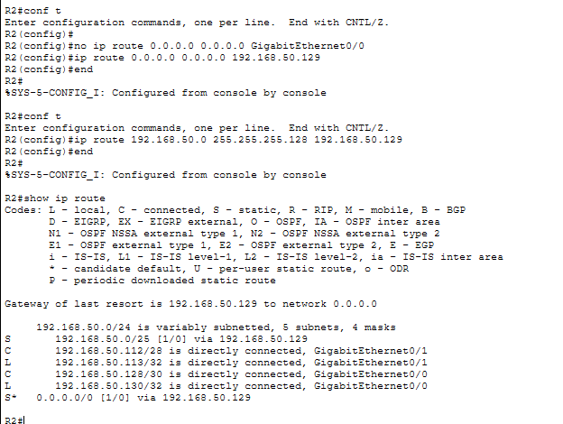

Pings from PC6 to PC3 and from PC1 to PC6 still worked:

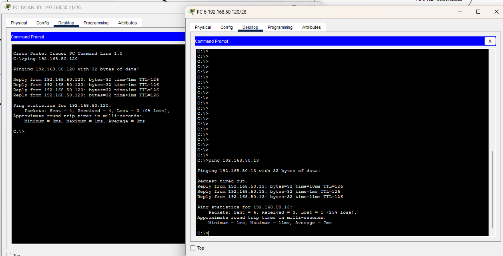

---

### Phase 4 · Default route as the only exit

I removed the summary route so R2 would use only its default route:

```text
R2(config)# no ip route 192.168.50.0 255.255.255.128 192.168.50.129
```

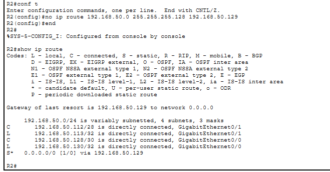

Then I pinged `10.10.10.10`, a network that is not part of the plan. The packet leaves PC6, R2 forwards it to R1 using the default route, and R1 does not know that network, so it replies with `Destination host unreachable`. The error came from R1, not R2, and helped me see the full path:

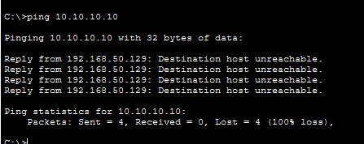

---

### Phase 5 · Backup link and floating route

#### Cabling and addressing

I connected R1 Gi0/2 to R2 Gi0/2 with a crossover cable and configured addresses `.133` and `.134`:

```text
R1(config)# interface gi0/2
R1(config-if)# ip address 192.168.50.133 255.255.255.252
R1(config-if)# no shutdown

R2(config)# interface gi0/2
R2(config-if)# ip address 192.168.50.134 255.255.255.252
R2(config-if)# no shutdown
```

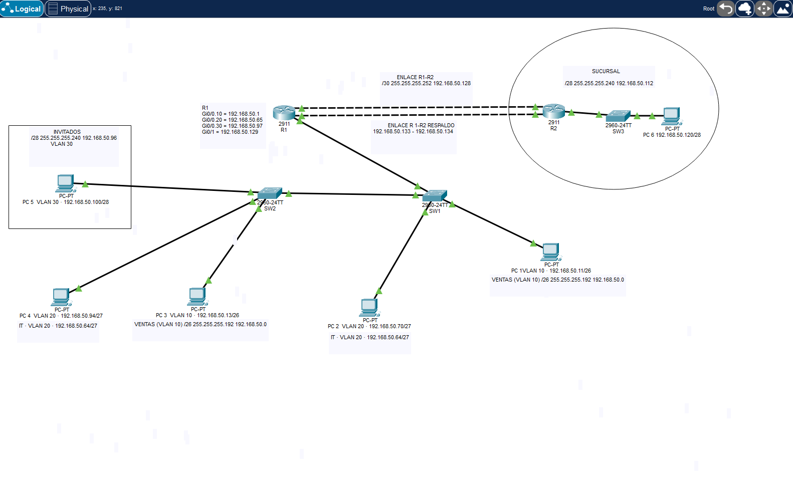

#### Floating routes

```text
R1(config)# ip route 192.168.50.112 255.255.255.240 192.168.50.134 200
R2(config)# ip route 0.0.0.0 0.0.0.0 192.168.50.133 200
```

`200` is the administrative distance (AD). Static routes have a default AD of 1, so the primary route wins. The AD 200 route stays configured but does not appear in the routing table; it is used only if the primary route disappears. This was the hardest part for me to understand, so I am writing it down to remember: **lower number, higher priority; higher number, backup**.

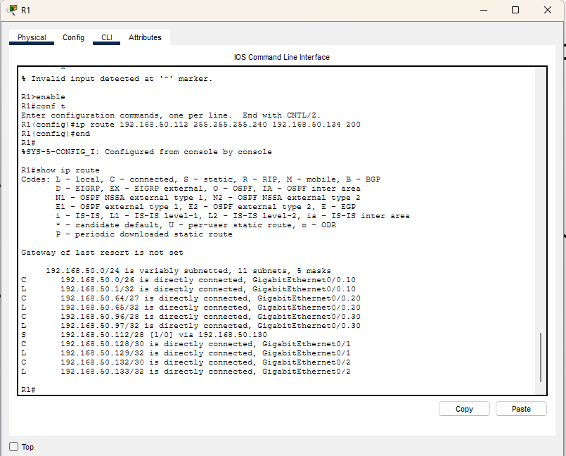

#### Failover

I shut down R1 Gi0/1 to simulate the primary link failing:

```text
R1(config)# interface gi0/1
R1(config-if)# shutdown
R1# show ip route
```

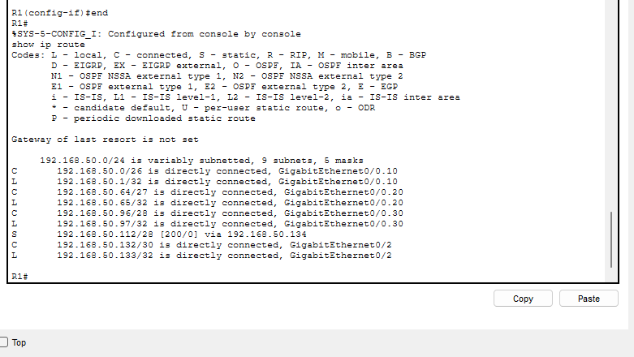

`show ip route` now shows `[200/0] via 192.168.50.134`. With `tracert` from PC1 to PC6, I verified that the intermediate hop changed from `.130` to `.134`:

```text
C:\>tracert 192.168.50.120
  1   192.168.50.1
  2   192.168.50.134
  3   192.168.50.120
```

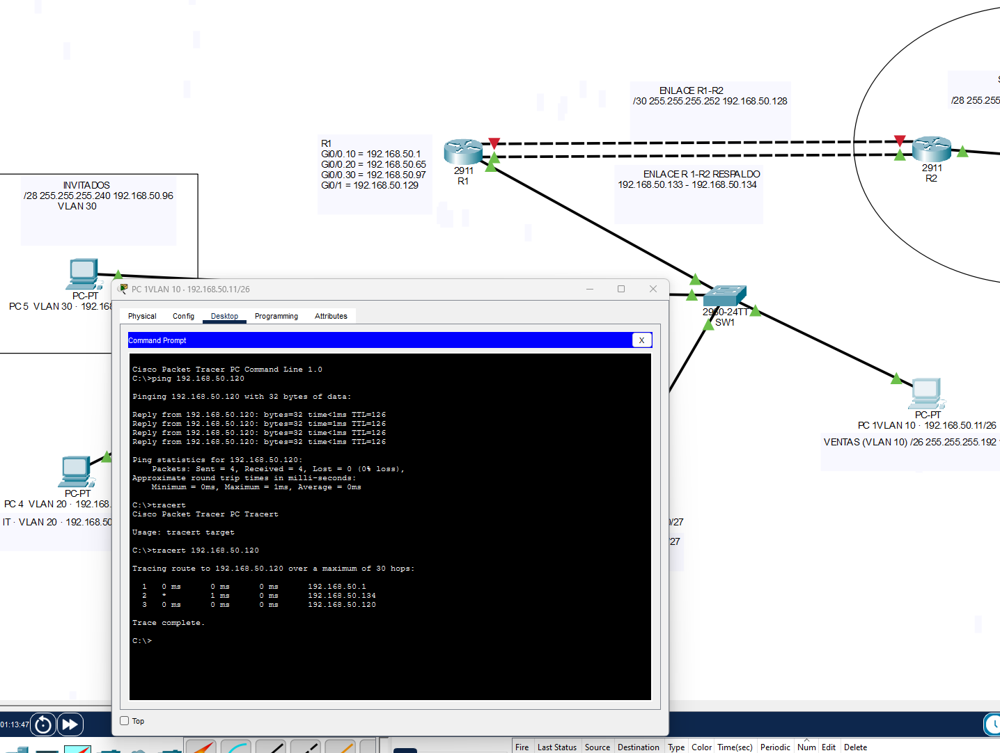

> **A typo unrelated to the route:** when checking with ping, I entered `192.168.20.120` instead of `192.168.50.120`. R1 returned `Destination host unreachable` because that network does not exist in my plan. I wasted time thinking failover was broken, even though `tracert` had already shown it was working.

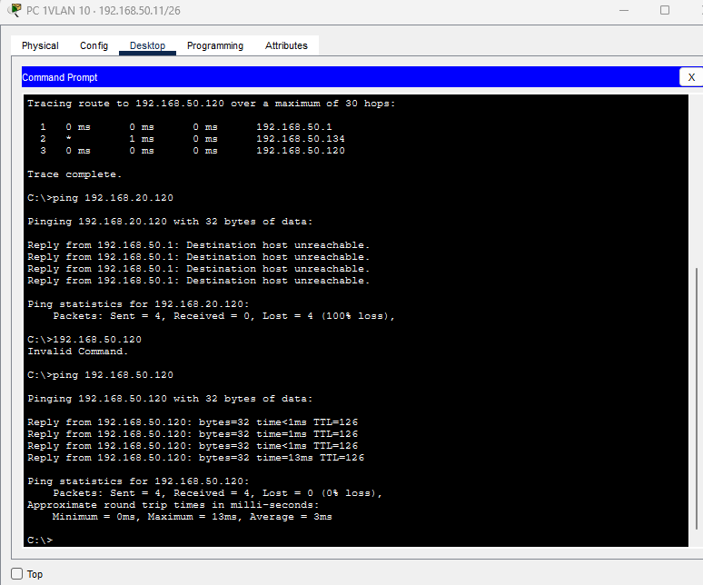

I then restored the primary link with `no shutdown` and checked that the route returned to AD 1:

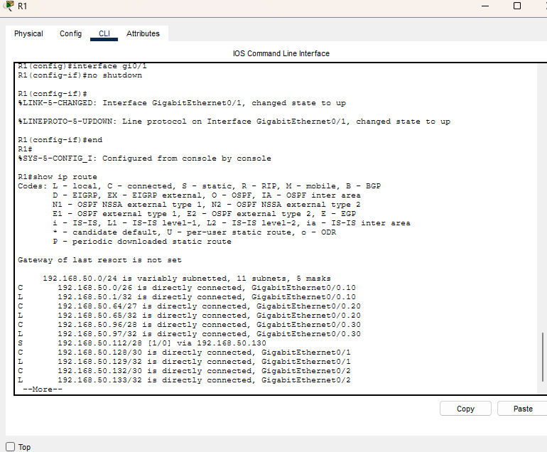

---

### Phase 6 · Troubleshooting (break and fix)

#### Fault 1 · `/24` mask in R1's route

I replaced R1's primary route with a `/24`:

```text
R1(config)# no ip route 192.168.50.112 255.255.255.240 192.168.50.130
R1(config)# ip route 192.168.50.0 255.255.255.0 192.168.50.130
R1# ping 192.168.50.200
```

> **Evidence missing:** `07-16-fallo-mascara-bucle.png` is not in the available evidence folder.

The result was `Time to live exceeded`. I know the `/24` route sends the packet to R2 and R2 sends it back to R1 using its default route, but **I did not fully understand why this creates a loop until the TTL reaches zero**. I am leaving this as a review topic below.

I fixed it by restoring the `/28` route.

#### Fault 2 · Unreachable next hop

I set the next hop to `192.168.50.99`, which is not in any connected network:

```text
R1(config)# ip route 192.168.50.112 255.255.255.240 192.168.50.99
R1# show ip route
R1# show running-config | include ip route
```

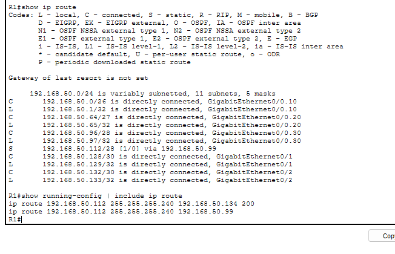

The route appeared in `show running-config`, but not in `show ip route`. The ping still worked because the backup route (AD 200) took over. I found this to be a dangerous kind of fault: the error is present, but it may go unnoticed until the primary link fails.

#### Fault 3 · Backup route with the same AD

I removed AD 200 from the backup route:

```text
R1(config)# no ip route 192.168.50.112 255.255.255.240 192.168.50.134 200
R1(config)# ip route 192.168.50.112 255.255.255.240 192.168.50.134
R1# show ip route
```

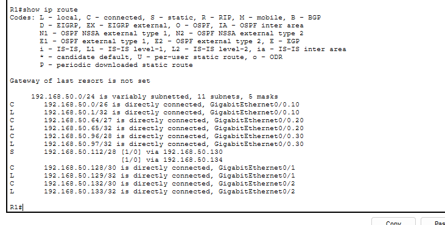

Now `show ip route` shows two active routes to the branch, one via `.130` and the other via `.134`, both with `[1/0]`. That is load balancing: traffic is distributed across both links. With AD 200, by contrast, the backup route does not appear in the table and is used only if the primary route fails. The difference is visible in `show ip route`.

---

### Saved final state

The final configuration keeps the primary route and floating route on R1. The topology ends with both links between R1 and R2 operational.

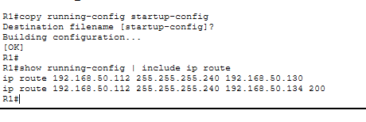

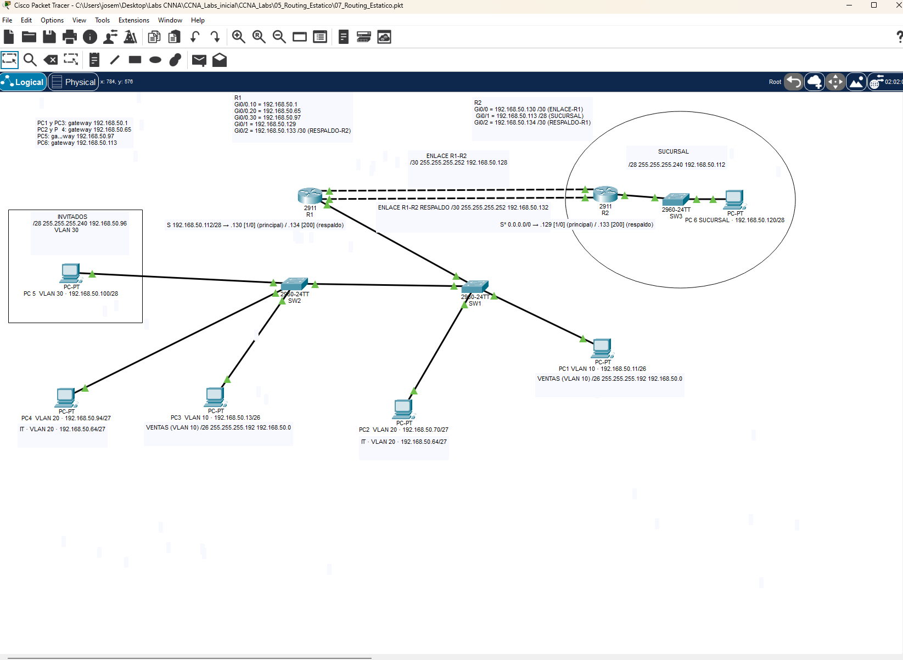

## ❌ Mistakes and difficulties (and what I learned)

| Mistake / issue | What happened | Cause and lesson |
|---|---|---|
| **Understanding the default route** | It took me about 30 minutes to understand why `0.0.0.0 0.0.0.0` means “everything I don't know.” | It is the route of last resort. Without it, R2 does not know what to do with destinations outside its LAN and link. |
| **Exit interface versus next hop** | I expected them to behave the same, but they did not. | On a point-to-point link, an exit interface works; on a LAN with many devices, it can create extra ARP traffic. The IOS warning helped me understand this. |
| **Mistyped route IP (`19`)** | I entered `ip route ... 19` instead of the full IP, and IOS replied `%No matching route to delete`. | Read the whole command before pressing Enter. `No matching route` means the route you are trying to remove does not exist. |
| **Not understanding `200`** | I did not know why the backup route used 200. | It is the administrative distance. Lower number means higher priority; the AD 200 route waits as a backup. |
| **Ping with a mistyped IP** | I entered `192.168.20.120` instead of `192.168.50.120` and got `Destination host unreachable`. | Before assuming the route is broken, check that the destination IP is correct. A typo can look like a configuration fault. |
| **Packet Tracer labels** | I had to correct several labels: the covered `/30`, PC6's incorrect IP, and misspelled gateways. | I still need practice organizing Packet Tracer. Before taking screenshots, I should check each label. |
| **Packet Tracer error messages** | I did not remember the exact message a command returned. | Copy the full message into the README instead of relying on memory. |

---

## ✅ What went well

- I wrote down the routing plan before using the CLI.
- I used `tracert` to verify failover instead of relying only on ping.
- I checked each change with `show ip route` and `show running-config | include ip route`.
- I identified the difference between load balancing and backup by looking at the routing table.

---

## 🧠 Key learnings

1. **The default route is the route of last resort:** `0.0.0.0 0.0.0.0` covers destinations the router does not otherwise know. That is why R2 needs it to reach R1.
2. **Next hop or exit interface:** the difference is how the router resolves the next step. On a `/30`, the interface is enough. On a LAN with multiple devices, specifying the next hop is safer.
3. **A summary route can include connected networks:** the `/25` includes the branch LAN, but the connected `/28` wins because it is more specific.
4. **Lower AD wins; higher AD waits:** the AD 200 floating route does not appear in `show ip route` until the primary route fails.
5. **Load balancing and backup look different:** with two routes at the same AD, both appear active. With different ADs, only the lower-AD route appears.
6. **A configured route is not necessarily an active route:** the `.99` next-hop fault appears in `show running-config`, but not in `show ip route`.
7. **`tracert` shows more than ping:** it shows the path traffic takes, while ping only tells me whether the destination responds.

---

## 📝 Topics to review

- **The loop in Fault 1 and `Time to live exceeded`:** I understand that the packet goes from R1 to R2 and back through R1's default route, but I have not fully understood how the loop continues until the TTL reaches zero. I will review this before moving on to OSPF.
- **The exact IOS message in Fault 2 and after the mistyped route command:** I did not copy it into the README. I will add it in the next session.
- **Packet Tracer fluency:** arranging labels still takes me too long.

---

## 📋 Quick command reference

| Goal | Device | Command |
|---|---|---|
| Route with next hop | Router | `ip route <network> <mask> <next-hop>` |
| Route with exit interface | Router | `ip route <network> <mask> <interface>` |
| Default route | Router | `ip route 0.0.0.0 0.0.0.0 <next-hop>` |
| Floating (backup) route | Router | `ip route <network> <mask> <next-hop> <AD>` |
| View routing table | Router | `show ip route` |
| View static routes only | Router | `show ip route static` |
| View configured routes | Router | `show running-config \| include ip route` |
| View traffic path | PC | `tracert <ip>` |
| Remove a route | Router | `no ip route <network> <mask> <next-hop>` |
| Save configuration | Any device | `copy running-config startup-config` |

---

## ➡️ Next step

With static routes and backup working, the natural next step is **OSPF**, so routers can learn networks automatically instead of requiring every route to be entered by hand. I left it pending in Lab 03, and it makes sense now that I have seen how much work it takes to maintain static routes across several links.

---

*José María Aparicio Portillo · [GitHub](https://github.com/anudoranador87) · [LinkedIn](https://linkedin.com/in/joseaparicio87)*
