# Lab 8: DHCP Server y DHCP Relay en Cisco IOS (CCNA · Packet Tracer)

> 🇬🇧 [Read in English](./README_EN.md) · [CCNA Packet Tracer lab index](../README.md)

Octavo bloque de mi portfolio de redes (CCNA). En los laboratorios anteriores diseñé el esquema de direccionamiento con VLSM ([Lab 06](../06-subnetting-vlsm/)) y configuré el enrutamiento estático inter-sitio con enlace de respaldo flotante ([Lab 07](../07-static-routing/)). Hasta ahora, todos los puestos de la topología tenían sus direcciones IP configuradas a mano. En este laboratorio doy el salto a la automatización del direccionamiento: configuro **R1 como servidor DHCP centralizado** para las VLANs locales y la sucursal remota, implemento **R2 como agente DHCP Relay (`ip helper-address`)**, mantengo direccionamiento estático por diseño en equipos clave y analizo el comportamiento de las solicitudes en escenarios de failover y contingencia.

Fue una sesión de **4 horas intensas**, con casi **2 horas dedicadas a un troubleshooting real y metódico** donde me enfrenté a problemas de capa física/enlace antes de arrancar, rechazo de sintaxis por limitaciones del simulador, asignaciones erróneas de subred que dejaron clientes en APIPA, bucles de simulación con tramas de control DTP y una errata crítica en la IP del agente relay.

| | |
|---|---|
| **Herramienta** | Cisco Packet Tracer |
| **Equipos** | 2 × Cisco 2911 (R1 servidor DHCP, R2 DHCP Relay), 3 × Catalyst 2960-24TT (SW1, SW2, SW3) y 6 PCs |
| **Tiempo de ejecución** | ~4 h (~2 h de configuración + ~2 h de troubleshooting real) |
| **Fecha** | 03/11/2026 |
| **Archivo Packet Tracer** | [`08_DHCP.pkt`](08_DHCP.pkt) |

---

## 🎯 Objetivo

- Diseñar y calcular las exclusiones DHCP en cada subred VLSM para proteger gateways, servidores y rangos de reserva.
- Configurar múltiples pools DHCP en Cisco IOS bajo un esquema Router-on-a-Stick (VLAN 10 VENTAS, VLAN 20 IT, VLAN 30 INVITADOS).
- Entender el mecanismo por el cual Cisco IOS selecciona automáticamente el pool adecuado basándose en la IP de la subinterfaz de entrada.
- Configurar un agente de retransmisión DHCP (**DHCP Relay**) en R2 mediante el comando `ip helper-address` para dar servicio a la sucursal remota (`192.168.50.112/28`).
- Comprender el papel del campo `giaddr` (*Gateway IP Address*) en el encabezado BOOTP/DHCP para que el servidor central asigne la subred correcta a través de un relay.
- Mantener y documentar la convivencia entre direccionamiento dinámico DHCP y direccionamiento estático fijado intencionadamente (PC4).
- Evaluar el comportamiento del servicio DHCP durante la caída del enlace WAN principal (failover a enlace flotante).
- Diagnosticar y resolver incidencias comunes: clientes estancados en APIPA (`169.254.x.x`), puertos desconectados, solapamiento de exclusiones y agotamiento de pools.

---

## 🧮 Fase 0 · El plan en papel

Siguiendo la regla aprendida en los laboratorios de VLSM y routing: **antes de abrir la CLI, todo debe estar calculado y verificado en papel**.

El diseño del direccionamiento requería definir para cada subred:
1. **Dirección de red y máscara VLSM**.
2. **Puerta de enlace (Gateway)**: primera IP útil de la subred (configurada en la subinterfaz de R1 o en la interfaz LAN de R2).
3. **Rangos excluidos (`ip dhcp excluded-address`)**: las 5 primeras direcciones útiles (reservadas para infraestructura, impresoras y administración) y la última dirección útil del segmento.
4. **Rango dinámico asignable**: direcciones libres para entrega a clientes por DHCP.

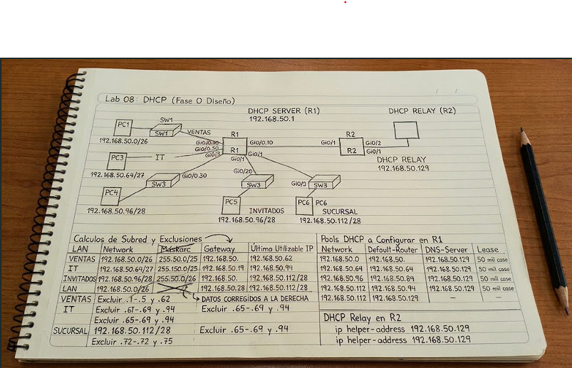

### Tabla de diseño de Pools y Exclusiones

| Subred / VLAN | Red y Máscara | Gateway | IPs Excluidas | Rango Asignable DHCP | Clientes objetivo |
|---|---|---|---|---|---|
| **VLAN 10 · VENTAS** | `192.168.50.0 /26` (`.192`) | `192.168.50.1` | `192.168.50.1` – `192.168.50.5`<br>`192.168.50.62` | `192.168.50.6` – `192.168.50.61` | PC1, PC3 |
| **VLAN 20 · IT** | `192.168.50.64 /27` (`.224`) | `192.168.50.65` | `192.168.50.65` – `192.168.50.69`<br>`192.168.50.94` | `192.168.50.70` – `192.168.50.93` | PC2 (DHCP)<br>PC4 (Estática `.71`) |
| **VLAN 30 · INVITADOS** | `192.168.50.96 /28` (`.240`) | `192.168.50.97` | `192.168.50.97` – `192.168.50.101`<br>`192.168.50.110` | `192.168.50.102` – `192.168.50.109` | PC5 |
| **SUCURSAL (Remota)** | `192.168.50.112 /28` (`.240`) | `192.168.50.113` | `192.168.50.113` – `192.168.50.117`<br>`192.168.50.126` | `192.168.50.118` – `192.168.50.125` | PC6 (vía Relay R2) |

> **Regla de oro de IOS:** Las exclusiones deben declararse **antes** o independientemente del bloque de configuración del pool. Se declaran en modo de configuración global (`config#`), nunca dentro de `dhcp-config#`.

---

## 🗺️ Topología

La topología parte exactamente del estado final del [Lab 07](../07-static-routing/), con enlace principal WAN (`192.168.50.128/30`) y enlace de respaldo flotante (`192.168.50.132/30` con Distancia Administrativa 200).

```text
    VENTAS (VLAN 10) / IT (VLAN 20) / INVITADOS (VLAN 30)                    SUCURSAL
                SW1 ========= trunk ========= SW2                            SW3
             (Fa0/1-3)                     (Fa0/1-2)                          |
                 |                                                            |
              [ R1 ] ============= Enlace Principal /30 =============> [ R2 ]
         SERVIDOR DHCP            Gi0/1 (.129) <---> Gi0/0 (.130)       DHCP RELAY
         Gi0/0 (802.1Q)                        |                        Gi0/1 (.113)
         .10 (.1) / .20 (.65) / .30 (.97)      |                             |
                 \                             /                             |
                  ==== Enlace de Respaldo =====                              |
                       Gi0/2 (.133) <---> Gi0/2 (.134) (AD 200)             PC6 (DHCP)
```

---

## 🛠️ Desarrollo paso a paso

### Fase 1 · Verificación previa e Incidente de enlace (Capa 1/2)

Antes de tocar una sola línea de DHCP, la premisa técnica era verificar que el enrutamiento base heredado del Lab 07 respondiera de extremo a extremo.

Al lanzar un ping desde PC1 (`192.168.50.6` manual) hacia PC6 en la sucursal (`192.168.50.120`), el resultado fue un **100% de pérdida**:

```text
C:\>ping 192.168.50.120
Pinging 192.168.50.120 with 32 bytes of data:
Request timed out.
Request timed out.
Request timed out.
Request timed out.

Ping statistics for 192.168.50.120:
    Packets: Sent = 4, Received = 0, Lost = 4 (100% loss)
```

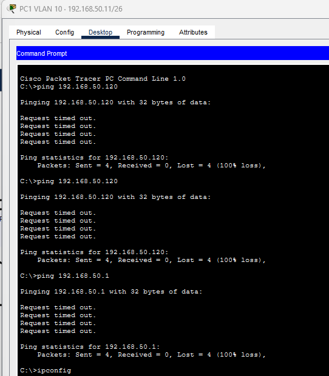

#### Diagnóstico metódico (de cerca a lejos):
1. **Comprobar gateway local**: `ping 192.168.50.1` falló. Si el equipo no llega a su propia puerta de enlace, el problema no está en la WAN ni en el routing estático, sino en la capa de acceso o en el enlace troncal.
2. **Inspección de SW1**: Ejecuté `show vlan brief` y `show interfaces status`.

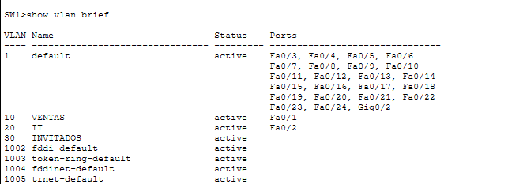

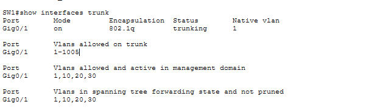

3. **Causa raíz física**: El puerto `Fa0/3` de SW1 (que interconecta con SW2) aparecía en estado `notconnect` debido a un cableado desconectado/erróneo en el esquema gráfico.

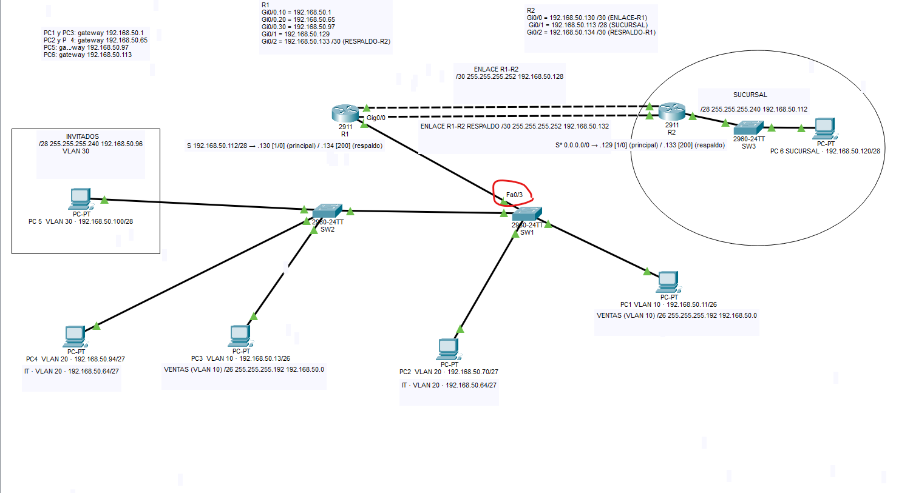

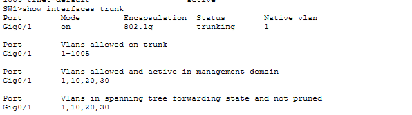

4. **Corrección**: Reconecté el enlace troncal entre SW1 y SW2, validando que ambos extremos negociaran modo trunk `802.1Q` activo:

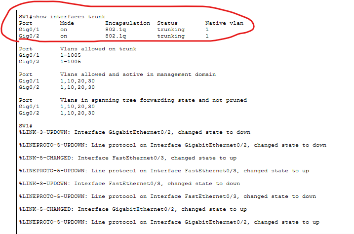

5. **Verificación**: El ping hacia PC6 respondió inmediatamente con **TTL = 126** (1 salto en R1, 1 salto en R2):

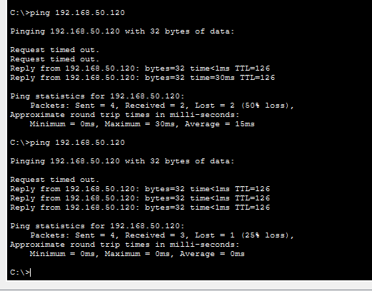
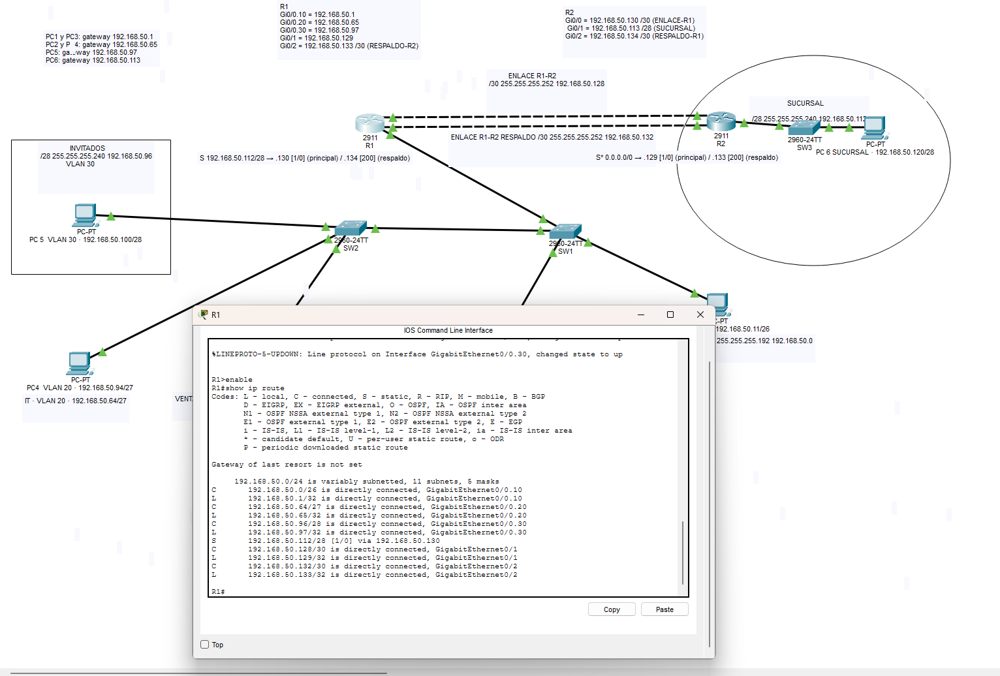
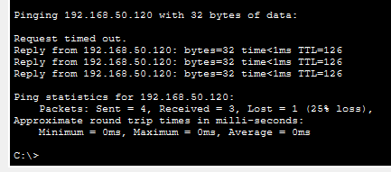

---

### Fase 2 · Servidor DHCP en R1 (VLAN 10 VENTAS)

Con la base de red sana, procedí a configurar el servicio en R1 para la VLAN 10.

#### 1. Exclusiones globales
```text
R1# configure terminal
R1(config)# ip dhcp excluded-address 192.168.50.1 192.168.50.5
R1(config)# ip dhcp excluded-address 192.168.50.62
```

#### 2. Configuración del Pool VENTAS y limitación de Packet Tracer
Al configurar los parámetros de red:
```text
R1(config)# ip dhcp pool VENTAS
R1(dhcp-config)# network 192.168.50.0 255.255.255.192
R1(dhcp-config)# default-router 192.168.50.1
R1(dhcp-config)# dns-server 8.8.8.8
```

> **Aviso de limitación en Packet Tracer:** Al intentar introducir `lease 0 2` (tiempo de concesión de 2 horas habitual en IOS real), el simulador devolvió un error de sintaxis:
> ```text
> R1(dhcp-config)# lease 0 2
>                         ^
> % Invalid input detected at '^' marker.
> ```
> Packet Tracer no implementa el comando `lease` dentro del intérprete DHCP de router. Se omite el comando y se mantiene el valor por defecto del sistema.

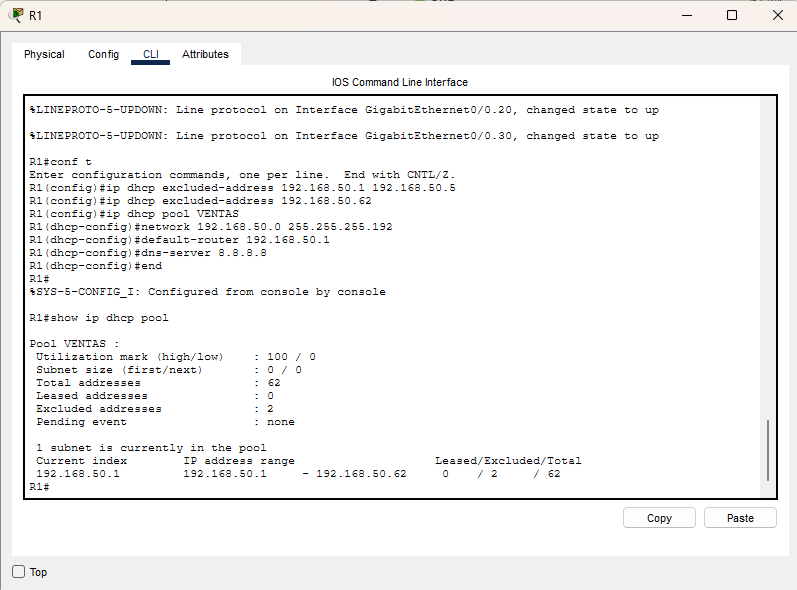

#### 3. Verificación en PC1
Cambié la interfaz de PC1 a modo DHCP. Inmediatamente completó el proceso DORA recibiendo la primera dirección libre tras las exclusiones: **`192.168.50.6`** con máscara `.192` y gateway `.1`.

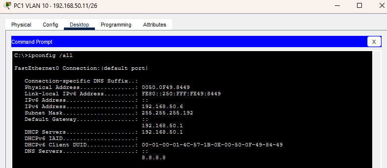

En R1, la tabla de concesiones registró la MAC de PC1 asociada a la IP dinámica:

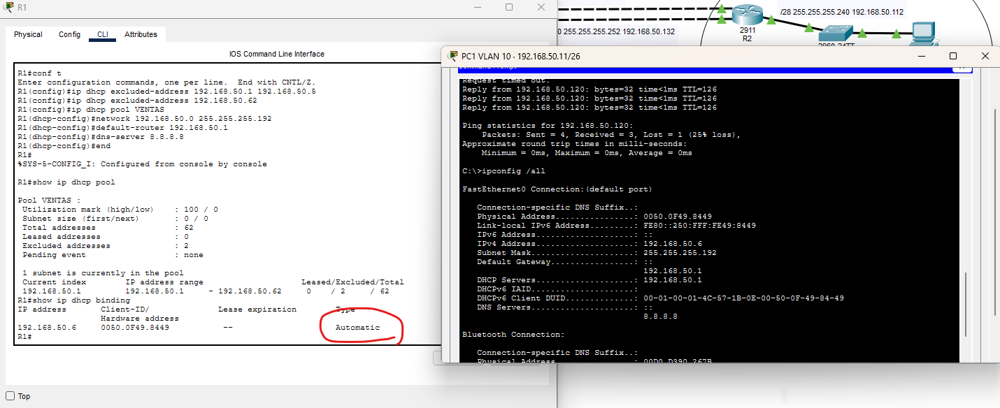

---

### Fase 3 · Pools de IT e INVITADOS y Troubleshooting de APIPA en PC2

A continuación configuré los pools correspondientes a las otras dos VLANs del Router-on-a-Stick.

#### 1. Exclusiones en R1
```text
R1(config)# ip dhcp excluded-address 192.168.50.65 192.168.50.69
R1(config)# ip dhcp excluded-address 192.168.50.94
R1(config)# ip dhcp excluded-address 192.168.50.97 192.168.50.101
R1(config)# ip dhcp excluded-address 192.168.50.110
```

#### 2. Incidente real: PC2 recibe dirección APIPA (`169.254.x.x`)
Al activar DHCP en todos los equipos:
- **PC3** (VLAN 10): recibió `192.168.50.7`.
- **PC5** (VLAN 30): recibió `192.168.50.102`.
- **PC2** (VLAN 20): **recibió `169.254.64.1` con máscara `255.255.0.0` (APIPA).**


#### Diagnóstico del fallo de PC2:
Si PC1, PC3 y PC5 recibían IP, el proceso DHCP general y los enlaces troncales estaban operativos. El fallo estaba acotado exclusivamente a la VLAN 20.

Ejecuté `show ip dhcp pool` en R1 para revisar las subredes de los pools activos:

```text
R1# show ip dhcp pool
Pool IT :
  Total addresses : 30
  Leased addresses : 0
  Excluded addresses : 6
  Current index IP address range Leased/Excluded/Total
  192.168.50.97    192.168.50.97 - 192.168.50.126    0 / 6 / 30
```


**Causa raíz técnica**: Al declarar el pool IT, cometí un error tipográfico en la subred configurando `network 192.168.50.96 255.255.255.224` (la red de Invitados) en lugar de `192.168.50.64 255.255.255.224`. 
Cuando el broadcast DHCP Discover de PC2 llegó por la subinterfaz `Gi0/0.20` (`192.168.50.65`), el router buscó un pool cuya red englobara a la IP `192.168.50.65`. Como ningún pool coincidía con esa dirección, **R1 descartó silenciosamente la solicitud** y PC2 terminó autoconfigurándose con APIPA.

#### Corrección aplicada:
```text
R1(config)# ip dhcp pool IT
R1(dhcp-config)# no network 192.168.50.96 255.255.255.224
R1(dhcp-config)# network 192.168.50.64 255.255.255.224
R1(dhcp-config)# default-router 192.168.50.65
R1(dhcp-config)# dns-server 8.8.8.8
R1(dhcp-config)# end
```

Tras forzar la renovación en PC2 (Static ➔ DHCP), el equipo recibió inmediatamente **`192.168.50.70`** (la primera IP libre tras la exclusión de `.65` a `.69`).

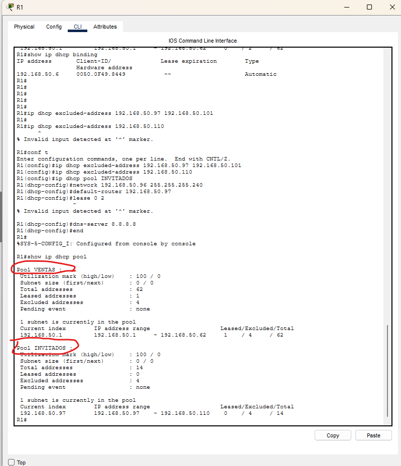
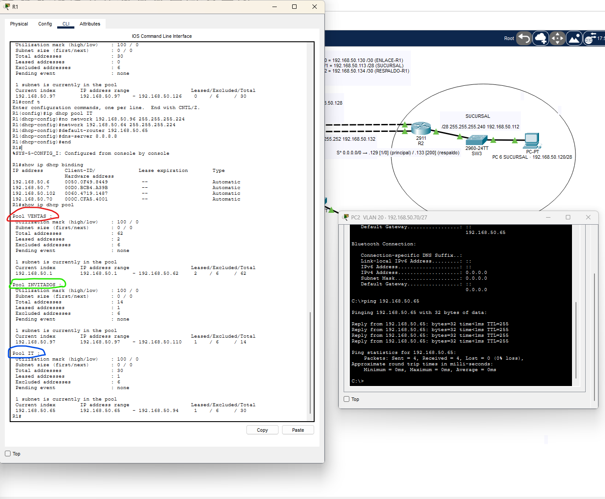
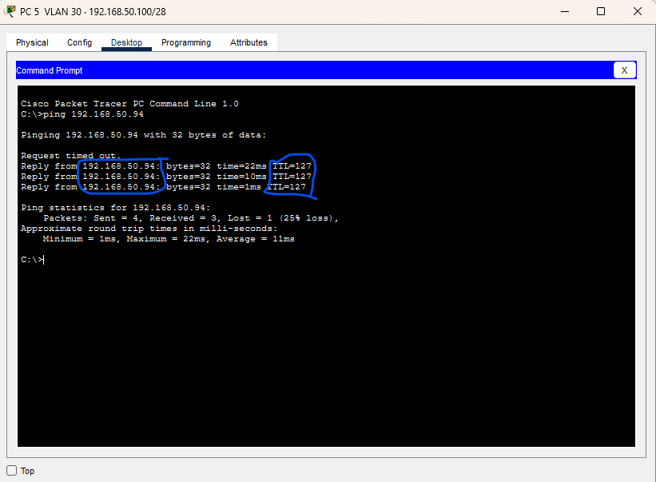

---

### Fase 4 · DHCP Relay en R2 y la errata de la guía técnica

Para que PC6 en la sucursal remota reciba direccionamiento de R1 sin tener un servidor DHCP local, R2 debe actuar como agente de retransmisión.

#### 1. Comprobación de PC6 sin Relay
Al pasar PC6 a DHCP antes de configurar el relay, la solicitud expiró con `DHCP request failed`, ya que los routers descartan los paquetes de broadcast (`255.255.255.255`) por defecto.

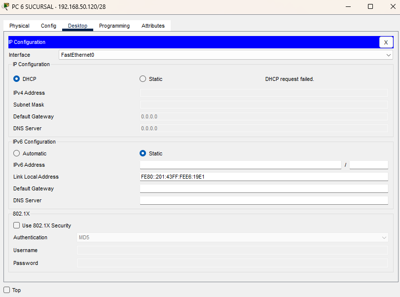

#### 2. Pool SUCURSAL y exclusiones en R1
```text
R1(config)# ip dhcp excluded-address 192.168.50.113 192.168.50.117
R1(config)# ip dhcp excluded-address 192.168.50.126
R1(config)# ip dhcp pool SUCURSAL
R1(dhcp-config)# network 192.168.50.112 255.255.255.240
R1(dhcp-config)# default-router 192.168.50.113
R1(dhcp-config)# dns-server 8.8.8.8
```

#### 3. Detección de la errata y configuración del Relay en R2
El borrador inicial de la guía indicaba configurar en R2:
```text
R2(config-if)# ip helper-address 192.168.50.1   <--- ¡ERRATA CRÍTICA!
```

> **Análisis del fallo**: `192.168.50.1` es la dirección de la subinterfaz `Gi0/0.10` (VLAN 10) en R1, al otro lado de la red local. Si R2 intenta reenviar el broadcast como unicast hacia esa IP, depende de un salto enrutado intermedio innecesario. 
> La dirección técnica correcta debe ser la IP del vecino en el enlace punto a punto directo: **`192.168.50.129`** (interfaz `Gi0/1` de R1).

Configuración aplicada y validada en R2:
```text
R2# configure terminal
R2(config)# interface GigabitEthernet0/1
R2(config-if)# ip helper-address 192.168.50.129
R2(config-if)# end
```

#### ¿Cómo sabe R1 qué pool entregarle a PC6 si la petición llega en unicast desde R2?
Cuando R2 recibe el broadcast en `Gi0/1` (`192.168.50.113`), lo encapsula en un paquete UDP unicast hacia `192.168.50.129:67` e inserta su propia IP de interfaz LAN en el campo **`giaddr`** (*Gateway IP Address* = `192.168.50.113`). 
Al recibirlo, R1 examina el campo `giaddr`, comprueba que coincide con el pool `SUCURSAL` (`192.168.50.112/28`) y extrae una concesión de ese rango.

PC6 recibió de inmediato **`192.168.50.118`** con gateway `192.168.50.113`:

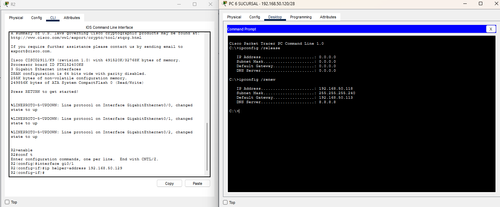
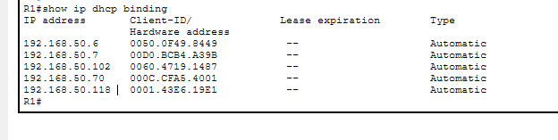
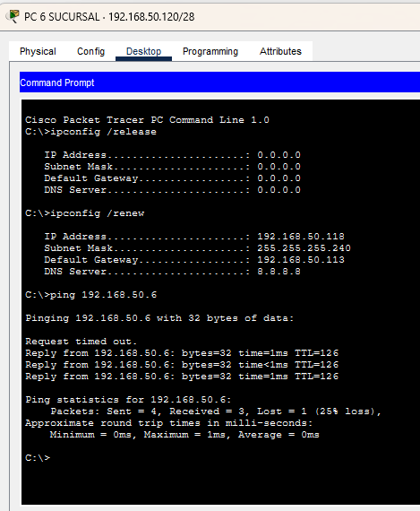

---

### Fase 5 · PC4: Direccionamiento estático y congelación de terminal en Packet Tracer

En la subred de IT, **PC4 se reservó intencionadamente con dirección estática `192.168.50.71`** (simulando un puesto de administración o servidor local que no debe cambiar de IP).

Durante la sesión se presentaron dos incidencias que nos llevaron casi una hora de depuración:
1. **La consola de Packet Tracer se congeló**: Al alternar varias veces entre DHCP y Static en la ventana del escritorio de PC4 mientras se producían peticiones fallidas, el proceso en segundo plano bloqueó la entrada de texto de la terminal negra (imposible escribir o ejecutar `cls`). Se solucionó cerrando la subventana con la "X", aplicando `Ctrl + C` o reiniciando la simulación.
2. **Diagnóstico con Simulation Mode e interferencia de DTP**: Pasamos a modo Simulación para rastrear el intercambio DORA paquete a paquete. La simulación parecía detenerse en SW1 porque el filtro capturaba tramas de control de capa 2 (**DTP - Dynamic Trunking Protocol**). Al editar los filtros para dejar **únicamente DHCP**, pudimos observar con claridad cómo el paquete `DHCP Discover` de PC4 (`0060.5C03.0C44`) llegaba a R1.


Tras comprobar con IP estática que el ping a `192.168.50.65` y a la sucursal (`192.168.50.118`) funcionaba con 0% de pérdidas, se fijó definitivamente la configuración estática de PC4:

```text
IPv4 Address:    192.168.50.71
Subnet Mask:     255.255.255.224
Default Gateway: 192.168.50.65
DNS Server:      8.8.8.8
```

---

### Fase 6 · Failover de DHCP y enlace de respaldo

Siguiendo el diseño de alta disponibilidad del Lab 07, pusimos a prueba la resiliencia del servicio apagando la interfaz principal `Gi0/1` de R1:

```text
R1(config)# interface gi0/1
R1(config-if)# shutdown
```

En la tabla de enrutamiento de R1, la ruta principal desaparece y entra la ruta flotante por el enlace de respaldo `Gi0/2` con Distancia Administrativa 200 (`via 192.168.50.134`):

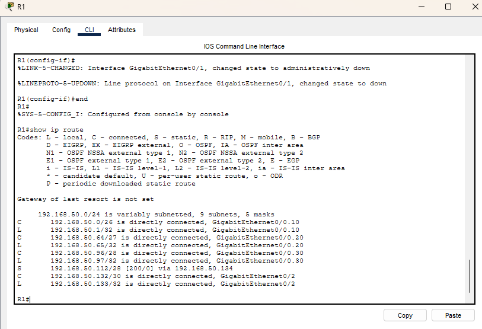

#### Impacto en el DHCP Relay:
Al forzar una renovación en PC6 (`ipconfig /renew`), el cliente falló y perdió su IP:

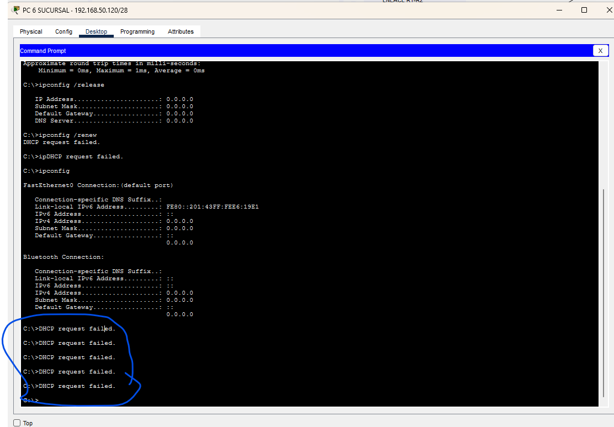

**Motivo técnico**: El comando `ip helper-address 192.168.50.129` en R2 apunta a la IP de la interfaz `Gi0/1` de R1, la cual se encuentra en estado `administratively down`. Aunque existe conectividad IP entre routers a través del respaldo (`.133`), los paquetes unicast dirigidos a `.129` se descartan. 

Para recuperar el servicio en contingencia, se actualiza temporalmente el helper hacia la IP de respaldo de R1 (`192.168.50.133`) o se restaura el enlace principal:

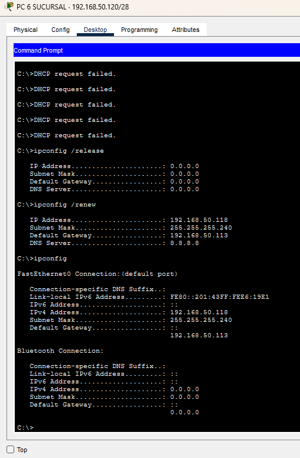

Tras aplicar `no shutdown` en R1 `Gi0/1`, la ruta de AD 1 volvió a la tabla de enrutamiento y la topología recuperó su estado nominal:

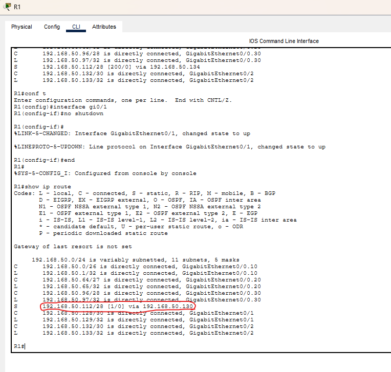

---

### Fase 7 · Troubleshooting provocado (Romper y reparar)

Para consolidar el diagnóstico de fallos según el guion de prácticas, provoqué y documenté dos escenarios típicos de soporte técnico:

#### 1. Puerta de enlace errónea en el pool (`default-router` incorrecto)
Configuré a propósito `default-router 192.168.50.10` en el pool VENTAS.
- **Síntoma**: PC1 obtuvo IP por DHCP (`192.168.50.6`), pero no podía comunicarse con el resto de VLANs ni con la sucursal.
- **Diagnóstico**: Al hacer `ipconfig`, la puerta de enlace mostraba una IP que no correspondía a la subinterfaz de R1.
- **Solución**: Corregido reconfigurando `default-router 192.168.50.1`.

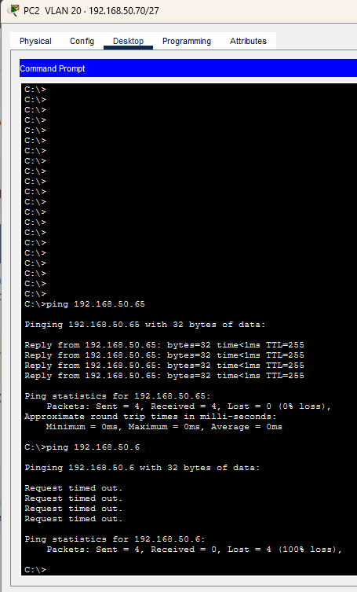
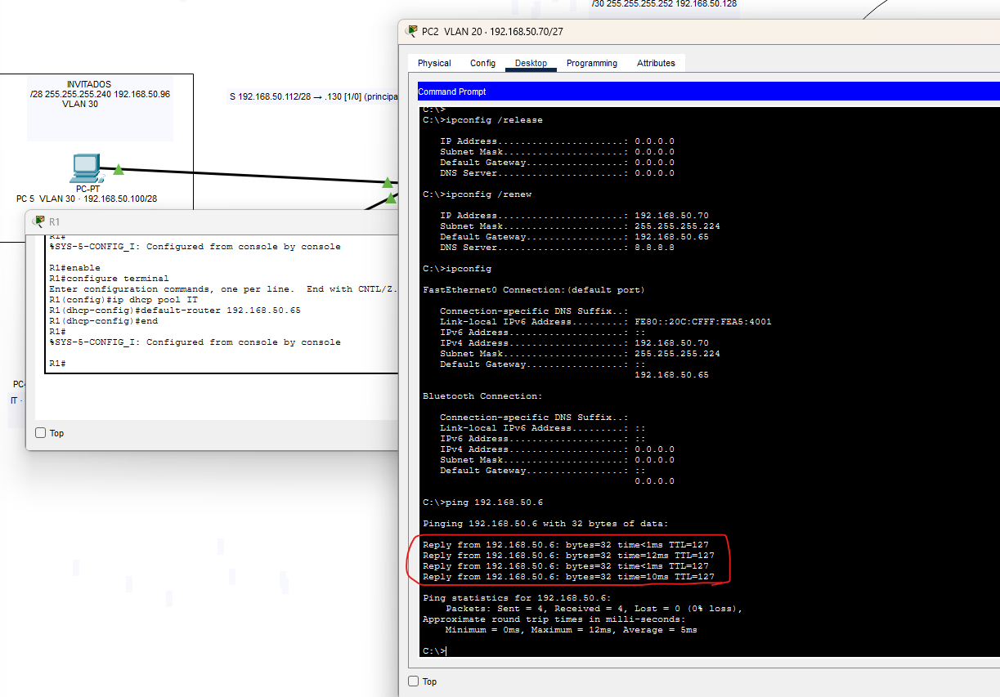

#### 2. Agotamiento de direcciones en el pool (Pool Exhaustion)
En una subred pequeña como SUCURSAL (`/28`, 14 IPs útiles), excluí casi todo el rango (`192.168.50.113` a `192.168.50.125`).
- **Síntoma**: Al conectar un nuevo puesto o renovar PC6, el cliente no recibió ninguna oferta (`DHCP request failed`).
- **Diagnóstico**: `show ip dhcp pool SUCURSAL` mostraba 0 direcciones disponibles en el rango.
- **Solución**: Eliminación de las exclusiones artificiales y ajuste a los límites reales.

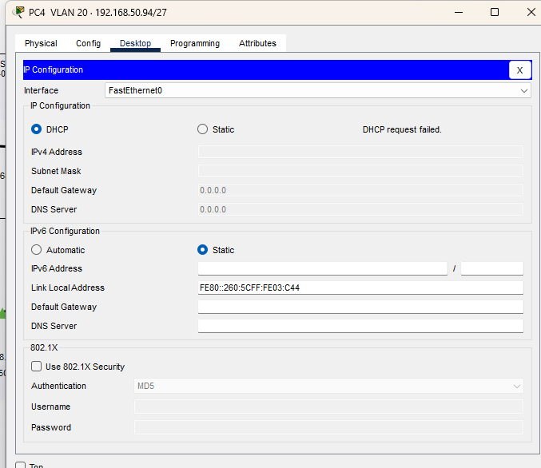
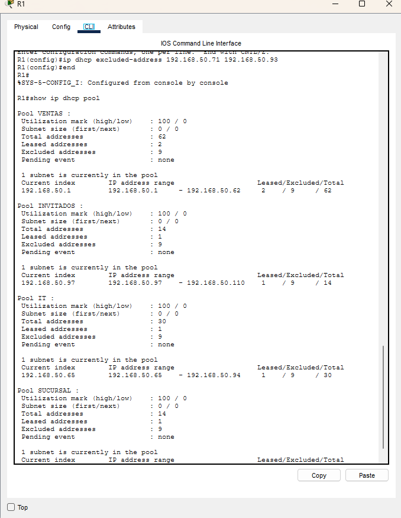
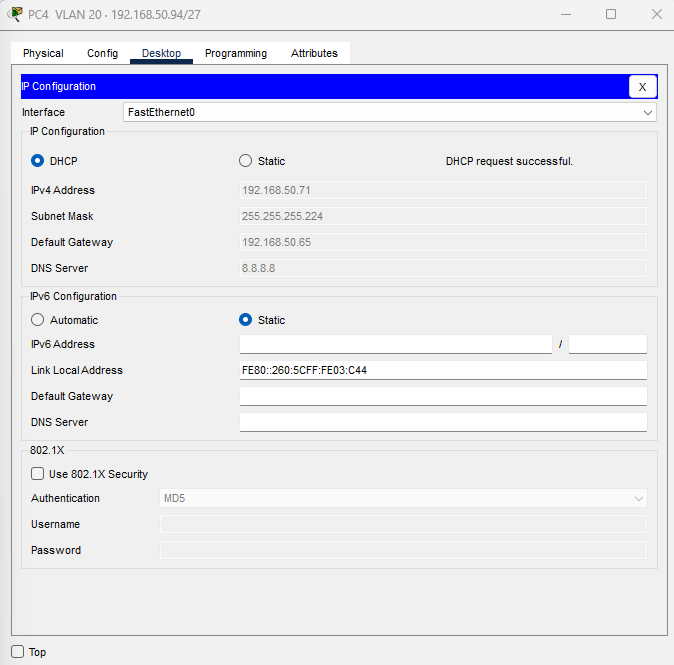

---

### Estado final guardado

Configuraciones activas finales comprobadas en ambos routers:
- **R1**: Los 4 pools DHCP activos con sus respectivas exclusiones y las rutas estáticas primaria y flotante.
- **R2**: Interfaz `Gi0/1` con `ip helper-address 192.168.50.129` y rutas estáticas por defecto.

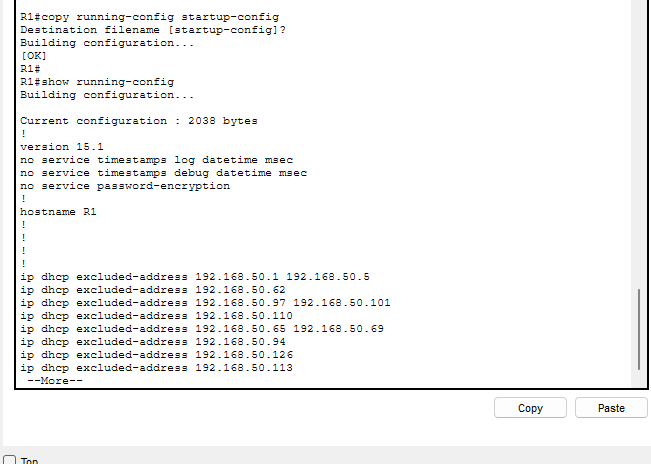
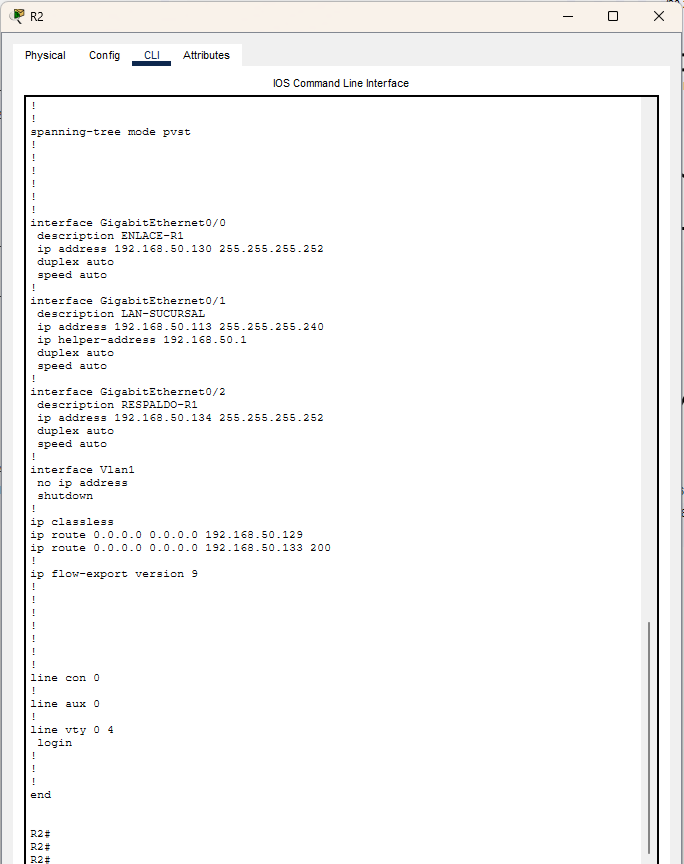

Topología final en Packet Tracer con todos los enlaces en verde, etiquetas de pools, roles de red (Servidor DHCP en R1, DHCP Relay en R2), clientes dinámicos y PC4 identificado como IP fija:

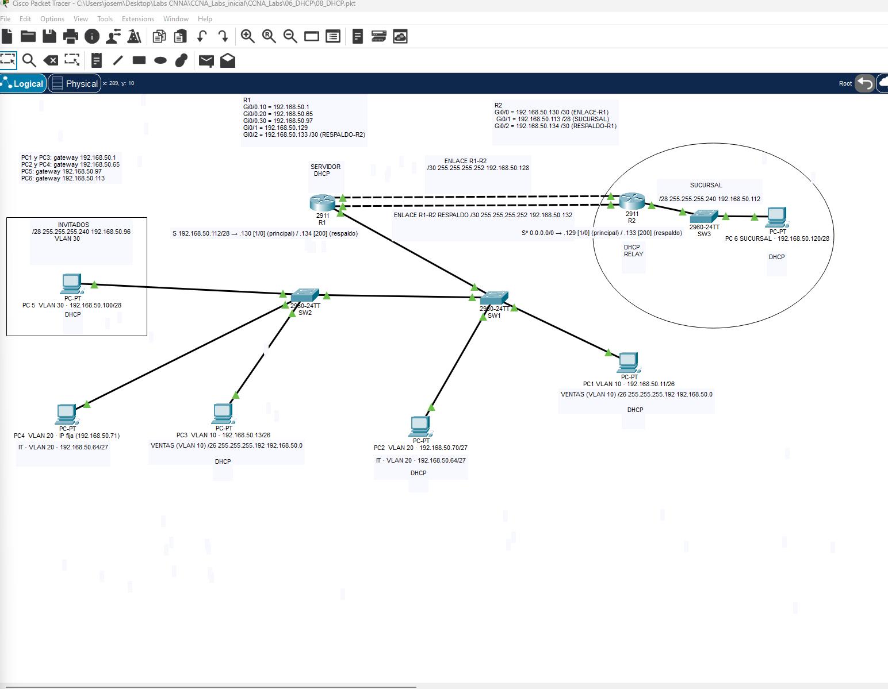

---

## ❌ Mis fallos y dificultades (y qué aprendí)

| Fallo / Incidencia | Qué pasó | Causa y qué aprendí |
|---|---|---|
| **Ping base a PC6 fallando (100% loss)** | Antes de tocar DHCP, el ping de PC1 a PC6 daba *Request timed out*. | El puerto `Fa0/3` de SW1 estaba desconectado/sin trunk. **Aprendizaje:** Jamás configures servicios de red (DHCP, DNS) sobre una infraestructura de capas 1-3 que no ha sido verificada previamente. |
| **Comando `lease` rechazado en CLI** | Al escribir `lease 0 2` en `R1(dhcp-config)#`, IOS devolvió error en el marcador `^`. | Packet Tracer tiene implementaciones recortadas de Cisco IOS y no soporta modificar el tiempo de lease en routers. **Aprendizaje:** Conocer las limitaciones del simulador evita perder tiempo depurando sintaxis que es válida en hardware real. |
| **Exclusiones escritas en el prompt incorrecto** | Tecleé `ip dhcp excluded-address` en modo privilegiado `R1#`. | El comando de exclusión pertenece a la configuración global (`config#`). En `R1#` IOS no lo reconoce. Hay que vigilar siempre el prompt antes de pegar comandos. |
| **PC2 atascado en APIPA (`169.254.x.x`)** | PC1, PC3 y PC5 recibían IP perfecta, pero PC2 se quedaba en APIPA sin obtener oferta DHCP. | Error tipográfico en el pool IT: configuré `network 192.168.50.96` (red de Invitados) en vez de `.64`. Al llegar la petición por `Gi0/0.20` (`.65`), R1 no encontró ningún pool coincidente y descartó la solicitud. **Aprendizaje:** El router mapea el pool comparando la IP de su interfaz de entrada con la red configurada en `network`. |
| **Errata en `ip helper-address` (`.1` vs `.129`)** | La guía proponía apuntar el relay de R2 a `192.168.50.1`. | `192.168.50.1` es la subinterfaz local de la VLAN 10 en R1. El helper debe apuntar a la IP del enlace punto a punto directo entre ambos routers (`192.168.50.129`). Entender el papel del campo `giaddr` aclaró por qué R1 sabe qué pool entregar sin importar a qué IP de R1 llegue el paquete. |
| **Congelación de terminal en PC4** | La consola de comandos de PC4 en Packet Tracer dejó de responder y no permitía escribir. | Múltiples solicitudes DHCP fallidas en segundo plano saturaron el hilo de la ventana virtual. Se desbloquea con `Ctrl + C`, cerrando y reabriendo la consola o reiniciando la simulación. |
| **Confusión con la PDU en Simulation Mode** | En modo simulación, el rastreo se detenía en SW1 con paquetes marcados como DTP. | El filtro de simulación tenía activos protocolos de capa 2. Hay que filtrar estrictamente por DHCP para aislar el proceso DORA sin ruido de tráfico de control. |
| **Solapamiento en exclusiones de SUCURSAL** | El pool SUCURSAL mostraba 8 direcciones excluidas en lugar de 6 y bloqueaba las primeras IPs útiles. | Se habían introducido rangos de exclusión redundantes que comían direcciones utilizables en una máscara `/28`. En subredes pequeñas, cada IP excluida cuenta. |
| **Erratas en etiquetas de topología** | La nota flotante de la topología decía `PC2 y P 4: gateway...`. | Detalle visual corregido antes de la entrega final a `PC2 y PC4`. La prolijidad en la documentación gráfica es clave en entornos de producción. |

---

## ✅ Mis aciertos

- **Frenar y verificar la infraestructura antes de configurar**: No di por supuesto que el enrutamiento del Lab 07 estaba intacto; descubrí el cable desconectado en SW1 en el minuto 5 de la práctica.
- **Uso metódico de `show ip dhcp pool` y `show ip dhcp binding`**: Cuando PC2 falló, no me puse a borrar configuraciones al azar. Consulté las tablas, comparé los rangos esperados frente a los reales y localicé el error de red en el pool IT.
- **Comprensión profunda de DHCP Relay**: No me limité a copiar el comando de la guía; detecté la errata de la IP `.1` y entendí cómo el campo `giaddr` permite que un router central sirva subredes remotas.
- **Aislamiento en Simulation Mode**: Utilicé la inspección de paquetes PDU para confirmar que el `DHCP Discover` de PC4 salía con origen `0.0.0.0:68` y destino `255.255.255.255:67`.
- **Comprobación de contingencia (Failover)**: Apagué el enlace principal y documenté qué sucede con las peticiones de relay cuando el siguiente salto no responde.

---

## 🧠 Aprendizajes clave

1. **Cómo asocia IOS una interfaz con un pool**: Cisco IOS no necesita que le digas en qué interfaz activar el DHCP. Cuando recibe un broadcast en una interfaz/subinterfaz (o un unicast con `giaddr`), busca en su memoria un pool cuya directiva `network` y máscara contenga a esa IP. Si coincide, entrega la concesión; si no, la descarta.
2. **El secreto del DHCP Relay (`giaddr`)**: Los routers no reenvían broadcasts. El comando `ip helper-address` convierte el broadcast del cliente en un unicast UDP hacia el servidor DHCP y sella en la cabecera la IP de su interfaz de recepción (`giaddr`). Así el servidor sabe exactamente a qué subred pertenece el cliente remoto.
3. **Coexistencia de DHCP y direccionamiento estático**: En redes corporativas, los servidores, gateways e impresoras deben quedar protegidos con `ip dhcp excluded-address` o configurados estáticamente (como PC4 en la VLAN 20) para evitar colisiones de IP.
4. **Impacto de las limitaciones del simulador**: Packet Tracer es excelente para CCNA, pero tiene diferencias con hardware real (rechazo de `lease`, saturación de consolas en bucles DHCP). Aprender a diagnosticar el simulador forma parte de la habilidad práctica.

---

## 📝 Pendientes de repaso

- **Captura completa de los 4 pasos DORA**: Aunque vi el `Discover` y el `Offer`, me queda pendiente capturar en una única secuencia limpia los 4 paquetes (`Discover`, `Offer`, `Request`, `ACK`) en modo simulación para guardarla como chuleta visual.
- **DHCP Snooping**: Investigar cómo se protege una red de conmutación contra servidores DHCP falsos (*rogue DHCP*) en switches Catalyst, un tema clave de seguridad en CCNA.
- **Failover redundante de Relay**: Investigar si se pueden configurar dos comandos `ip helper-address` simultáneos en la misma interfaz (uno apuntando a la IP principal y otro a la de respaldo) para evitar cortes de DHCP durante contingencias WAN.

---

## 📋 Comandos de referencia rápida

| Objetivo | Dispositivo | Modo CLI | Comando |
|---|---|---|---|
| Excluir rango de IPs | Router | `config#` | `ip dhcp excluded-address <ip-ini> <ip-fin>` |
| Excluir IP individual | Router | `config#` | `ip dhcp excluded-address <ip>` |
| Crear/acceder al pool | Router | `config#` | `ip dhcp pool <NOMBRE>` |
| Definir red y máscara | Router | `dhcp-config#` | `network <red> <máscara>` |
| Definir gateway por defecto | Router | `dhcp-config#` | `default-router <ip-gw>` |
| Definir servidor DNS | Router | `dhcp-config#` | `dns-server <ip-dns>` |
| Configurar DHCP Relay | Router | `config-if#` | `ip helper-address <ip-servidor-dhcp>` |
| Ver estado y rangos de pools | Router | `#` | `show ip dhcp pool` |
| Ver concesiones activas y MACs | Router | `#` | `show ip dhcp binding` |
| Ver conflictos de IP detectados | Router | `#` | `show ip dhcp conflict` |
| Renovar IP en cliente | PC | `C:\>` | `ipconfig /renew` |
| Liberar IP en cliente | PC | `C:\>` | `ipconfig /release` |

---

## ➡️ Siguiente paso

Con el direccionamiento dinámico y el relay plenamente operativos, la red cuenta con una base sólida de capa 2 y capa 3. El siguiente paso natural en mi hoja de ruta es **implementar enrutamiento dinámico mediante OSPF (Open Shortest Path First)** para sustituir las rutas estáticas manuales y el enlace flotante por convergencia automática ante fallos de topología.

---

*José María Aparicio Portillo · [GitHub](https://github.com/anudoranador87) · [LinkedIn](https://linkedin.com/in/joseaparicio87)*
