# Lab 9: IPv6 en doble pila (SLAAC, DHCPv6 y failover)

[Índice de los labs de Packet Tracer](../README.md)

> **Estado: sesión 1 de 2.** Ya configuré IPv6 y probé varias formas de asignar direcciones. Me quedan algunos fallos por provocar y las capturas de cierre.

En el [Lab 08](../08-dhcp/) dejé funcionando IPv4 con DHCP, relay y rutas estáticas. En este lab añadí IPv6 a la misma red, sin quitar IPv4. Así pude probar las dos versiones a la vez.

Quería entender cómo consigue un PC su dirección IPv6 y qué diferencia hay entre SLAAC, DHCPv6 sin estado y DHCPv6 con estado. También practiqué cómo buscar la causa de un fallo paso a paso. Esa parte me llevó más tiempo del que esperaba.

| | |
|---|---|
| **Herramienta** | Cisco Packet Tracer |
| **Equipos** | 2 routers Cisco 2911, 3 switches Catalyst 2960-24TT y 6 PCs |
| **Tiempo** | `[COMPLETAR]` |
| **Fecha** | 10/11/2026 (sesión 1) |
| **Archivo** | [`09_IPv6.pkt`](./09_IPv6.pkt), creado a partir de `08_DHCP.pkt` |

---

## Qué quería practicar

- Preparar un plan de direccionamiento IPv6 con prefijos `/64`.
- Activar IPv6 en los routers y configurar direcciones globales y link-local.
- Revisar cómo se forma una dirección EUI-64 usando la MAC de un PC.
- Crear rutas IPv6 con una ruta flotante de respaldo (AD 200).
- Probar SLAAC y DHCPv6 con las banderas M y O.
- Practicar troubleshooting leyendo los mensajes de IOS y comprobando la red por partes.

---

## Fase 0 · El plan de direcciones

Antes de abrir la CLI preparé el plan en papel. Cada LAN y cada enlace entre routers tiene su propio prefijo `/64`.

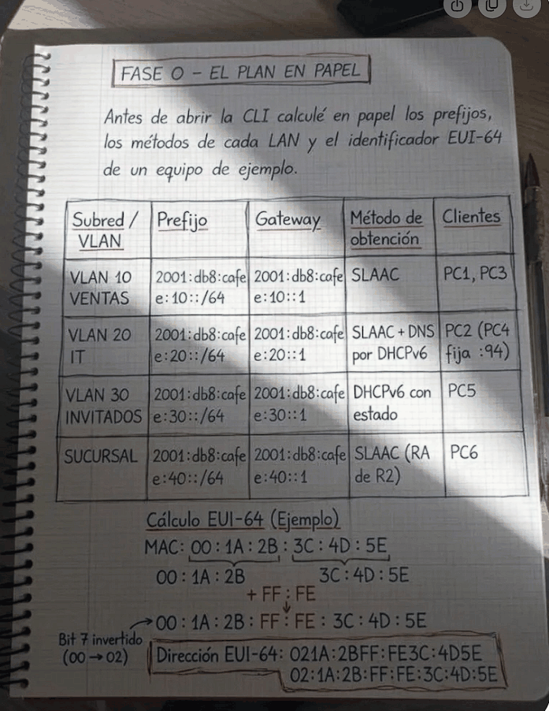

| Red / VLAN | Prefijo | Gateway | Cómo recibe IPv6 | Equipos |
|---|---|---|---|---|
| VENTAS (VLAN 10) | `2001:db8:cafe:10::/64` | `::1` | SLAAC | PC1, PC3 |
| IT (VLAN 20) | `2001:db8:cafe:20::/64` | `::1` | SLAAC y DNS por DHCPv6 | PC2; PC4 usa `::94` fija |
| INVITADOS (VLAN 30) | `2001:db8:cafe:30::/64` | `::1` | DHCPv6 con estado | PC5 |
| SUCURSAL | `2001:db8:cafe:40::/64` | `::1` | SLAAC, con anuncios de R2 | PC6 |
| Enlace principal | `2001:db8:cafe:ff01::/64` | R1 `::1`, R2 `::2` | Fija | — |
| Enlace de respaldo | `2001:db8:cafe:ff02::/64` | R1 `::1`, R2 `::2` | Fija | — |

Me quedó claro que en este lab no tenía que calcular subredes IPv6 de distintos tamaños como hice con VLSM en IPv4: usamos `/64` en cada segmento. Tampoco configuré exclusiones como en DHCPv4. Si necesito reservar una dirección en DHCPv6, puedo hacerlo asociándola al cliente.

También comprobé cómo se forma EUI-64: se parte la MAC, se inserta `FF:FE` en medio y se invierte el bit 7 del primer byte. Por ejemplo, `00:1A:2B:3C:4D:5E` da `021A:2BFF:FE3C:4D5E`.

En PC1 comprobé el cálculo con la dirección real. Al quitar `FF:FE` de `2001:DB8:CAFE:10:250:FFF:FE49:8449` y deshacer el cambio del primer byte, obtuve la MAC `0050.0F49.8449`, que coincide con la dirección física del PC.

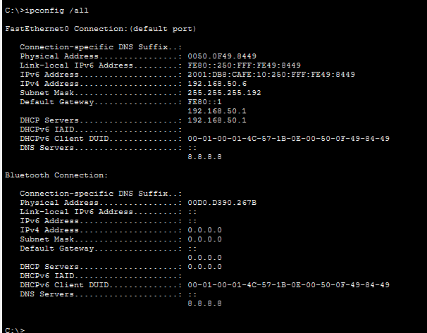

---

## La topología y la comprobación inicial

La topología es la misma que en el Lab 08. Las VLAN de VENTAS, IT e INVITADOS llegan a R1 mediante un trunk. La sucursal está conectada a R2. Entre R1 y R2 hay un enlace principal y otro de respaldo.

Antes de empezar revisé que los enlaces estuvieran activos y comprobé IPv4. El primer ping de PC1 a PC6 falló porque usé la dirección antigua `192.168.50.120`. PC6 ya había recibido `192.168.50.118` por DHCP. Al probar con esa dirección, el ping respondió: el problema era el destino que había escrito, no las rutas. Dejé el detalle en [las notas de diagnóstico](./img/diagnostico/diag-00-LEEME.md) y el [registro de pings](./img/diagnostico/diag-01-ping-log.txt).

---

## Fase 1 · Activar IPv6 y configurar las rutas

Primero confirmé que IPv4 seguía funcionando. Después activé el enrutamiento IPv6 en R1 y configuré la subinterfaz de VENTAS:

```text
ipv6 unicast-routing
interface gi0/0.10
 ipv6 address 2001:db8:cafe:10::1/64
 ipv6 address FE80::1 link-local
```

Fijé la dirección link-local `FE80::1` para reconocer fácilmente el gateway en las pruebas.

Al copiar la configuración me equivoqué de subinterfaz: puse el prefijo de la VLAN 30 en `gi0/0.20`. IOS aceptó el comando, pero al intentar configurar `gi0/0.30` avisó de que las redes se solapaban. Quité la dirección de la interfaz equivocada con `no ipv6 address` y la configuré en la subinterfaz correcta.

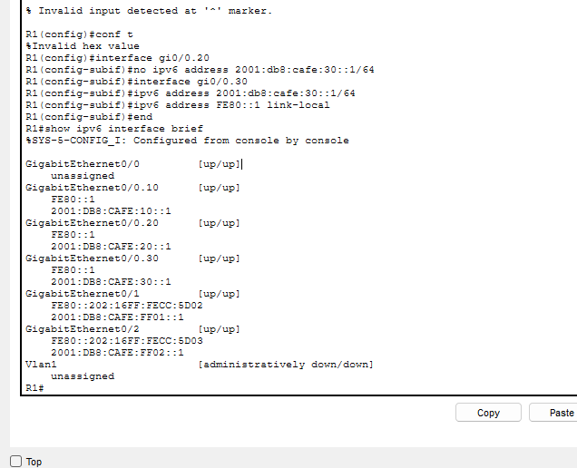

También pegué alguna vez el prompt junto con los comandos, por ejemplo `R1(config)#`. Eso produjo errores de sintaxis. Me quedo con la costumbre de copiar solo los comandos y revisar en qué interfaz estoy antes de pegarlos.

Luego configuré la ruta a la sucursal y una ruta flotante con distancia administrativa 200:

```text
ipv6 route 2001:db8:cafe:40::/64 2001:db8:cafe:ff01::2
ipv6 route 2001:db8:cafe:40::/64 2001:db8:cafe:ff02::2 200
```

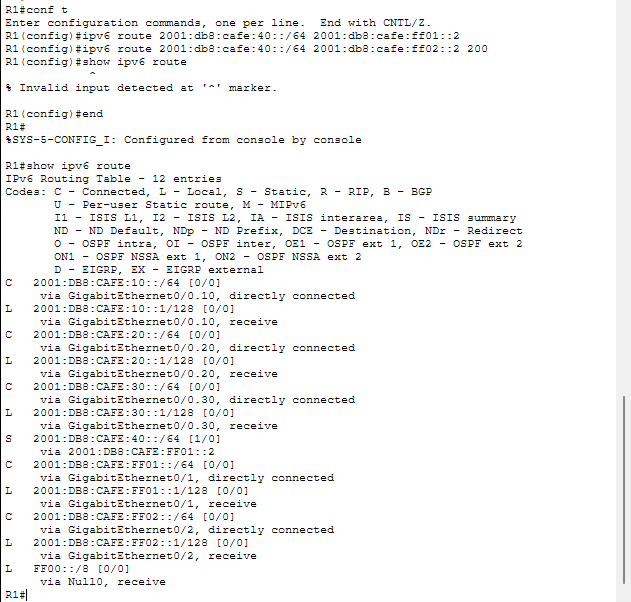

Mientras el enlace principal está activo, en la tabla aparece la ruta con AD 1. La ruta de respaldo no aparece hasta que hace falta. También aprendí que `show ipv6 route` no funciona dentro del modo de configuración: primero hay que salir con `end`.

---

## Fase 2 · SLAAC en VENTAS y SUCURSAL

Puse PC1, PC3 y PC6 en **Automatic**. Los routers anunciaron el prefijo y los PCs crearon sus direcciones con SLAAC.

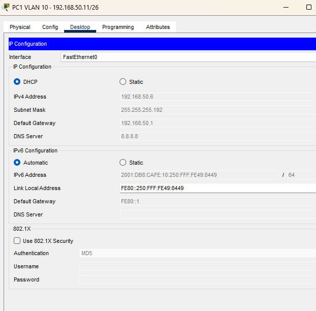

PC1 recibió `2001:DB8:CAFE:10:250:FFF:FE49:8449` y usó `FE80::1` como gateway. PC6 también recibió su dirección automáticamente; en su caso el gateway es la dirección link-local automática de R2.

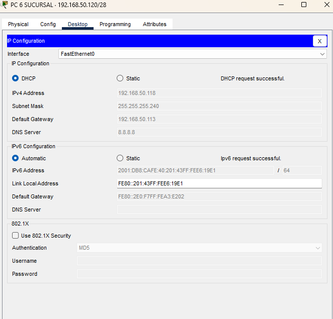

Al principio `show ipv6 neighbors` no mostraba vecinos. Después de hacer pings, aparecieron PC1, PC3 y R2. PC6 no aparece en la tabla de R1 porque está detrás de R2; R1 solo muestra a sus vecinos directos.

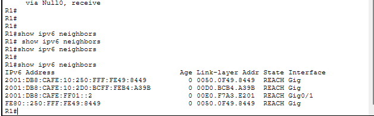

Los pings a PC3 y PC6 respondieron. El ping a PC3, que está en la misma VLAN, mostró TTL 128. El de PC6 mostró TTL 126, tras pasar por dos routers.

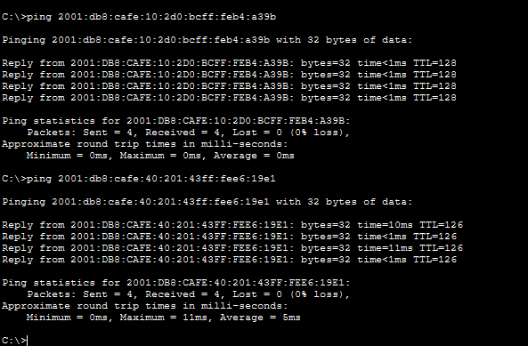

---

## Fase 3 · DHCPv6 sin estado en IT

En IT quería que los PCs obtuvieran su dirección por SLAAC y el DNS por DHCPv6. Para ello configuré un pool con DNS y activé la bandera O en la interfaz:

```text
ipv6 dhcp pool IT-DNS
 dns-server 2001:4860:4860::8888
 domain-name lab.local
interface gi0/0.20
 ipv6 dhcp server IT-DNS
 ipv6 nd other-config-flag
```

PC2 obtuvo la dirección `2001:DB8:CAFE:20:20C:CFFF:FEA5:4001` por SLAAC y recibió el DNS `2001:4860:4860::8888` por DHCPv6.

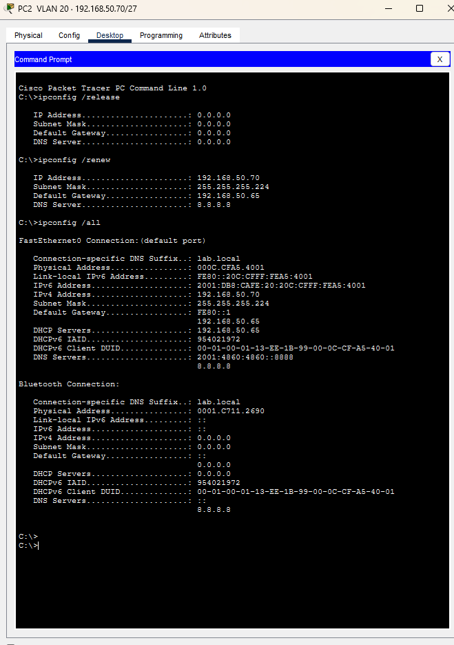

El pool no mostró concesiones de direcciones, que es lo esperado en este modo: DHCPv6 solo entrega información adicional, como el DNS. Antes pensaba que DHCPv6 siempre asignaba la dirección. En esta parte aprendí la diferencia entre las banderas: **O** pide otros datos, mientras que **M** pide la dirección por DHCPv6.

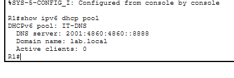

---

## Fase 4 · DHCPv6 con estado en INVITADOS

En la VLAN de INVITADOS sí quería que DHCPv6 entregara la dirección. Configuré el prefijo en el pool y activé la bandera M:

```text
ipv6 dhcp pool INVITADOS
 address prefix 2001:db8:cafe:30::/64
 dns-server 2001:4860:4860::8888
interface gi0/0.30
 ipv6 dhcp server INVITADOS
 ipv6 nd managed-config-flag
```

PC5 recibió una dirección del pool y R1 registró la concesión. El servidor identifica al cliente mediante su DUID, que también aparece en `ipconfig /all` del PC.

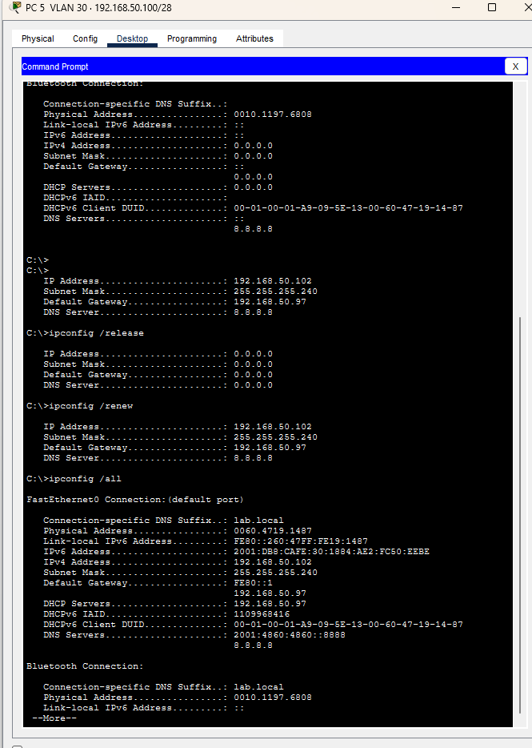

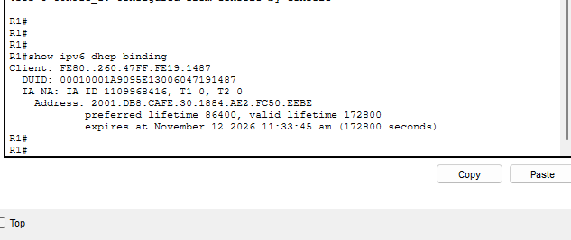

---

## Fase 5 · Probar el enlace de respaldo

Apagué `Gi0/1` de R1 para comprobar si se activaba la ruta IPv6 de respaldo. En la tabla apareció la ruta con AD 200 a través de `2001:DB8:CAFE:FF02::2`.

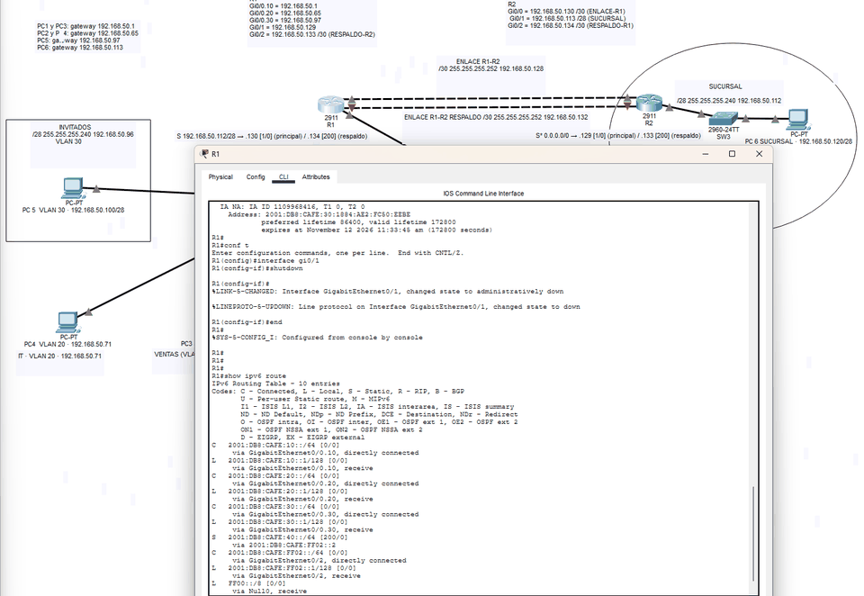

Con el enlace principal apagado, PC6 renovó su IPv4 y recibió `192.168.50.118`. Me sorprendió porque el relay de R2 apunta a `192.168.50.129`, la dirección del enlace principal. En la captura, el servidor DHCP figura como `192.168.50.133`, la dirección de R1 en el enlace de respaldo.

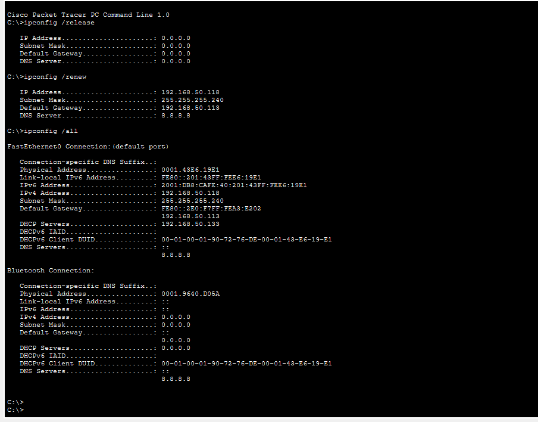

El ping IPv6 de PC6 a PC1 también respondió. El TTL fue 126, igual que antes.

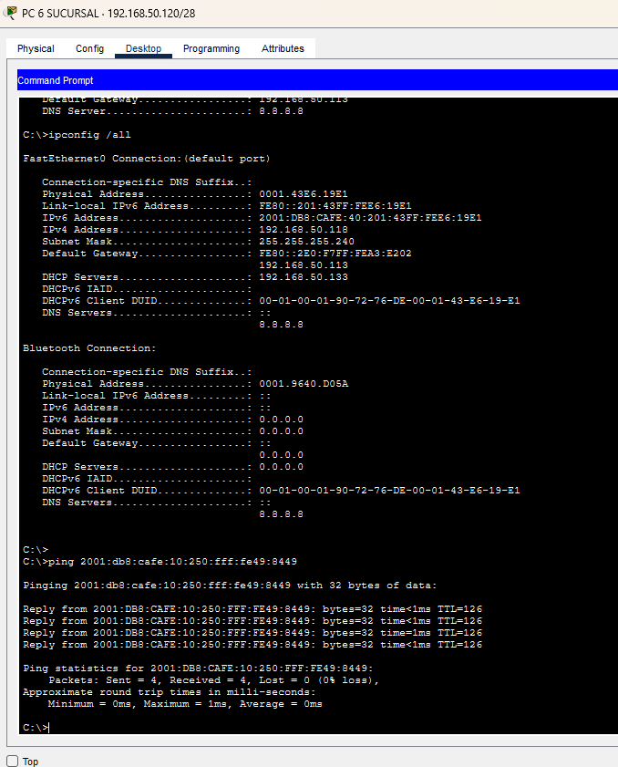

Yo esperaba ver TTL 125 porque pensaba que el camino de respaldo añadía un salto. Me equivoqué: ambos caminos pasan por dos routers, así que el TTL es el mismo. Para saber qué enlace tomó el paquete, tengo pendiente comprobarlo con `tracert`.

Al volver a activar el enlace principal, R1 volvió a usar su ruta con AD 1.

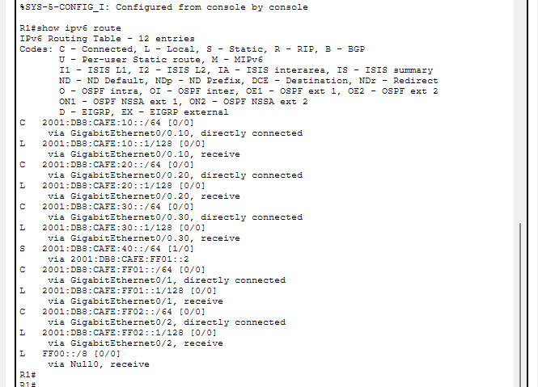

---

## Fase 6 · Fallos que probé y que me faltan

### Fallo 1 · R1 deja de enviar anuncios IPv6 (completado)

Quité `ipv6 unicast-routing` en R1. Sin los anuncios del router, PC1 perdió su dirección global y el gateway IPv6. Al principio `ipconfig /release` y `ipconfig /renew` no quitaban la dirección SLAAC; tuve que cambiar IPv6 a Static y después otra vez a Automatic en Packet Tracer.

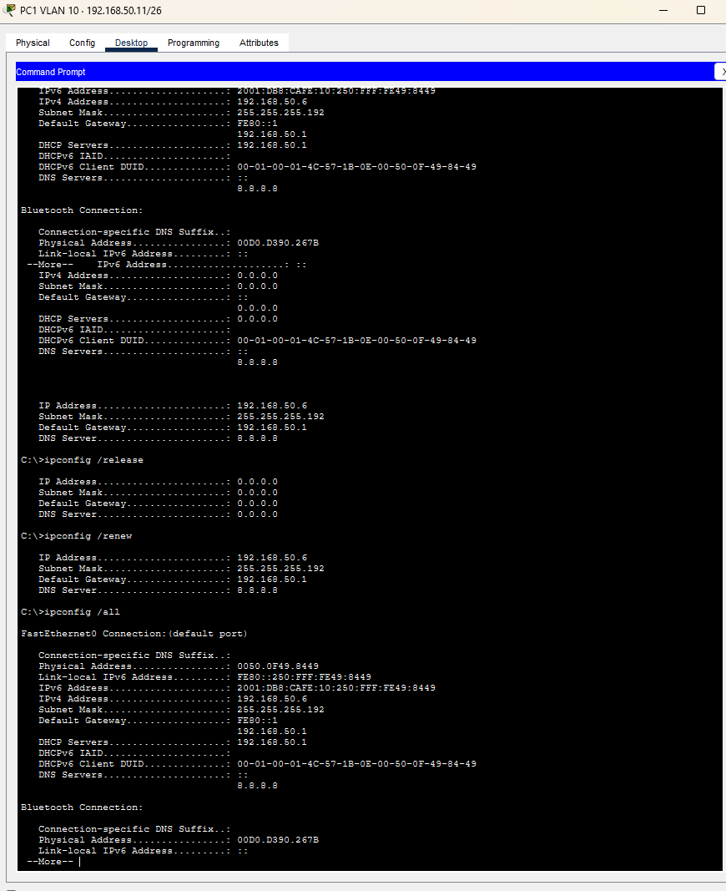

Después PC1 solo tenía la dirección link-local y el ping IPv6 a PC6 fallaba. El ping IPv4 a la misma máquina sí respondía, así que pude ver que el problema estaba en IPv6.

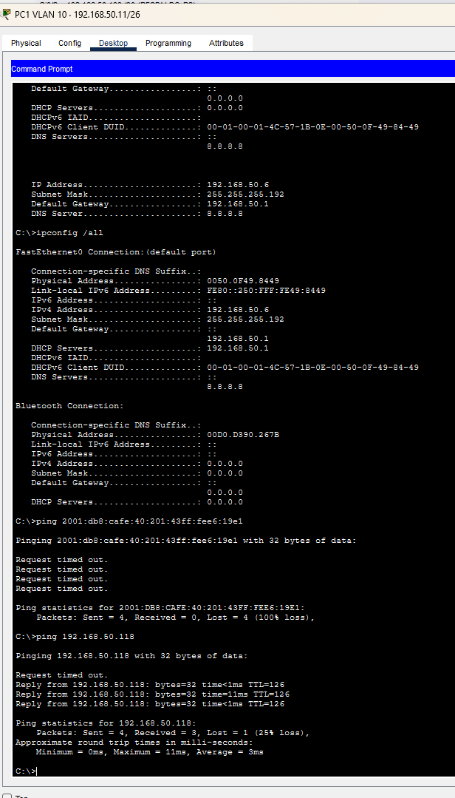

Volví a activar `ipv6 unicast-routing` y puse IPv6 en Automatic. PC1 recuperó su dirección y volvió a hacer ping a PC6.

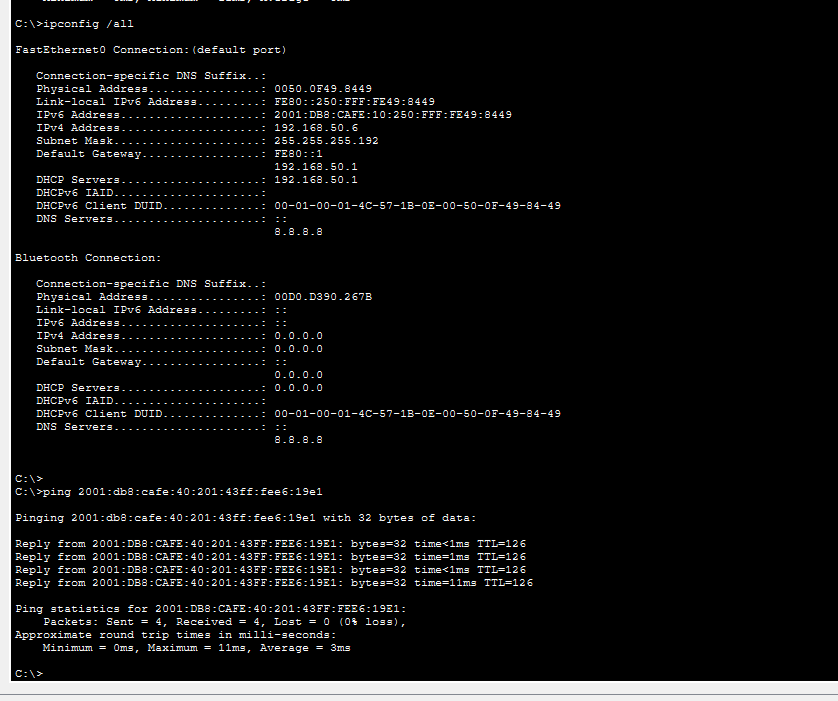

### Fallo 2 · Bandera M activada, pero sin servidor (pendiente)

Quiero quitar `ipv6 dhcp server INVITADOS` de `gi0/0.30` y comprobar qué ocurre con PC5 cuando el anuncio sigue indicando que debe pedir la dirección por DHCPv6.

### Fallo 3 · PC5 en la VLAN equivocada (pendiente)

Quiero mover el puerto de PC5 a VLAN 20 y comprobar si recibe el prefijo de IT (`2001:db8:cafe:20::/64`).

---

## Errores que cometí

| Qué pasó | Qué aprendí |
|---|---|
| Puse el prefijo de VLAN 30 en `gi0/0.20`. IOS avisó del solapamiento al configurar `gi0/0.30`. | Revisar el nombre de la interfaz antes de pegar cada dirección. |
| Copié prompts como `R1(config)#` junto con los comandos y obtuve errores de sintaxis. | Copiar solo los comandos, sin el prompt. |
| Ejecuté `show ipv6 route` desde el modo de configuración. | Usar `end` antes de ejecutar comandos `show`. |
| Pensé que el failover tendría TTL 125. | El TTL cuenta routers, no indica qué enlace se usó. Para ver el camino necesito `tracert`. |
| Borré sin querer la dirección global de PC4 al editar su configuración. | Revisar las direcciones del PC antes de probar el ping. El mensaje `Reply from FE80::1` venía del router. |
| Sugerí fijar `FE80::94` en PC4, pero no hacía falta. | La link-local automática del PC también funciona. |
| Dejé a PC4 con IPv4 `.71`, dentro del pool DHCP de IT, aunque debía usar `.94`. | Comprobar que una IP fija no esté dentro del rango que DHCP puede entregar. |
| Probé PC6 en `192.168.50.120`, aunque DHCP le había dado `.118`. | Mirar `ipconfig` antes de usar una IP que anoté en una guía. |
| `release` y `renew` no quitaron la dirección SLAAC de PC1. | En Packet Tracer tuve que cambiar IPv6 de Static a Automatic para repetir la prueba de SLAAC. |

---

## Lo que me llevo de este lab

- SLAAC necesita que el router envíe anuncios (RA). Sin ellos, el PC conserva su dirección link-local, pero no obtiene el prefijo global.
- La bandera **O** indica que DHCPv6 puede entregar otros datos, como DNS. La bandera **M** indica que el PC debe obtener la dirección mediante DHCPv6.
- En DHCPv6 con estado, R1 registra el cliente usando su DUID.
- Un TTL igual no demuestra que se haya usado el mismo enlace. Para ver el camino, hay que usar `tracert`.
- Cuando algo falla, me ayuda probar primero el gateway y luego avanzar hacia el destino. También conviene comprobar IPv4 como referencia mientras diagnostico IPv6.

---

## Pendiente para la próxima sesión

- Probar los fallos 2 y 3 y guardar las capturas 20–23.
- Guardar la configuración de R1 con `copy running-config startup-config` y capturar los `running-config` de R1 y R2.
- Hacer la captura final de la topología con los prefijos y el método de cada PC.
- Confirmar que la IPv4 fija `.94` de PC4 está excluida del pool de IT con `show ip dhcp pool`.
- Con el enlace principal apagado, ejecutar desde PC6 `tracert 2001:db8:cafe:10:250:fff:fe49:8449` y comprobar el salto por `2001:DB8:CAFE:FF02::1`.
- Generar tráfico desde PC5 y revisar si aparece en `show ipv6 neighbors` de R1.

---

## Comandos que usé

| Para | Modo | Comando |
|---|---|---|
| Activar el enrutamiento IPv6 | `config#` | `ipv6 unicast-routing` |
| Poner una dirección IPv6 | `config-if#` | `ipv6 address <prefijo/64>` |
| Fijar una link-local | `config-if#` | `ipv6 address FE80::1 link-local` |
| Crear una ruta IPv6 | `config#` | `ipv6 route <red/longitud> <siguiente-salto> [AD]` |
| Crear un pool DHCPv6 | `config#` | `ipv6 dhcp pool <NOMBRE>` |
| Añadir un prefijo al pool | `config-dhcpv6#` | `address prefix <prefijo/64>` |
| Añadir DNS al pool | `config-dhcpv6#` | `dns-server <ip>` |
| Asociar el pool a una interfaz | `config-if#` | `ipv6 dhcp server <NOMBRE>` |
| Activar la bandera O | `config-if#` | `ipv6 nd other-config-flag` |
| Activar la bandera M | `config-if#` | `ipv6 nd managed-config-flag` |
| Ver interfaces IPv6 | `#` | `show ipv6 interface brief` |
| Ver rutas IPv6 | `#` | `show ipv6 route` |
| Ver vecinos | `#` | `show ipv6 neighbors` |
| Ver pools y concesiones DHCPv6 | `#` | `show ipv6 dhcp pool` · `show ipv6 dhcp binding` |
| Seguir el camino a un destino | `C:\>` | `tracert <ipv6>` |
| Ver la configuración IPv6 del PC | `C:\>` | `ipconfig /all` |

---

## Siguiente paso

Cuando termine las pruebas pendientes, quiero estudiar OSPFv3 para sustituir las rutas estáticas y practicar la convergencia automática ante fallos.

---

*José María Aparicio Portillo · [GitHub](https://github.com/anudoranador87) · [LinkedIn](https://linkedin.com/in/joseaparicio87)*
